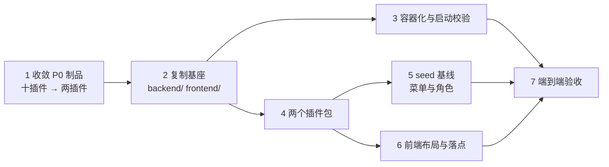

## 产品概述

货灵 WMS 的 P0 阶段：把 ApeAdmin 基座搬进仓库、改造成货灵形态、立起最小可开发的骨架。这一期不实现任何业务单据，只保证"能登录、菜单对、插件能启停、账号按身份落点"。

## 核心内容

- 确定每个文件落在哪个目录，给出完整目录树与文件职责。
- P0 只建两个插件：主数据（真表真接口）、库存（骨架 + 依赖声明）。其余八个域随各自期次再建。
- 菜单与角色基线收敛为：两个域级目录 + 一个门户根 + 四个角色（基座超管 + 货主三级）。
- 基座自带的插件市场、组件演示、示例插件、MCP、AI 菜单一律隐藏不可见，代码保留。
- 前端三个布局根（后台 / 门户 / 作业端）与登录后按身份落点，互不串门。
- 容器化与启动校验：字符集、排序规则、时区、单进程配置不符即拒绝启动。
- 已归档的 P0 制品仍按"十个插件"写，需先收敛口径再动手。

## 交付判定

侧边栏只有两个目录；两个插件可独立启停且停主数据后启库存被拒；货主账号落门户、员工账号落后台、互相访问对方首页被拒；重复初始化不产生重复角色与菜单。

## 技术栈

| 层 | 选型 | 来源 |
| --- | --- | --- |
| 后端 | Python 3.11 + FastAPI + SQLAlchemy 2.0 async + aiomysql | 沿用基座，不改 |
| 数据库 | MySQL 8（`utf8mb4` / `utf8mb4_0900_ai_ci` / `+08:00`） | 基座支持 sqlite/mysql 双驱动，生产走 MySQL |
| 前端 | Vue 3.5 + TypeScript + Vite 6 + Element Plus + Pinia | 沿用基座，不改 |
| 容器 | Docker Compose：mysql + backend + nginx | 新增 |
| 依赖 | **P0 不新增任何 Python 包与前端包** | — |


## 实现方式

**整体策略是"整目录复制 + 收敛改动面"，不做裁剪式重构。**

基座不是一组可以按需摘取的模块，而是一个自洽的运行时：插件管理器靠 `importlib` 扫描 `src/plugins/builtin`、前端靠 `import.meta.glob('@/views/**/*.vue')` 解析菜单、MCP 与 AI 虽然关闭但被 `main.py` 与路由表直接引用。任何"删掉不用的部分"都会引发 ImportError 或菜单解析失败。所以复制范围是 `backend/` 与 `frontend/` 全量，只清理产物类文件。

**改动面锁在三处**：配置文件（`.env`、`my.cnf`）、seed（`core/seed.py` 与两个插件自己的 `seed.py`）、新增文件。`core/deps.py`、`plugins/base.py`、`plugins/manager.py`、`models/`、`api/` 一律不动——基座升级时要能干净合并。

**菜单归属分两级**：`core/seed.py` 只负责把基座自带菜单置为 `status=0`（示例插件、插件市场、组件演示、MCP、AI）；业务菜单由各自插件的 `seed.py` 建。这不是风格选择，是基座既有机制——`dev_example/seed.py` 就是这么做的。

**前端页面与插件包必须同名**：菜单的 `component` 是 `wms_master_data/owner/index` 这类字符串，前端到 `src/views/wms_master_data/owner/index.vue` 去找。所以 `views/` 下的目录名与 `plugins/builtin/` 下的包名必须严格一致，写错的表现是"点菜单白屏"。

**落点判定另开接口，不改 `/auth/userinfo`**：前端登录成功后调 `GET /api/v1/wms-master-data/me/portal` 拿布尔值，多一次请求换掉对 core 的侵入。`userinfo` 一旦被改，每次合上游都会冲突。

## 执行顺序



第 1 步必须最先做：已归档的 `p0-bootstrap` 制品里 B2、B4、tasks 2.x 仍写着"十个插件、十个域目录"，不先改，执行时会照着错的清单干。

## 目录结构

```
huolingWMS/
├── CODEBUDDY.md                          已有，不改
├── README.md                             新增｜一页启动说明：依赖版本、初始化命令、默认账号
├── .env.example                          新增｜根级示例，供 compose 读取
├── docker-compose.yml                    新增｜mysql + backend + nginx 三个服务，仅 mysql 挂数据卷
├── docker/
│   ├── mysql/my.cnf                      新增｜character-set-server=utf8mb4、collation-server=utf8mb4_0900_ai_ci、default-time-zone=+08:00
│   ├── nginx/default.conf                新增｜静态目录 + /api 反代到 backend:8000
│   ├── backend.Dockerfile                新增｜python:3.11-slim，pip install -e .
│   └── frontend.Dockerfile               新增｜node:20 构建，产物拷进 nginx 镜像
├── backend/                              由 ApeAdmin-master/backend 整体复制，清 .git、__pycache__、apeadmin.db、setup.lock
│   ├── .env                              改｜APP_NAME、DB_TYPE=mysql、DB_*、JWT_SECRET、CORS_ORIGINS、MCP_ENABLED=false、SUPER_ADMIN_*
│   ├── pyproject.toml                    改｜项目名与描述，依赖不动
│   ├── alembic/ alembic.ini scripts/ tests/ uploads/    原样
│   └── src/
│       ├── main.py                       改｜lifespan 里调用 startup_check，其余不动
│       ├── cli.py                        原样
│       ├── api/ models/ schemas/ crud/ db/ ai/ mcp/ setup_wizard/    原样，一行不动
│       ├── core/
│       │   ├── config.py                 改｜仅补默认值（APP_NAME 等），不加新配置项
│       │   ├── seed.py                   改｜唯一职责：把基座自带菜单置 status=0，保持幂等
│       │   ├── startup_check.py          新增｜校验排序规则、会话时区、PLUGIN_RUNTIME_MODE，不符抛异常
│       │   └── deps.py security.py exceptions.py middleware.py 等   一行不动
│       └── plugins/
│           ├── __init__.py base.py manager.py    一行不动
│           └── builtin/
│               ├── dev_example/          原样保留，菜单由 core/seed.py 停用
│               ├── wms_master_data/      新增｜主数据域
│               │   ├── __init__.py       导出插件类，照 dev_example 的写法
│               │   ├── plugin.json       name=wms_master_data，dependencies=[]
│               │   ├── plugin.py         install 建两张表并调 seed；register 挂 router
│               │   ├── models.py         owner、user_owner 两个 ORM，表名 wms_master_data_*
│               │   ├── schemas.py        user_owner 出参
│               │   ├── api.py            GET /wms-master-data/me/portal
│               │   └── seed.py           主数据域菜单 + 门户根 + 三个货主角色 + 角色绑权限
│               └── wms_inventory/        新增｜库存域骨架
│                   ├── __init__.py
│                   ├── plugin.json       name=wms_inventory，dependencies=["wms_master_data"]
│                   └── plugin.py         install/register 均为空实现，不建表不挂路由
├── frontend/                             由 ApeAdmin-master/frontend 整体复制，清 node_modules、dist
│   ├── package.json                      不动｜P0 不新增前端依赖
│   ├── vite.config.ts                    改｜仅按需补代理，其余不动
│   └── src/
│       ├── layout/
│       │   ├── index.vue                 改｜侧边栏只渲染 path 以 /wms- 开头的顶级目录
│       │   ├── OwnerLayout.vue           新增｜只渲染 /owner 分支
│       │   └── MobileLayout.vue          新增｜窄屏容器，只渲染 /m 分支
│       ├── router/index.ts               改｜登录成功后按 me/portal 分流，末尾追加 /owner 与 /m 路由组
│       ├── api/
│       │   └── wms_master_data.ts        新增｜isOwnerPortal() 调用 /me/portal
│       ├── stores/ components/ composables/ directives/ styles/ utils/ locales/   不动
│       └── views/
│           ├── system/ ai/ mcp/ apehub_web/ apeui/ dev_example/ error/ login/     原样保留
│           ├── wms_master_data/
│           │   └── portal/{dashboard,account}/index.vue    新增｜占位页，能渲染即达标
│           └── wms_mobile/
│               └── {tasks,scan}/index.vue                   新增｜占位页
└── openspec/ docs/                       已有；P0 只改 changes/p0-bootstrap 下的制品
```

不建 `mobile/`（P5 才建）。不建 `src/modules/`（业务走插件）。

## 关键代码结构

两个插件包是最容易写错的地方，接口形状必须与基座一致：

```python
# backend/src/plugins/builtin/wms_master_data/plugin.py
from fastapi import FastAPI
from src.core.config import settings
from src.plugins import PluginInterface


class WmsMasterDataPlugin(PluginInterface):
    name = "wms_master_data"
    display_name = "主数据"
    version = "0.1.0"

    async def install(self) -> None:
        """建表 + seed 菜单与角色。幂等，重复调用不产生重复数据。"""

    async def uninstall(self) -> None:
        """删表 + 清 permission like 'wms_master_data:%' 的菜单。"""

    def register(self, app: FastAPI) -> None:
        """app.include_router(router, prefix=settings.API_PREFIX)"""
```

## 实施要点

- **`.env` 必须在 `backend/` 下**：`Settings` 的 `env_file=".env"` 是相对工作目录解析的，`uvicorn` 必须从 `backend/` 启动，否则全部配置回落到默认值（包括 `DB_TYPE=sqlite`）。
- **`CORS_ORIGINS` 是 `list[str]`**：写进 `.env` 要按 JSON 数组写 `CORS_ORIGINS=["http://localhost:5173"]`，写成逗号分隔会解析失败。
- **单进程校验只能校验配置，不能探测进程数**：`PLUGIN_RUNTIME_MODE` 已是 `Literal["single_process"]`，运行时无法可靠判断 uvicorn 开了几个 worker。所以校验落到"配置项是否被改动"，并在 README 写明启动命令不加 `--workers`，不假装能拦住。
- **启动校验只在 MySQL 模式下校验排序规则与时区**：SQLite 没有排序规则概念，开发机走 SQLite 时跳过这两项，保留单进程校验。
- **seed 幂等按业务键判重**：菜单按 `path` + `permission`，角色按 `code`，权限绑定按 `(role_id, menu_id)`。落库前先查，不用 `merge` 硬写。
- **`owner` 表直接带 `sync_enabled`**：与仓网对接已定该字段，P0 建表就带上，避免 P1 走 ALTER 补丁。
- **`user_owner` 的 `user_id` 唯一**：一个账号只能绑一个货主，隔离边界靠它。
- **停用插件后的接口鉴权由基座负责**：`manager.py` 会移除路由，不要自己在 `uninstall` 里写路由清理。

## 风险

- **基座跑不起来是最大风险**：Python 3.11、Node 20、`fastapi[standard]` 的传递依赖，任何一处版本不对就卡住。所以第 2 步的验收标准是"能登录看到菜单"，不是"文件复制完"。
- **复制整目录会让仓库体积膨胀**：`frontend` 源树约 1.5 万文件（含 `node_modules` 残留）。必须先清 `node_modules`、`dist`、`__pycache__` 再提交，否则仓库直接不可用。
- **两个插件撑不起"启停机制全验"**：依赖链只有两层（库存 → 主数据），比十插件方案弱。代价接受，验证点保留在"停主数据后启库存被拒"这一条上。

## Agent Extensions

### Skill

- **openspec-apply-change**
- Purpose: 按 `p0-bootstrap` 的任务清单逐条实现并勾选，保持变更状态与实际代码同步
- Expected outcome: `p0-bootstrap` 任务从 0/24 推进到全部完成，`openspec status` 显示可归档

### SubAgent

- **code-explorer**
- Purpose: 在复制基座后快速摸清 `plugins/base.py`、`plugins/manager.py`、`core/seed.py`、`router/index.ts` 的实际签名与调用约定，避免按名字猜 API
- Expected outcome: 产出一份"基座接口事实清单"，供插件骨架与前端改动直接参照，减少试错