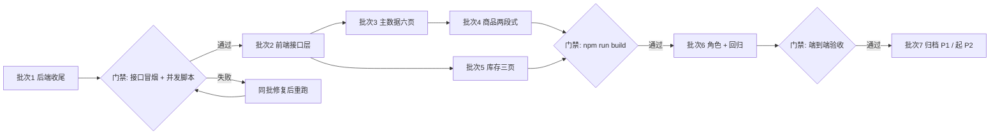

## 产品概述

货灵 WMS 的 P1 收尾：补齐主数据与库存的后端缺口，把九个前端页面从占位改成可用，完成端到端验收，然后不停顿地进入 P2（入库）。

## 核心功能

- 后端收尾：库位批量创建与坐标/仓型组合校验、API 凭证重置密钥、`transfer_status` 与并发过账的实测验证。
- 主数据六页：仓库配置、货主管理、库位管理、商品管理、合作方、API 凭证。
- 商品表单分两段：基础信息（货主可写）与存储要求（仓库可写），下方挂条码子表。
- 库存三页：库存查询（按商品聚合，展开看批次）、库存流水、批次查询（含临期过滤），并提供调整库存弹窗。
- 角色补齐：收货、上架、拣货、复核、盘点、只读六个岗位角色。
- 验收后归档 P1，直接起 P2 变更继续推进。

## 交付判定

九个页面能在浏览器里建、改、查；同一 `request_id` 调整两次只记一条流水；停用主数据插件后库存接口对非超管未授权；`npm run build` 与 `openspec validate --strict` 均通过。

## 技术栈

沿用现有栈，不新增任何依赖。

| 层 | 技术 | 说明 |
| --- | --- | --- |
| 后端 | Python 3.11 + FastAPI + SQLAlchemy 2.0 async | 只加路由函数，不动基座 |
| 前端 | Vue 3.5 + TypeScript + Element Plus + Vite 6 | 全部页面用 `el-card` + `el-table` + `el-dialog` |
| 数据库 | MySQL 8（容器 3307） | 已有 14 张 `wms_*` 表，本期只加角色与菜单数据 |


## 执行模型：批次 + 自检闸门

这是本次计划的核心约定。七个批次按依赖顺序连续执行，**每批结束自动跑门禁，通过就直接进下一批**，只在两种情况停下：

1. 需要产品决策（例如规格之间本身矛盾）
2. 门禁反复失败且无法在当批修复



门禁失败时在同批内修复并重跑，不退回询问。只有连续两轮仍失败才停下来汇报。

## 实现要点

### 后端（批次 1）

- `wms_master_data/api.py` 补两个接口：`POST /locations/batch`（一次建一排库位，逐条校验后整体提交）、`POST /apikeys/{id}/rotate`（作废旧哈希、返新明文一次）。
- 坐标与仓型校验放在 `LocationIn` 的校验函数里，不在路由里写 if：`FLAT` 只允许 aisle/rack/bin，`MULTI_FLOOR` 必须带 floor_no，`ASRS` 必须带 aisle/rack/level。校验失败抛 `ValidationException`。
- `transfer_status` 与并发过账的验证写成一次性脚本（用完即删），不进仓库常驻代码：并发用 `asyncio.gather` 起两个会话，断言最终数量等于两次之和且流水两条。

### 前端（批次 2 到 5）

新增文件全部落在现有目录，不新建架构层：

```
frontend/src/
├── api/
│   ├── wms_master_data.ts      改｜补仓库/库区/库位/货主/商品/条码/合作方/凭证
│   └── wms_inventory.ts        新｜库存、流水、批次、调整
├── composables/
│   └── usePagedList.ts         新｜query/loading/total/fetch 四件事，九个页面共用
└── views/
    ├── wms_master_data/
    │   ├── owner/index.vue     改｜占位 → 列表 + 抽屉表单
    │   ├── warehouse/index.vue 新｜单表单页
    │   ├── location/index.vue  新｜列表 + 批量新建
    │   ├── sku/index.vue       新｜列表 + 两段式表单 + 条码子表
    │   ├── partner/index.vue   新｜列表 + 抽屉
    │   └── apikey/index.vue    新｜列表 + 签发弹窗（明文只显示一次）
    └── wms_inventory/
        ├── stock/index.vue     改｜占位 → 聚合列表 + 展开明细 + 调整弹窗
        ├── txn/index.vue       新｜流水列表 + 筛选
        └── lot/index.vue       新｜批次列表 + 临期过滤
```

`usePagedList.ts` 只有九个调用点、约 60 行，超出"两处以上调用才抽取"的门槛，属于该抽的。页面模板本身**不抽公共组件**——每个页面字段不同，抽成配置驱动会让改一个列宽都要翻两层。

### 前端约定（照现有页面抄）

- 响应式写法：`request.get()` 已解包，直接拿 `data`，不要再 `.data.data`。
- 表格页结构：`el-card.page-card` → `div.toolbar`（搜索 + 新建）→ `el-table` → `el-pagination.pagination`。
- 按钮权限：`v-permission="'wms_master_data:sku:create'"`，与菜单里的权限字符串逐字一致。
- 表单用 `el-drawer`（宽 480–560），不用 `el-dialog`——字段多，抽屉不遮表格。
- 文案写中文，不接 i18n。本期页面只有中文使用者。
- 库存查询的批次明细用 `el-table` 的展开行，展开时才请求 `/stocks/detail`，不在首屏拉。

### 性能与正确性

- 所有列表走服务端分页，`page_size` 默认 20；库位批量新建时单次上限 200 条。
- 库存聚合在 SQL 里 `group by`，不把明细拉到前端再算。
- 调整库存必须由前端生成并复用 `request_id`（用 `Date.now()` 并在重试时保持同一个值），不能每次点击都新生成——否则幂等失效。
- 商品两段式表单提交两个不同接口：基础信息走 `PUT /skus/{id}`，存储要求走 `PUT /skus/{id}/storage`。不做"一个接口按字段猜权限"。

### 风险

- **九个页面工作量集中在前端**，`vue-tsc` 容易因 Element Plus 类型推断报错；每写完两页跑一次 `npm run build`，不攒到最后。
- **角色补绑可能让只读角色看不到页面**：绑定时同时绑目录、页面、按钮三层，只绑页面会导致侧边栏没有入口。
- **P2 起会调用 `post_stock`**：本期并发验证若不过，P2 一开工就得返工，所以批次 1 的并发脚本必须真跑，不能只看代码。

## 设计方向

九个页面全部是工具型后台，不做视觉表达。信息密度优先：一屏能看 15 行以上，操作入口固定在右上角，不加大面积留白和插画。

沿用 P0 已建的视觉基调（青绿主色 + 浅灰底），与货主门户、作业端保持同一套色，避免后台像另一个产品。

## 页面规划（五个核心页，其余三个复用同模板）

**1. 货主管理** — 顶部工具条（关键字搜索、新建），中部表格（编码、名称、联系人、对接开关、状态、操作），新建走右侧抽屉，抽屉里填完提交后弹一个提示框显示初始密码（只显示这一次）。

**2. 商品管理** — 表格左侧固定列显示仓库编码与名称，右侧列可横向滚动。点开抽屉后分上下两段：上段「基础信息」、下段「存储要求」，两段之间用一条浅色分隔线加小标题，段内字段各自按权限只读。抽屉底部再挂一个条码子表，可直接增删。

**3. 库位管理** — 表格显示库位编码、所属库区、类型、温区、楼层、容量。顶部多一个「批量新建」按钮，弹窗里填编码前缀与起止号，预览生成结果后再提交。

**4. 库存查询** — 首屏只显示聚合行（商品、状态、数量、批次数），数字右对齐、等宽字体。点行展开显示该商品的批次与库位明细，展开时才请求。顶部有「调整库存」按钮，弹窗里填数量与原因，提交后行内数量就地刷新。

**5. 库存流水与批次** — 两张结构相同的列表页：左侧筛选区窄栏，右侧列表。流水页数量列用正绿负红着色；批次页的剩余天数列在 30 天以内标黄、已过期标红。

其余三页（仓库配置、合作方、API 凭证）：仓库配置是单表单页，居中卡片宽 560；合作方与 API 凭证沿用列表 + 抽屉模板。

## 交互

- 抽屉从右侧滑出，宽度 520，底部固定「取消 / 保存」。
- 表格行悬停高亮，操作列按钮默认文字按钮，危险操作二次确认。
- 保存成功后不整页刷新，只重取当前页数据，保持滚动位置。
- 加载态用表格自带 `v-loading`，不用全屏遮罩。
- 空列表显示一行说明文字，不显示空表格骨架。

## Agent Extensions

### Skill

- **openspec-apply-change**
- Purpose: 按 `p1-master-data-inventory` 的任务清单逐条推进并勾选，保持变更状态与代码同步
- Expected outcome: P1 任务从 17/26 推进到 26/26，`openspec status` 可归档

- **openspec-archive-change**
- Purpose: P1 验收通过后归档该变更，把增量并入常驻规格
- Expected outcome: `openspec/specs/` 更新，`changes/` 下不再有 P1

- **openspec-propose**
- Purpose: P1 归档后立刻起 P2（入库）变更，产出 proposal/design/tasks
- Expected outcome: `p2-inbound` 变更可执行，无需用户再描述需求

### SubAgent

- **code-explorer**
- Purpose: 写页面前确认 Element Plus 组件在本项目的实际用法与既有表单校验写法，避免按记忆写错 API
- Expected outcome: 产出一份「页面模板事实清单」，供九个页面直接套用