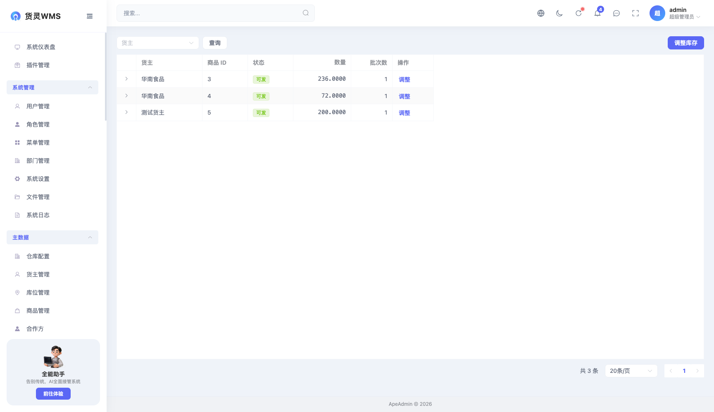
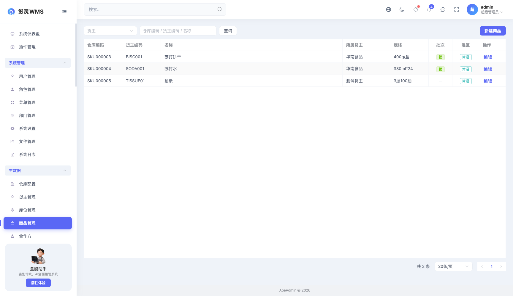
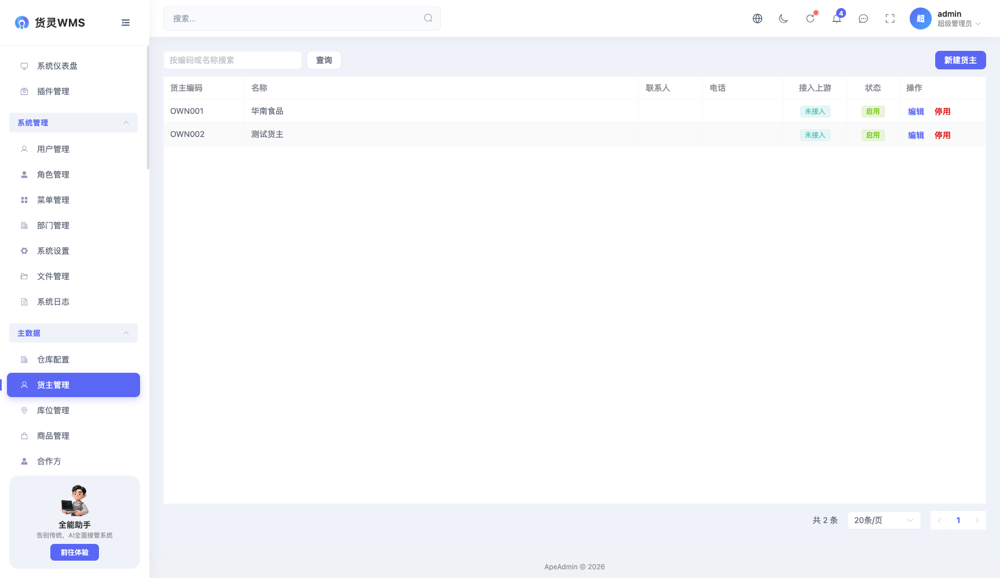
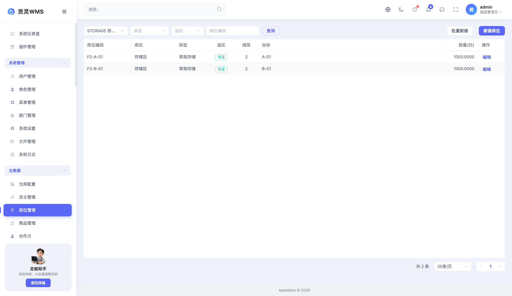
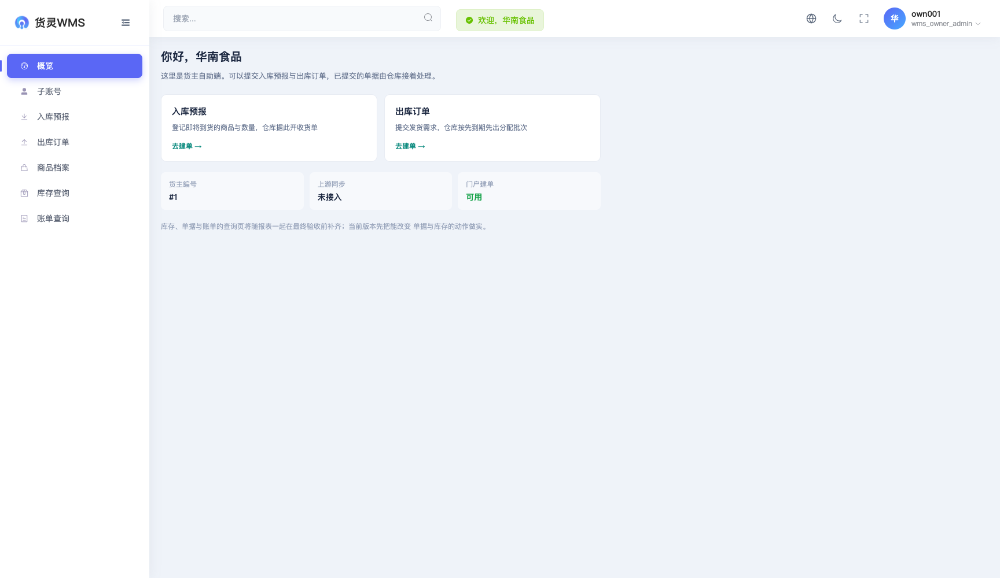
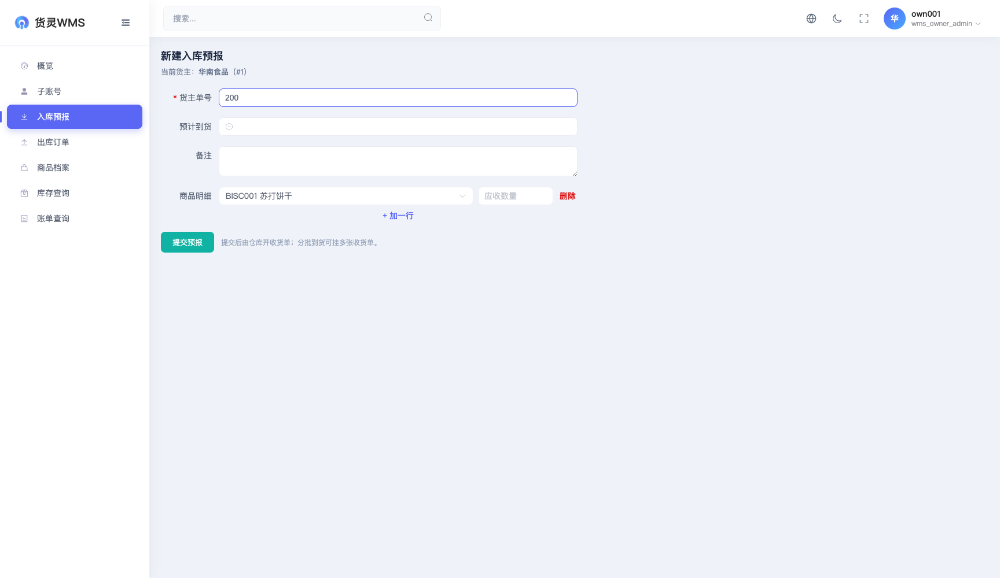
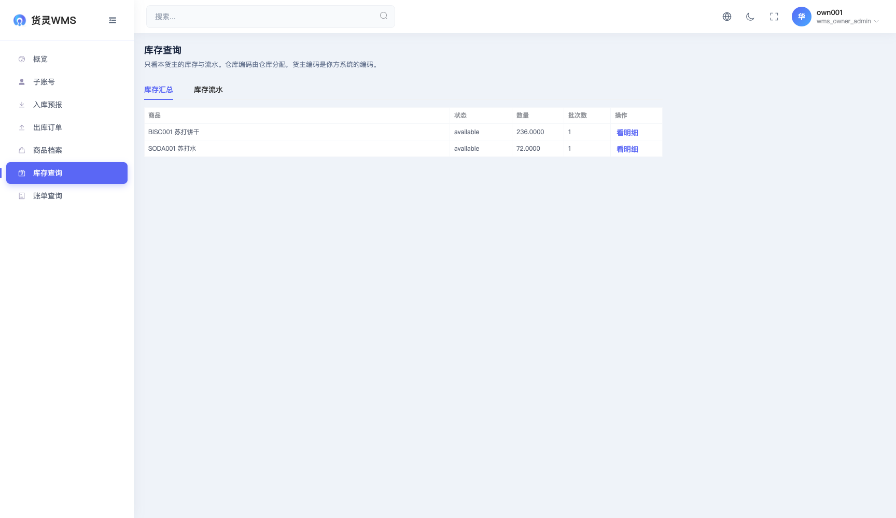
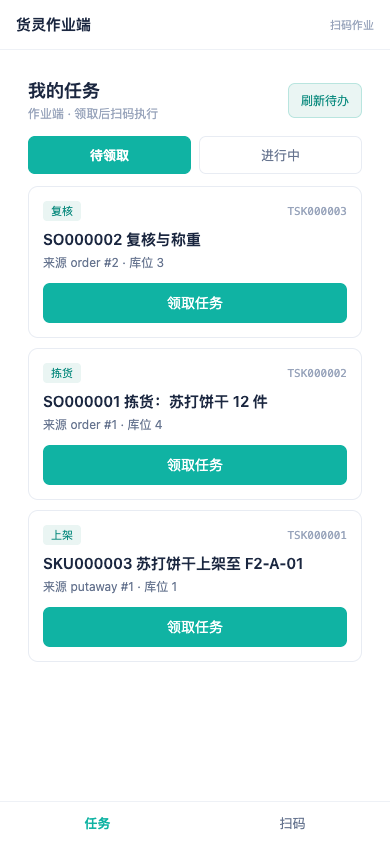

# 货灵 WMS

单仓、多货主的三方仓储系统，基于 ApeAdmin 插件化基座。P0 只交付骨架：能登录、菜单对、插件能启停、账号按身份落点。

完整业务设计见 `openspec/specs/wms/`（常驻规格）与 `docs/design/`（表结构、接口、页面、技术栈）。

## 界面速览

截图取自本地 dev 环境，使用演示数据。

### 管理后台



按货主与商品查看库存数量、批次数与状态，库存只能由收货和调整记账产生。



货主填商品基础信息，仓库补批次与温区要求，两组字段分开维护。



一个货主一个主账号，建货主时自动开通对应的门户登录账号。



库位按库区归集，可按库区、类型、温区筛选。

### 货主门户



货主用独立账号登录，只看得到本货主的入口与数据。



货主自助登记货主单号、商品与应收数量，提交后由仓库开收货单。



货主查本货主的库存汇总，库位与批次明细由仓库侧管理。

### 作业端



PDA 与浏览器共用的窄屏任务页，领取后扫码执行。

## 货主系统对接

货主自己的 ERP/OMS 走 `/api/v1/open/v1`，鉴权头 `X-API-Key`，货主身份由密钥决定、不读请求体。机器可读契约是 `docs/api/openapi-owner.json`（OpenAPI 3.1），可直接导入生成客户端或交给 AI 读取。

交给 AI 时要补两句：`X-API-Key` 在 schema 里标的是可选，实际必传；200 响应的 schema 目前是空的，实际返回 `{"code": 200, "msg": "...", "data": {...}}`，错误码以 `backend/src/core/exceptions.py` 为准，`interface-map.md` 里的字符串错误码尚未落地。幂等键 `owner_doc_no`、数量只存最小单位等规则见 `docs/design/interface-map.md` 与 `openspec/specs/wms/owner-access/spec.md`，需要一并读。

## 依赖版本

| 项 | 版本 | 说明 |
|---|---|---|
| Python | 3.11+ | 宿主开发需要；纯容器运行不需要 |
| Node | 20 LTS+ | 宿主开发需要 |
| Docker | 24+，含 Compose v2 | 两种启动方式都需要 |
| MySQL | 8.0 | 由镜像提供，字符集与排序规则随镜像固化 |

## 方式一：全栈容器（验收与部署）

```bash
cp .env.example .env          # 把 JWT_SECRET 换成 openssl rand -hex 32 的输出
docker compose up -d --build
```

两个入口，两个登录端，互不通用：

| 端 | 地址 | 谁能登录 |
|---|---|---|
| 管理后台（含作业端 `/m`） | http://localhost:8080/admin/ | 仓库员工，如 `admin` / `Admin@12345` |
| 货主门户 | http://localhost:8080/owner/ | 绑定了货主的账号 |

货主账号在后台登录会被直接拒绝，员工账号在门户登录同样被拒——判定在登录接口里，不是登录后再跳转。

首次启动会自动建表、建菜单与角色，并默认启用「主数据」「库存」两个业务域。

## 方式二：宿主开发（改一行看一行）

```bash
docker compose -f docker-compose.dev.yml up -d    # 只起 MySQL，宿主端口 3307

cd backend
uv run --python 3.12 uvicorn src.main:app --reload --port 8000

cd frontend
npm install
npm run dev          # 后台 http://127.0.0.1:5173/admin/
npm run dev:owner    # 门户 http://127.0.0.1:5174/owner/
```

前端 dev server 默认 5173（后台）与 5174（门户），后端 8000，跨域已在 `backend/.env` 的 `CORS_ORIGINS` 放行。

`npm run build` 会出两套产物：`dist/admin` 与 `dist/owner`。两套的 `base`、入口 HTML、登录页都不同，靠 `vite --mode owner` 切换，不需要额外依赖。

> Windows 上源码挂进容器时 inotify 不跨挂载传递，`--reload` 与 HMR 会失效，
> 所以容器只负责"一次跑通"，日常开发在宿主跑。

## 三条不能破的约定

**不要加 `--workers`。** 插件运行时状态存在进程内存里，多 worker 会让插件启停与菜单同步各自为政。启动校验会拦住被改动的配置，但拦不住命令行参数。

**`backend/.env` 必须在 `backend/` 目录下启动才生效。** 配置的 `env_file` 是相对工作目录解析的，从仓库根起 `uvicorn` 会让所有配置回落默认值（包括 `DB_TYPE=sqlite`）。

**数据库排序规则必须是 `utf8mb4_0900_ai_ci`、时区 `+08:00`。** 排序规则不一致会让唯一索引误判大小写，表现为"偶尔有单建不出来"。启动时会校验，不符直接退出。

## 目录

```
backend/         FastAPI 后端，业务按域拆成插件（src/plugins/builtin/wms_*）
frontend/        Vue3 前端，后台 + 货主门户 /owner + 作业端 /m
docker/          MySQL 配置、nginx 配置、两个 Dockerfile
docs/design/     表结构、接口清单、页面清单、技术栈
openspec/        specs/ 常驻规格；changes/ 进行中的变更
```

`mobile/`（Capacitor 容器）留到 P5。

## 常用命令

```bash
docker compose -f docker-compose.dev.yml up -d      # 起开发数据库
docker compose run --rm backend pytest              # 跑测试（P1 起有内容）
openspec list                                       # 看进行中的变更
openspec validate <change> --strict                 # 校验变更
```
