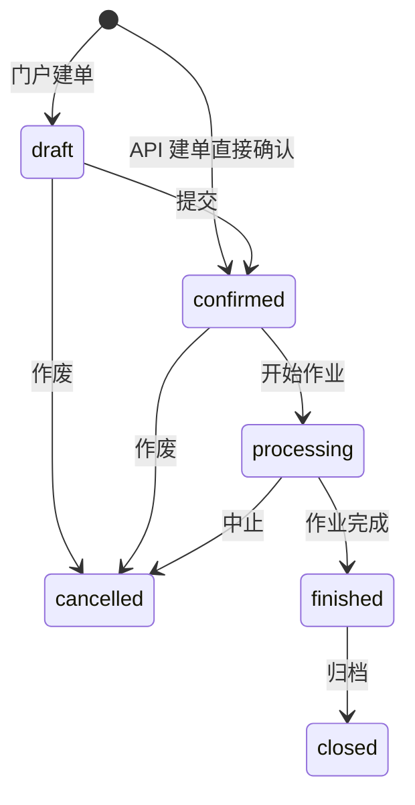

# 数据模型

**层：详细设计** ｜ 蓝图与决策见 [design.md](../../openspec/changes/archive/2026-11-21-define-wms-blueprint/design.md)。新增字段改这里，新增域或改依赖方向改 design.md。

## 通用约定

- 表名 `wms_<域>_<实体>`，与插件包名同前缀（D1）。
- 主键统一 `id bigint` 自增；业务标识用 `code varchar(64)`，不把自增 ID 暴露给外部。
- **数量一律以商品的最小计量单位存储。** 箱、托只存在于录入与展示两端，进库前换算成件。所有表里的 `qty` 都是件数，没有"箱数"字段。
- 数量与金额统一 `numeric(18,4)`，禁止浮点。
- 时间统一 `datetime`，默认值由应用写入，不用数据库 `NOW()`（SQLite 与 MySQL 行为不一致）。
- 软删只在主数据表上启用（`is_deleted`），单据与流水不做软删。单据作废走状态，流水永不删除。
- 所有金额、数量字段不允许 NULL，未发生的量填 0。
- 外键只建在同一域内；跨域引用一律存 `xxx_id` + `xxx_code` 两个字段，不建外键，不 join 对方表（D6）。

## 主数据域 `wms_master_data`

| 表 | 关键字段 | 约束 |
|---|---|---|
| `warehouse` | id, code, name, address, contact, phone, topology, status | 全库仅一条，应用层保证；`topology` 决定坐标解释与选位算法 |
| `owner` | id, code, name, contact, phone, address, primary_user_id, settle_period, sync_enabled, status, remark | `code` 唯一；`primary_user_id` 指向主账号；`sync_enabled=true` 时门户与对外接口的建单入口关闭 |
| `user_owner` | id, user_id, owner_id, is_primary, status | `user_id` 唯一（一账号一货主） |
| `owner_api_key` | id, owner_id, name, key_prefix, key_hash, expires_at, last_used_at, status, created_by | `key_prefix` 建索引；明文不落库 |
| `zone` | id, warehouse_id, code, name, zone_type, temp_zone, floor_no, status | `code` 唯一；`floor_no` 默认 1 |
| `location` | id, zone_id, code, owner_id, location_type, temp_zone, floor_no, aisle, rack, level, bin, capacity, replenish_min, replenish_max, status | `code` 唯一；`owner_id` 空=共享；`replenish_min/max` 只在 `picking` 类型上生效；详见下表 |
| `sku` | 见下 | `code` 全仓唯一；`(owner_id, owner_sku_code)` 唯一 |
| `barcode` | id, sku_id, barcode, barcode_type | `barcode` 唯一 |
| `unit` | id, code, name, decimal_places | `code` 唯一 |
| `partner` | id, code, name, partner_type, contact, phone, address, status | `code` 唯一；`partner_type` = supplier / customer |
| `team` | id, code, name, function_type, leader_staff_id, status, remark | `code` 唯一；`function_type` = receiving / putaway / picking / sorting / checking / shipping / internal_ops / other；`leader_staff_id` 指向 `staff.id`，可空 |
| `staff` | id, code, name, phone, user_id, team_id, status, remark | `code`（工号）全仓唯一；`user_id` 可空且唯一（空=临时工）；索引 `(team_id, status)`；离职改 `status`，不删除 |
| `sequence` | id, prefix, period, current | `(prefix, period)` 唯一 |
| `print_template` | id, code, name, template_type, paper_width, paper_height, content, version, status | 同类型只允许一个启用；`content` 为 hiprint 的 JSON |
| `print_task` | id, ref_type, ref_id, template_id, template_version, printer_name, client_id, status, error_msg, reprint_times, operator_id, created_at | 索引 `(ref_type, ref_id)`、`(created_at)`；按月归档，只留近 90 天 |

### `wms_master_data_sku` 货品档案

字段按填写方分成两组。这个划分不是排版，是权限边界：货主能改的字段与仓库能改的字段不重叠，接口按组校验。

| 字段 | 类型 | 填写方 | 说明 |
|---|---|---|---|
| id | bigint | — | 主键 |
| owner_id | bigint | 系统 | 由建档入口的凭证或登录态决定，入参不接受 |
| code | varchar(64) | 仓库 | 仓库编码，全仓唯一，新建时自动取号 `SKU000001`，允许仓库改 |
| name | varchar(200) | 上游或货主 | 名称 |
| spec | varchar(200) | 上游或货主 | 规格描述，自由文本 |
| unit_code | varchar(16) | 上游或货主 | 计量单位 |
| owner_sku_code | varchar(64) | 上游或货主 | 货主编码，同步匹配键；`(owner_id, owner_sku_code)` 唯一 |
| category | varchar(64) | 货主 | 分类 |
| weight / volume | numeric(18,4) | 货主 | 单件重量与体积 |
| qty_per_box | numeric(18,4) | 货主 | 一箱几件，默认 1；收货与下单按箱录入时的换算系数 |
| temp_requirement | varchar(16) | 货主 | `ambient` / `chilled`，该货品需要什么温区 |
| lot_required | bool | 货主 | 是否启用批次管理，默认 false |
| expiry_warn_days | int | 货主 | 临期预警天数，默认 30；`0` 表示到期当天才冻结 |
| status | varchar(16) | 系统 | `active` / `disabled` |
| default_zone_id | bigint | 仓库 | 上架优先库区 |
| qty_per_pallet | numeric(18,4) | 仓库 | 一托几件，用于整托上架与盘点 |
| putaway_note | varchar(255) | 仓库 | 上架要求，如"不可倒置" |

条码在 `wms_master_data_barcode` 表，一品多码，由货主维护。

货主填的字段是"这是什么货"，仓库补的字段是"这货怎么存"。分界线清楚了，就不会出现货主被迫理解"存储类型"这种词。

### `wms_master_data_location` 坐标字段

五个坐标字段按仓型解释，含义不同但字段不变（design.md D21）：

| 字段 | 平面仓 | 楼层仓 | 钢结构立库 |
|---|---|---|---|
| `floor_no` | 恒为 1 | 建筑楼层 | 恒为 1 |
| `aisle` | 巷道 | — | 巷道 |
| `rack` | — | — | 排（巷道左右） |
| `level` | 货架层 | 货架层 | 货架层 |
| `bin` | 位 | 位 | 列 |

`floor_no` 与 `level` 必须分开：楼层仓里「建筑第 3 层」和「货架第 2 层」是两个维度，混用一个字段会让跨层作业判定直接算错。`floor_no` 从 `zone` 冗余到 `location`，避免每次判定跨域都要 join。

`capacity` 存该库位可容纳的托盘数，`null` 表示不限制。它是运行约束，与空间公式算出的规划总量无关。

## 库存域 `wms_inventory`

### `wms_inventory_lot` 批次

| 字段 | 类型 | 说明 |
|---|---|---|
| id | bigint | 主键，`0` 保留给默认批次（见下） |
| owner_id / sku_id | bigint | 归属，冗余便于按批次直接查 |
| lot_code | varchar(64) | 批号，收货时按实物喷码录入 |
| production_date | date | 生产日期，可空 |
| expiry_date | date | 到期日，启用批次的商品必填 |
| status | varchar(16) | `active` / `frozen` / `consumed` |
| frozen_reason | varchar(32) | `expiry_warn` / `manual` |
| created_at | datetime | 首次到货时间 |

唯一约束 `(owner_id, sku_id, lot_code)`。

**`lot_id = 0` 是约定，不建记录。** 未启用批次管理的商品，其库存行的 `lot_id` 恒为 0，表示"这一行不分批次"。不建一条 id=0 的实体记录，因为那会被 join 到处带出来，反而要处处排除。代价是所有需要批次信息的地方先判 0——这个判断只出现在展示层，不在业务逻辑里。

### `wms_inventory_stock` 库存台账

| 字段 | 类型 | 说明 |
|---|---|---|
| id | bigint | 主键 |
| owner_id | bigint | 冗余自 `sku.owner_id`，只用于过滤与索引，不接收外部输入 |
| sku_id | bigint | 商品 |
| lot_id | bigint | 批次，未启用批次管理为 0 |
| location_id | bigint | 库位 |
| stock_status | varchar(16) | available / frozen / damaged |
| qty | numeric(18,4) | 当前数量，非负 |

唯一约束 `(owner_id, sku_id, lot_id, location_id, stock_status)`；索引 `(sku_id, lot_id)`、`(location_id)`；`qty >= 0` 由应用与 CHECK 双重兜底。

### `wms_inventory_txn` 库存流水

| 字段 | 类型 | 说明 |
|---|---|---|
| id | bigint | 主键 |
| owner_id / sku_id / lot_id / location_id | bigint | 发生位置 |
| stock_status | varchar(16) | 变动后的状态 |
| direction | varchar(8) | in / out / transfer |
| qty | numeric(18,4) | 变动量（正数，方向由 direction 表达） |
| qty_before / qty_after | numeric(18,4) | 变动前后数量 |
| from_status / to_status | varchar(16) | 仅 transfer 时填写 |
| ref_type | varchar(32) | asn / receipt / order / shipment / count / transfer / sample |
| ref_id | bigint | 来源单据 ID |
| ref_code | varchar(64) | 来源单据号，便于直接展示 |
| action | varchar(32) | 同一单据内的动作区分 |
| operator_id | bigint | 操作人 |
| created_at | datetime | 发生时间 |

唯一约束 `(ref_type, ref_id, sku_id, lot_id, location_id, action)` 即幂等键；索引 `(sku_id, lot_id, created_at)`、`(ref_type, ref_id)`。无 `updated_at`、无删除接口。

幂等键必须含 `lot_id`：一次收货可能把同一商品拆成多个批次，若键里没有批次，第二个批次的过账会被判为重复而丢掉。

## 入库域 `wms_inbound`

| 表 | 关键字段 | 约束 |
|---|---|---|
| `asn` | id, code, owner_id, source, owner_doc_no, supplier_id, expect_arrive_at, status, remark, created_by | `(owner_id, owner_doc_no)` 唯一 |
| `asn_line` | id, asn_id, sku_id, expect_qty, remark | — |
| `service_order` | id, code, owner_id, asn_id, service_type, sample_mode, sample_qty, sample_ratio, retain_days, on_expiry, status, created_by | 一张 ASN 可多条 |
| `receipt` | id, code, asn_id, owner_id, received_at, status, operator_id | 一个 ASN 可对应多张，对应分批到货；`asn_id` 不唯一 |
| `receipt_line` | id, receipt_id, sku_id, expect_qty, received_qty, damaged_qty, sample_qty, putaway_qty, variance_reason | 汇总字段；启用批次的商品由 `receipt_lot` 汇总写回 |
| `receipt_lot` | id, receipt_line_id, lot_code, production_date, expiry_date, received_qty, damaged_qty | 仅启用批次的商品建行；各行之和须等于所属 `receipt_line.received_qty` |
| `putaway` | id, code, receipt_id, owner_id, status, operator_id | — |
| `putaway_line` | id, putaway_id, receipt_lot_id, sku_id, lot_id, qty, to_location_id, sample_flag, temp_mismatch | `.temp_mismatch` 记录是否被上架到非匹配温区 |

### `wms_inbound_service_order` 货主服务订单

| 字段 | 类型 | 说明 |
|---|---|---|
| id / code | bigint / varchar(64) | 主键与单号 |
| owner_id | bigint | 提出要求的货主 |
| asn_id | bigint | 针对哪次来货 |
| sku_id | bigint | 针对哪个商品；为空表示对本次来货的全部商品生效 |
| service_type | varchar(32) | 当前只有 `sample`，留扩展位 |
| sample_mode | varchar(16) | `fixed` / `ratio` |
| sample_qty | numeric(18,4) | fixed 时使用 |
| sample_ratio | numeric(10,6) | ratio 时使用，如 0.005 |
| retain_days | int | 留样期限天数，必填 |
| on_expiry | varchar(16) | 默认处置：`dispose` / `ship` / `release` / `extend` |
| status | varchar(16) | draft / confirmed / done / cancelled |

`sample_mode = ratio` 时算法为 `min(ceil(received_qty * sample_ratio), received_qty)`；`= fixed` 时算法为 `min(sample_qty, received_qty)`。两者都用实收数量封顶，基数取**实收**而非应收——留样留的是真实到货的那批。`sku_id` 为空时对每个商品行各自按比例算，不按整单总量算。

## 库内作业域 `wms_internal_ops`

| 表 | 关键字段 | 约束 |
|---|---|---|
| `transfer` | id, code, owner_id, from_location_id, to_location_id, status, operator_id, ref_type, ref_id | — |
| `transfer_line` | id, transfer_id, sku_id, qty | — |
| `replenish` | id, code, owner_id, sku_id, lot_id, from_location_id, to_location_id, qty, trigger_type, status, operator_id | `trigger_type` = `min` / `manual`；补货量按整箱取整 |
| `count` | id, code, owner_id, count_type, status, started_at, closed_at, operator_id | — |
| `count_line` | id, count_id, sku_id, lot_id, location_id, book_qty, count_qty, diff_qty, diff_reason, adjusted | 按批次盘 |
| `sample` | 见下 | — |

### `wms_internal_ops_sample` 留样记录

| 字段 | 类型 | 说明 |
|---|---|---|
| id / code | bigint / varchar(64) | 主键与留样单号 |
| owner_id | bigint | 货主 |
| sku_id | bigint | 商品 |
| lot_id | bigint | 批次，留样精确到批；未启用批次管理为 0 |
| qty | numeric(18,4) | 留样数量，生成后不可改 |
| location_id | bigint | 留样库位（`location_type = sample`） |
| source_service_order_id | bigint | 来源服务订单 |
| source_receipt_id | bigint | 来源收货单 |
| retained_at / retain_until | datetime | 留样开始与到期 |
| status | varchar(16) | holding / released / shipped / disposed |
| extended_times | int | 延期次数，默认 0 |
| disposed_at | datetime | 处置时间 |
| handled_ref | varchar(64) | 处置凭据：出库单号或移库单号 |
| remark | varchar(255) | — |

索引 `(owner_id, status, retain_until)`——到期清单就靠这个索引。

## 出库域 `wms_outbound`

| 表 | 关键字段 | 约束 |
|---|---|---|
| `order` | id, code, owner_id, order_type, source, owner_doc_no, carrier_code, region_code, receiver_name, receiver_phone, receiver_address, weight_theory, expect_ship_at, wave_id, status | `(owner_id, owner_doc_no)` 唯一；索引 `(order_type, wave_id)`、`(carrier_code, status)` |
| `order_line` | id, order_id, sku_id, lot_id, order_qty, allocated_qty, picked_qty, shipped_qty, short_qty | `lot_id` 仅在货主指定批次时填写 |
| `wave_rule` | id, name, priority, enabled, order_type, carrier_code, region_code, cut_off_time, abc_class, max_orders, split_mode | 条件为空表示不限；按 `priority` 升序匹配 |
| `wave` | id, code, rule_id, order_type, split_mode, cut_off_at, order_count, line_count, status, progress, operator_id | `split_mode` = `seed_wall` / `pick_and_pack` |
| `allocation` | id, wave_id, order_line_id, sku_id, lot_id, location_id, qty, status | 索引 `(wave_id, location_id)`；按 FEFO 选出的批次与库位 |
| `pick` | id, code, owner_id, wave_id, status, operator_id | 波次级，一张拣货单服务一个波次 |
| `pick_line` | id, pick_id, sku_id, lot_id, from_location_id, qty, picked_qty | 按库位聚合，一次取多个订单的总量 |
| `sort_cell` | id, wave_id, order_id, cell_code, status | 播种墙格口与订单一一对应 |
| `seed` | id, wave_id, pick_line_id, order_line_id, cell_id, qty, seeded_qty, status | 分播记录，差异记入异常 |
| `check` | id, code, owner_id, order_id, status, weight_actual, weight_diff, result, operator_id | `result` = `pass` / `reweight` / `skipped` |
| `shipment` | id, code, owner_id, order_id, carrier, tracking_no, label_printed_at, reprint_times, shipped_at, status | — |

### 出库的三种状态

`wave.status`：`created → allocating → allocated → picking → sorting → checking → shipped → closed`；`allocating` 期间可中止，中止后整体回滚。

`order.status`：`created → allocated → picking → checked → shipped`；未发货前可 `cancelled`。订单状态由所属波次推进带动，不单独变更。

`split_mode` 决定 `sorting` 阶段是否存在：边拣边分的波次拣完直接进 `checking`，没有分播环节。

`order.receiver_address` 是留样邮寄的目标地址来源之一；留样出库的订单在此字段上取货主指定地址。

## 逆向域 `wms_returns`

| 表 | 关键字段 | 约束 |
|---|---|---|
| `disposal` | 见下 | 破损处置，P2 上线；`return` 在 P6 才到位 |
| `return` | id, code, owner_id, source, owner_doc_no, customer_name, status | `(owner_id, owner_doc_no)` 唯一 |
| `return_line` | id, return_id, sku_id, lot_id, expect_qty, received_qty, disposition, disposition_qty | disposition = restock / scrap / return_owner；`lot_id` 优先沿用原批次，认不出则为新批次 |

### `wms_returns_disposal` 库存处置

破损货的出口。P2 上线，比同域的退货单早三个期次——**因为破损货在 P2 就会产生，不给出口就会一直堆在收货暂存位**。

| 字段 | 类型 | 说明 |
|---|---|---|
| id / code | bigint / varchar(64) | 主键与处置单号 |
| owner_id / sku_id / lot_id / location_id | bigint | 处置对象，从哪条库存扣 |
| qty | numeric(18,4) | 处置数量 |
| method | varchar(16) | `restock` 转回可发 / `scrap` 报废 / `return_owner` 退回货主 |
| reason | varchar(32) | `damaged_in_receipt` / `found_in_count` / `other` |
| status | varchar(16) | `draft` / `done` / `cancelled` |
| ref_source_type / ref_source_id | varchar(32) / bigint | 来源：收货单或盘点单 |
| ref_out_code | varchar(64) | 退回时的出库单号，`restock` 与 `scrap` 为空 |
| operator_id / created_at / done_at | — | 操作留痕 |

三种处置对应的记账动作：

| method | 库存变化 |
|---|---|
| `restock` | `transfer_status(damaged → available)`，同库位 |
| `scrap` | `post_stock(-qty, damaged, ref=disposal)` |
| `return_owner` | 建出库单从该库位出货，`ref_out_code` 记单号 |

`return_owner` 依赖出库能力，P3 才实现；P2 只开放前两种。

## 任务域 `wms_tasking`

| 表 | 关键字段 | 约束 |
|---|---|---|
| `task` | id, code, task_type, owner_id, target_type, target_id, location_id, assignee_id, status, priority, created_at, started_at, finished_at | 索引 `(assignee_id, status)`、`(target_type, target_id)` |

`task` 只存指针，不存业务明细。任务完成后由注册的处理器回写业务域（D8）。

## 计费域 `wms_billing`

| 表 | 关键字段 | 约束 |
|---|---|---|
| `rate` | id, owner_id, charge_item, location_type, pricing_mode, unit_price, effective_from, effective_to, status | `(owner_id, charge_item, location_type, effective_from)` 唯一；`owner_id` 空=通用 |
| `charge` | 见下 | — |
| `occupancy_snapshot` | id, owner_id, day, location_type, location_count | `(owner_id, day, location_type)` 唯一 |
| `invoice` | id, code, owner_id, period, total_amount, status, confirmed_at | `(owner_id, period)` 唯一 |
| `invoice_line` | id, invoice_id, charge_item, location_type, amount, charge_count | — |

### `wms_billing_charge` 费用流水

| 字段 | 类型 | 说明 |
|---|---|---|
| id | bigint | 主键 |
| owner_id | bigint | 货主 |
| charge_item | varchar(32) | storage_fee / inbound_fee / outbound_fee / return_fee / sample_storage_fee |
| location_type | varchar(16) | 仅 storage_fee 与 sample_storage_fee 使用，其余为空 |
| ref_type / ref_id / ref_code | varchar(32) / bigint / varchar(64) | 来源：单据或快照 |
| period | varchar(8) | 账期 `YYYYMM` |
| qty | numeric(18,4) | 计费数量（件数、单数或库位日数） |
| unit_price | numeric(18,4) | 当时适用的单价 |
| amount | numeric(18,4) | 金额，冲抵时为负 |
| direction | smallint | 1 正常，-1 冲抵 |
| occurred_at | datetime | 费用发生时间 |
| invoice_id | bigint | 归属账单，未出账时为空 |

唯一约束 `(charge_item, ref_type, ref_id, period)` 即幂等键。冲抵记录通过不同 `ref_type = adjust` 写入，不受该键限制地追加。

## 集成域 `wms_integration`

| 表 | 关键字段 | 约束 |
|---|---|---|
| `endpoint` | id, owner_id, name, url, method, secret, event_types, status | — |
| `sync_log` | id, direction, object_type, object_id, endpoint_id, event_type, payload, response, status, retry_count, next_retry_at | `direction` = `inbound` / `outbound`；索引 `(status, next_retry_at)`、`(direction, object_type)` |
| `outbox` | id, event_type, payload, status, retry_count, next_retry_at, created_at, sent_at | `id` 即上游幂等标识；索引 `(status, next_retry_at)`；超过 50 万条丢弃最老并标记需全量重推 |
| `cursor` | id, object_type, last_synced_at, last_object_id | 下行拉取水位，按对象类型各一条 |

`event_types` 存 JSON 数组字符串，读时解析；不建子表，因为查询从不按事件类型过滤。

## 枚举字典

| 枚举 | 取值 |
|---|---|
| `topology` | `FLAT` 平面仓 / `MULTI_FLOOR` 楼层仓 / `ASRS` 钢结构立库 |
| `location_type` | `receiving` 收货暂存 / `storage` 常规存储 / `picking` 拆零拣选 / `sorting` 分播区 / `packing` 打包区 / `staging` 发货暂存 / `sample` 留样区 |
| `temp_zone` | `ambient` 常温 / `chilled` 冷藏。`zone` 与 `location` 上各存一份（location 冗余自 zone），`sku.temp_requirement` 与它同构 |
| `stock_status` | `available` 可发 / `frozen` 冻结 / `damaged` 破损 |
| `lot_status` | `active` 可发 / `frozen` 冻结（临期或手工）/ `consumed` 已清空 |
| `task_type` | `receipt` / `putaway` / `pick` / `check` / `count` / `transfer` / `sample_dispose` |
| `charge_item` | `storage_fee` / `sample_storage_fee` / `inbound_fee` / `outbound_fee` / `return_fee` |
| `pricing_mode` | `per_piece` 按件 / `per_order` 按单 / `per_location_day` 按库位日 / `fixed_monthly` 按月固定 |
| `doc_source` | `api` / `portal` / `internal` |
| `template_type` | `waybill` 面单 / `location_label` 库位 / `sku_label` 商品 / `pallet_label` 托盘 / `parcel_label` 包裹 / `pick_sheet` 拣货单 / `packing_list` 装箱单 |
| `sample_mode` | `fixed` / `ratio` |

## 状态机

`wms_inbound_asn` 与 `wms_outbound_order` 走同一套骨架：草稿可改，确认后只推进不回退，异常走取消。

具体到各单据：

| 单据 | 状态序列 |
|---|---|
| `asn` | draft → confirmed → receiving → received → closed；任意未收货状态可 cancelled。`receiving` 期间可反复开收货单；累计实收达到应收，或人工执行「结案」，才进入 `received` |
| `receipt` | open → checked → putaway_done；open 可 cancelled |
| `service_order` | draft → confirmed → done；可 cancelled |
| `putaway` | pending → doing → done；可 cancelled |
| `transfer` | pending → done；可 cancelled |
| `count` | draft → counting → reviewing → adjusted → closed |
| `wave` | created → allocating → allocated → picking → sorting → checking → shipped → closed；`allocating` 期间可中止并整体回滚；边拣边分跳过 `sorting` |
| `order` | created → allocated → picking → checked → shipped；未发货前可 cancelled；状态由所属波次推进带动，不单独变更 |
| `replenish` | pending → doing → done；可 cancelled |
| `return` | expected → received → disposed → closed |
| `sample` | holding → released / shipped / disposed |
| `task` | pending → assigned → doing → done；可 cancelled |
| `invoice` | draft → confirmed → settled |

约束：`sample` 的四个状态是终态，不允许二次处置；`invoice.confirmed` 之后明细锁死（billing spec）。

## 单号规则

格式 `前缀 + 周期 + 4 位流水`，周期默认 `yyMMdd`，账单用 `yyMM`。

| 单据 | 前缀 | 示例 |
|---|---|---|
| 入库预报 | ASN | ASN2511210001 |
| 货主服务订单 | SV | SV2511210001 |
| 收货单 | RC | RC2511210001 |
| 上架单 | PA | PA2511210001 |
| 移库单 | TR | TR2511210001 |
| 补货单 | RP | RP2511210001 |
| 盘点单 | CT | CT2511210001 |
| 留样单 | SM | SM2511210001 |
| 出库订单 | OB | OB2511210001 |
| 波次 | WV | WV2511210001 |
| 拣货单 | PK | PK2511210001 |
| 复核单 | CK | CK2511210001 |
| 发运单 | SH | SH2511210001 |
| 退货单 | RT | RT2511210001 |
| 任务 | TK | TK2511210001 |
| 账单 | IV | IV25110001 |

取号走 `wms_master_data_sequence`，`SELECT ... FOR UPDATE` 后自增。流水超过 9999 时进位为 5 位，不截断。

## 索引与约束汇总

除各表已标注的之外，以下索引与业务规则直接相关，必须在建表时一次性建好：

| 表 | 索引 | 原因 |
|---|---|---|
| `wms_inventory_stock` | `(owner_id, sku_id, lot_id, location_id, stock_status)` 唯一 | 库存粒度 |
| `wms_inventory_txn` | `(ref_type, ref_id, sku_id, lot_id, location_id, action)` 唯一 | 过账幂等 |
| `wms_inventory_txn` | `(sku_id, lot_id, created_at)` | 单商品单批次流水查询 |
| `wms_inventory_lot` | `(owner_id, sku_id, lot_code)` 唯一 | 批号在同一货主同一商品下唯一 |
| `wms_inventory_lot` | `(expiry_date, status)` | 临期扫描与清单 |
| `wms_internal_ops_sample` | `(owner_id, status, retain_until)` | 到期清单 |
| `wms_billing_charge` | `(charge_item, ref_type, ref_id, period)` 唯一 | 费用幂等 |
| `wms_billing_occupancy_snapshot` | `(owner_id, day, location_type)` 唯一 | 每日单次结算 |
| `wms_tasking_task` | `(assignee_id, status)` | 作业员待办 |
| `wms_master_data_sku` | `(owner_id, code)` 唯一 | 货主内编码唯一 |
| `wms_outbound_order` | `(owner_id, owner_doc_no)` 唯一 | 货主侧单号幂等 |
| `wms_outbound_order` | `(order_type, wave_id)` | 按波次取订单 |
| `wms_outbound_order` | `(carrier_code, status)` | 按承运商切波次 |
| `wms_outbound_allocation` | `(wave_id, location_id)` | 按库位聚合拣货 |
| `wms_inbound_asn` | `(owner_id, owner_doc_no)` 唯一 | 货主侧单号幂等 |

主数据表除 `sku` 与 `location` 外，唯一键都落在 `code` 上；`sku` 落到 `(owner_id, code)`；`location` 的 `code` 全仓唯一，不按货主区分，因为库位属于仓库不属于货主。
