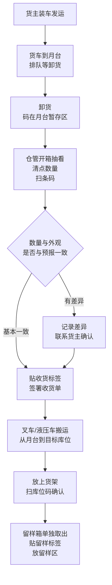

# 货主来货场景推演

**层：详细设计** ｜ 蓝图见 [design.md](../../openspec/changes/archive/2026-11-21-define-wms-blueprint/design.md)。

用一次真实来货走完全流程，把**物理世界发生的事**和**系统感知到的事**分开写。混在一起写，设计时就会把"人做的事"误当成"系统该做的事"。

这份也是 P2 的操作脚本与验收依据。

## 一、结论

一次来货切成七个阶段，其中**只有五个是系统感知点**。系统在整条链上始终滞后于物理事实——货已经放到货架上，扫码那一刻系统才知道。

| 阶段 | 物理世界 | 系统感知 |
|---|---|---|
| 1 预报 | 货主在自家系统录单 | 是 |
| 2 到货 | 货车到月台、排队、卸货 | **否** |
| 3 验货 | 开箱、清点、扫条码 | 是 |
| 4 收货过账 | 货堆在月台暂存区 | 是（纯系统） |
| 5 搬运 | 叉车把货从月台搬到货架 | **否** |
| 6 上架确认 | 货已放上货架，扫库位码 | 是 |
| 7 库存生效 | — | 是（纯系统） |

系统不感知的两个阶段（2 和 5）恰恰是最耗时、最容易出问题的。这决定了系统不能假装知道"货现在在哪"——它只知道"最后一次扫码的位置"。

## 二、前提设定

| 项 | 值 |
|---|---|
| 货主 | 华南食品（`owner_id=1`），主账号已开户，API Key 已签发 |
| 仓型 | 楼层仓，F1 收发货层，F2–F5 存储层；冷藏区在 F1 东侧 |
| 商品 A | `SKU-A001` 饼干，常温，200 件（箱规 12 件/箱），启用批次，预警 30 天 |
| 商品 B | `SKU-A002` 酸奶，冷藏，60 件（箱规 6 件/箱），启用批次，预警 15 天 |
| 服务订单 | 对 `SKU-A001` 按 0.5% 比例留样，留 90 天，到期默认报废 |
| 收货暂存位 | `RCV-01`（`location_type=receiving`） |
| 目标存储位 | `F2-A-01`（storage，常温）、`F1-C-01`（storage，冷藏）、`SP-01`（sample） |

## 三、物理动作链



物理世界里没有"单据状态"这种东西，只有货的位置和人的动作。

## 四、系统侧数据变化

### 阶段 1：预报

货主调两个接口，顺序无所谓但通常一起提交。

```http
POST /api/v1/open/v1/asns
X-API-Key: wms_live_xxxx
{ "owner_doc_no": "PO-2026-1121-01", "supplier": "华东食品厂",
  "expect_arrive_at": "2026-11-22T09:00:00",
  "lines": [{"sku_code":"SKU-A001","qty":200},{"sku_code":"SKU-A002","qty":60}] }
```

```http
POST /api/v1/open/v1/service-orders
{ "asn_code": "ASN2611210001", "service_type": "sample",
  "sku_code": "SKU-A001", "sample_mode": "ratio", "sample_ratio": 0.005,
  "retain_days": 90, "on_expiry": "dispose" }
```

写入：

| 表 | 变化 |
|---|---|
| `wms_inbound_asn` | 新增一条，`status=confirmed`，`source=api` |
| `wms_inbound_asn_line` | 两条明细 |
| `wms_inbound_service_order` | 新增一条，`status=confirmed` |

注意：API 建单直接 `confirmed`，门户建单先 `draft` 再提交。同一份 `services.create_asn`，区别只在入口传的初始状态。

### 阶段 2：到货（系统无感知）

货到了，系统里什么都没发生。ASN 仍是 `confirmed`。

这一段系统唯一能做的是"事后知道货到得晚不晚"——如果做了到货预约（本蓝图未做），才可能记录。所以**系统里看不到"货已到月台"这个状态**，直到仓管开始验货。

### 阶段 3：验货

仓管点「开始收货」，系统按 ASN 生成收货单：

| 表 | 变化 |
|---|---|
| `wms_inbound_asn` | `status: confirmed → receiving` |
| `wms_inbound_receipt` | 新增，`status=open` |
| `wms_inbound_receipt_line` | 按 ASN 明细生成，`expect_qty` 带过来 |

然后逐行录实收。这是**唯一需要人逐项判断**的环节：

| 实际发生的 | 系统里录成 |
|---|---|
| 饼干数出 200 件，外包装完好 | `received_qty=200`，`damaged_qty=0` |
| 饼干分两个生产批次：`20261015` 150 件、`20261102` 50 件 | 拆两条 `receipt_lot`，效期分别到期 |
| 酸奶数出 58 件，应到 60 | `received_qty=58`，`variance_reason=short` |
| 饼干里有 3 件外包装压瘪 | `damaged_qty=3`，归到 `20261015` 这一批 |
| 扫到一件条码系统中不存在 | 拒绝该次扫描，提示先建档 |
| 扫到的批号实物已模糊看不清 | 货主确认批号后补录；确认不了则该行暂不收货，不入账 |

批次在验货时录，**不是在预报时录**——货主不管批次，批号印在实物外箱上。

数量按「包装 × 数量」录入（D27）：界面可以选「件」或「箱」，按商品的箱规折算，**提交给接口的永远是件数**。本文以下一律按件叙述。

`status: open → checked`。此时**库存还没动**。

### 阶段 4：收货过账

确认收货，一次性过账。

| 动作 | 库存变化 |
|---|---|
| 饼干批次 `20261015` 好货 | `post_stock(+147, lot=1001, RCV-01, available, ref=receipt)` |
| 饼干批次 `20261015` 破损 | `post_stock(+3, lot=1001, RCV-01, damaged, ref=receipt)` |
| 饼干批次 `20261102` 好货 | `post_stock(+50, lot=1002, RCV-01, available, ref=receipt)` |
| 酸奶批次 `Y20261020` | `post_stock(+58, lot=1003, RCV-01, available, ref=receipt)` |

四条流水，`ref_type=receipt`，`action=receive`，货主都由商品档案派生。`lot_id` 由 `ensure_lot` 返回——批号已存在则复用，效期不一致则整单拒绝。

**同一商品拆成两条流水，是因为批次不同。** 幂等键里含 `lot_id`，否则第二条会被判为重复过账而丢掉——这正是加批次后最容易踩的坑。

状态推进：`receipt.status: checked → putaway_done`（中间态等到上架完成），`asn.status: receiving → received`。

**这一步之后库存账面已经存在，但货还在月台。** 这是账实之间的已知偏差窗口，也是必须收货即入账的原因：如果等上架才入账，月台丢货系统一无所知。

### 阶段 5：搬运（系统无感知）

叉车把 197 件饼干（约 17 箱）从月台搬到 F2，把 58 件酸奶（约 10 箱）搬到 F1 冷藏区。

系统此时生成上架任务，但不知道搬运进行到哪一步。

| 表 | 变化 |
|---|---|
| `wms_inbound_putaway` | 新增，`status=pending` |
| `wms_inbound_putaway_line` | 按收货明细拆分，`to_location_id` 由选位规则算出 |
| `wms_tasking_task` | 每个上架行生成一条任务，`type=putaway` |

选位按 D21 的三条优先级：专属库位 → 同商品就近 → 按仓型。酸奶要求冷藏，先筛 `temp_zone=chilled`。饼干算留样数量：`ceil(197 × 0.005) = 1` 件，从先到期的那批（`20261015`）里划。

于是拆成四行任务：

| 行 | 商品 | 批次 | 数量 | 目标库位 | 说明 |
|---|---|---|---|---|---|
| 1 | SKU-A001 | `20261015` | 146 | `F2-A-01` | 常规上架 |
| 2 | SKU-A001 | `20261015` | 1 | `SP-01` | 留样，取先到期批次 |
| 3 | SKU-A001 | `20261102` | 50 | `F2-A-01` | 同库位不同批次，库存分两条记录 |
| 4 | SKU-A002 | `Y20261020` | 58 | `F1-C-01` | 冷藏 |

行 1 与行 3 落在同一库位，因为选位规则是"同商品就近合并"。**但它们是两条库存记录**——批次不同的货放在一起，账上必须分开，否则拣货时无法按批次出货。

`putaway.status: pending → doing`。

### 阶段 6：上架确认

作业员每放好一批，扫库位码 + 商品码确认。**此时物理动作已经完成，系统才开始追上。**

每行确认时执行两次过账（同事务、同一 `ref`，批次跟着走）：

| 动作 | 库存变化 |
|---|---|
| 行 1 从暂存位扣减 | `post_stock(-146, lot=1001, RCV-01, available, ref=putaway)` |
| 行 1 加到目标位 | `post_stock(+146, lot=1001, F2-A-01, available, ref=putaway)` |

**跨库位移动就是"扣源 + 加目标"两条流水，不是一条带 from/to 的记录。** 带 from/to 的那个契约（`transfer_status`）只用于同一库位内的状态转换，两件事不要混。

留样那一行执行到 `SP-01` 后，生成留样记录：

| 表 | 变化 |
|---|---|
| `wms_internal_ops_sample` | 新增，`qty=1`，`location_id=SP-01`，`retain_until=收货日+90`，`status=holding` |

留样记录在上架完成时才建，不在收货时建——这样它一出现，记录里的库位就是真的。

`putaway_line.temp_mismatch` 在酸奶那行置 `false`（冷藏货进冷藏区）。若冷藏区已满而上了常温区，置 `true` 并提示，仍允许提交。

### 阶段 7：库存生效

`putaway.status: doing → done`，`receipt.status → putaway_done`，`asn.status: received → closed`。

最终账面：

| 库位 | 商品 | 批次 | 状态 | 数量 |
|---|---|---|---|---|
| `RCV-01` | SKU-A001 | `20261015` | damaged | 3 |
| `F2-A-01` | SKU-A001 | `20261015` | available | 146 |
| `F2-A-01` | SKU-A001 | `20261102` | available | 50 |
| `SP-01` | SKU-A001 | `20261015` | available | 1 |
| `F1-C-01` | SKU-A002 | `Y20261020` | available | 58 |

按批次核对：`20261015` 到货 150（147 好 + 3 破），账上 146 + 1 + 3 = 150 ✓；`20261102` 到货 50，账上 50 ✓；酸奶 58 ✓。

可发数量只算 `storage` 库位的 `available`：A001 可发 196（两个批次相加），A002 可发 58。留样区那 1 件状态是可发，但库位类型不是 storage，不参与分配。

**按批次看可发量才是关键**：`20261015` 可发 146，`20261102` 可发 50。出库时 FEFO 会先动 146 那批。如果只看 SKU 总量 196，就丢失了"哪一批先到期"这个决定性的信息。

## 五、异常分支

按差异类型切分，每类互斥。

| 类型 | 系统怎么处理 | 谁决定 |
|---|---|---|
| **少收** | 允许。`received_qty < expect_qty`，ASN 留在 `receiving` 等补货；补送则再开一张收货单，永不补送则人工结案 | 仓管录数，或结案 |
| **超收** | 拒绝。实收不能大于应收；需货主追加 ASN 后重收 | 货主追加单 |
| **破损** | 入 `damaged` 状态，留在暂存位，不进可发池 | 仓管录数 |
| **未建档条码** | 拒绝扫描，提示先建档 | 货主或仓库建档 |
| **别家货主商品混入** | 拒绝扫描（四者一致校验） | 现场退回或隔离 |
| **批号重复但效期不一致** | 拒绝收货，提示核对 | 仓管核对实物 |
| **批号实物模糊无法识别** | 暂入待定区不入账，等货主确认后补录 | 仓管 |
| **温区不符** | 允许上架，置 `temp_mismatch` 并提示 | 作业员确认 |
| **整批拒收** | `receipt.status → cancelled`，`asn.status → cancelled`，不产生任何库存与流水 | 仓管发起，需注明原因 |
| **货主取消未到货的 ASN** | `asn.status → cancelled` | 货主 |

超收拒绝是有意的：允许超收会让 ASN 数量失去意义，账上永远对不上"应到多少"。代价是货已在月台却收不了，要靠货主当场追加单——这个流程比"账永远不平"便宜。

整批拒收与部分收货的区别：拒收是零库存变化，部分收货是按实收入账。

## 六、系统不感知的部分

这几件事不要把逻辑往系统里塞，塞进去就是在假装物理世界可观测：

| 物理事实 | 系统只能近似 |
|---|---|
| 货在月台堆了多久 | 只能算 `receipt.created_at` 到上架完成的时间差 |
| 搬运用的是叉车还是液压车、走了哪条路 | 完全不知道，也不要记录 |
| 开箱检查抽了几箱、看了什么 | 只记结论（好/破损/短缺），过程不进系统 |
| 货在上架途中被临时放在通道 | 系统认为它在暂存位，直到扫码确认 |

最后一条尤其重要：**系统的位置永远是"最后已知位置"，不是"当前位置"。** 任何要求"实时知道货在哪"的功能，都得先有定位或连续扫码，否则做不出来。

## 七、破损货的出口

那 3 件压瘪的饼干入账到 `RCV-01` 的 `damaged` 状态后，走 `wms_returns` 的处置记录（D25）。三种方式：

| 方式 | 动作 | 可用期次 |
|---|---|---|
| 转回可发 | `transfer_status(damaged → available)`，货主同意降级销售 | P2 |
| 报废 | `post_stock(-3, damaged, ref=disposal)` | P2 |
| 退回货主 | 建出库单从该库位出货 | P3，依赖出库能力 |

待处置视图按滞留天数排序，这 3 件会一直挂在上面直到被处理。**看得见就会有人管**——不加待处理区类型，靠清单而不是靠拦截。

批号模糊的货情况不同：本文第三节写"暂入待定区"，现在没有待定区，改成**该行暂不收货**，物理上留在暂存区，系统里不产生记录。账实一致（都不认），代价是系统不知道这批货存在。

## 八、酸奶少收的 2 件后来补送了

供应商第二天补 2 件。因为一个 ASN 可挂多张收货单（D26），处理方式是：

| 步骤 | 系统里发生什么 |
|---|---|
| 仓管对同一张 ASN 再开一张收货单 | 生成 `RC202611220001`，`asn.status` 仍是 `receiving` |
| 验货、录实收 2 件 | 该张收货单 `open → checked` |
| 入库暂存、上架 | 两次过账，批次沿用 `Y20261020` |
| ASN 累计实收 60 = 应收 60 | `asn.status: receiving → received` |

第一批的货已经在货架上，第二批才刚进月台，两张收货单互不干扰。

如果供应商**永远不补**，仓管执行「结案」，把 ASN 从 `receiving` 推到 `received`，未收的 2 件定性为放弃。不结案的话这张 ASN 会一直挂着。

代价：ASN 的"收了多少"不再是一个字段能回答，要按 `asn_id` 汇总所有收货单明细。
