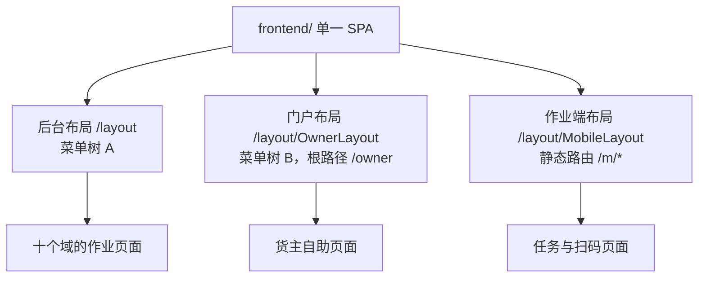

# 界面与菜单

**层：详细设计** ｜ 蓝图见 [design.md](../../openspec/changes/archive/2026-11-21-define-wms-blueprint/design.md)。三个界面根共存于同一个 Vue 工程，靠菜单树与路由组分开。



三者共用登录态与接口，不共用页面组件。门户页面独立写，不复用后台的宽表组件——字段一多就会把仓库内部的字段漏给货主。

## 后台菜单树

每个业务域一个顶级目录，`path` 为 `/wms-<域>`，`component` 为空，`permission` 为空。子菜单的 `permission` 以 `wms_<域>:` 开头即被认作该域所有（D1）。

| 顶级目录 | 子菜单 | component | 权限 | 期次 |
|---|---|---|---|---|
| 主数据 `/wms-master-data` | 仓库配置 | `wms_master_data/warehouse/index` | `wms_master_data:warehouse:edit` | P1 |
| | 货主管理 | `wms_master_data/owner/index` | `wms_master_data:owner:list` | P1 |
| | 库位管理 | `wms_master_data/location/index` | `wms_master_data:location:list` | P1 |
| | 商品管理 | `wms_master_data/sku/index` | `wms_master_data:sku:list` | P1 |
| | 合作方 | `wms_master_data/partner/index` | `wms_master_data:partner:list` | P1 |
| | API 凭证 | `wms_master_data/apikey/index` | `wms_master_data:apikey:list` | P1 |
| | 打印模板 | `wms_master_data/print_template/index` | `wms_master_data:print_template:list` | P4 |
| 库存 `/wms-inventory` | 库存查询 | `wms_inventory/stock/index` | `wms_inventory:stock:list` | P1 |
| | 库存流水 | `wms_inventory/txn/index` | `wms_inventory:txn:list` | P1 |
| | 批次查询 | `wms_inventory/lot/index` | `wms_inventory:lot:list` | P2 |
| | 临期与过期 | `wms_inventory/lot/expiring` | `wms_inventory:lot:expiring` | P4 |
| 入库 `/wms-inbound` | 入库预报 | `wms_inbound/asn/index` | `wms_inbound:asn:list` | P2 |
| | 服务订单 | `wms_inbound/service_order/index` | `wms_inbound:service_order:list` | P2 |
| | 收货 | `wms_inbound/receipt/index` | `wms_inbound:receipt:list` | P2 |
| | 上架 | `wms_inbound/putaway/index` | `wms_inbound:putaway:list` | P2 |
| 库内作业 `/wms-internal-ops` | 补货 | `wms_internal_ops/replenish/index` | `wms_internal_ops:replenish:list` | P4 |
| | 移库 | `wms_internal_ops/transfer/index` | `wms_internal_ops:transfer:list` | P5 |
| | 盘点 | `wms_internal_ops/count/index` | `wms_internal_ops:count:list` | P5 |
| | 留样 | `wms_internal_ops/sample/index` | `wms_internal_ops:sample:list` | P2 |
| 出库 `/wms-outbound` | 出库订单 | `wms_outbound/order/index` | `wms_outbound:order:list` | P3 |
| | 拣货 | `wms_outbound/pick/index` | `wms_outbound:pick:list` | P3 |
| | 复核与称重 | `wms_outbound/check/index` | `wms_outbound:check:list` | P3 |
| | 发运 | `wms_outbound/shipment/index` | `wms_outbound:shipment:list` | P3 |
| | 波次规则 | `wms_outbound/wave_rule/index` | `wms_outbound:wave_rule:list` | P4 |
| | 波次管理 | `wms_outbound/wave/index` | `wms_outbound:wave:list` | P4 |
| | 分播作业 | `wms_outbound/seed/index` | `wms_outbound:seed:execute` | P4 |
| 逆向 `/wms-returns` | 待处置库存 | `wms_returns/disposal/index` | `wms_returns:disposal:list` | P2 |
| | 退货单 | `wms_returns/return/index` | `wms_returns:return:list` | P6 |
| 任务 `/wms-tasking` | 任务列表 | `wms_tasking/task/index` | `wms_tasking:task:list` | P5 |
| 计费 `/wms-billing` | 费率 | `wms_billing/rate/index` | `wms_billing:rate:list` | P8 |
| | 费用明细 | `wms_billing/charge/index` | `wms_billing:charge:list` | P8 |
| | 账单 | `wms_billing/invoice/index` | `wms_billing:invoice:list` | P8 |
| 报表 `/wms-reporting` | 库存报表 | `wms_reporting/stock/index` | `wms_reporting:report:list` | P6 |
| | 作业效率 | `wms_reporting/operation/index` | `wms_reporting:report:list` | P6 |
| 集成 `/wms-integration` | 推送配置 | `wms_integration/endpoint/index` | `wms_integration:endpoint:list` | P7 |
| | 推送日志 | `wms_integration/log/index` | `wms_integration:log:list` | P7 |

按钮级权限（`type = F`）挂在对应子菜单下，命名与 `interface-map.md` 的权限表一致。

## 门户菜单树

顶级目录 `path = /owner`、`permission = wms_master_data:portal:view`、`component` 为空。它靠 permission 前缀归主数据域所有，停用主数据域时整个门户收起。

| 子菜单 | component | 权限 | 可见角色 | 期次 |
|---|---|---|---|---|
| 概览 | `wms_master_data/portal/dashboard/index` | `wms_master_data:portal:view` | 全部 | P1 |
| 我的库存 | `wms_inventory/portal/stock/index` | `wms_inventory:stock:list` | 全部 | P1 |
| 我的商品 | `wms_master_data/portal/sku/index` | `wms_master_data:sku:list` | 全部，新建按角色 | P1 |
| 子账号 | `wms_master_data/portal/account/index` | `wms_master_data:subaccount:list` | 仅主账号 | P1 |
| 入库预报 | `wms_inbound/portal/asn/index` | `wms_inbound:asn:list` | 全部，新建按角色 | P2 |
| 服务订单 | `wms_inbound/portal/service_order/index` | `wms_inbound:service_order:list` | 全部，新建按角色 | P2 |
| 出库订单 | `wms_outbound/portal/order/index` | `wms_outbound:order:list` | 全部，新建按角色 | P3 |
| 我的账单 | `wms_billing/portal/invoice/index` | `wms_billing:invoice:list` | 全部 | P8 |

门户页面按 1280 以上宽度设计，不做窄屏适配（D18）。

## 作业端路由

静态路由，不进菜单，不参与动态路由生成。前缀 `/m`。

**两种形态共用这一组路由**：装 APK 时走容器，不装时浏览器直接访问同一份 `dist`。扫码统一走「广播优先、键盘模拟兜底」，打印在两种形态下都经本地代理，不退化成 A4。

| 路径 | 用途 | 说明 |
|---|---|---|
| `/m/login` | 登录 | 与后台同一套 JWT |
| `/m/tasks` | 我的任务 | 按 `assignee_id` 拉取，分待办与进行中 |
| `/m/task/:id` | 任务执行 | 扫码校验货主、货品、批次、库位后提交 |
| `/m/seed` | 分播 | 播种墙作业，按格口提示投放 |
| `/m/pack` | 打包称重 | 称重比对，超差拦截 |
| `/m/scan` | 扫码入口 | 无指定任务时的通用扫码，用于查货 |

扫码结果通过容器桥接注入，输入框保留键盘模拟通道，设备不支持广播时退化为扫描枪直输。

## 前端目录约定

```
frontend/src/
  views/
    wms_master_data/{warehouse,owner,location,sku,partner,apikey}/index.vue
    wms_master_data/portal/{dashboard,sku,account}/index.vue
    wms_inventory/{stock,txn}/index.vue
    wms_inventory/portal/stock/index.vue
    wms_inbound/{asn,service_order,receipt,putaway}/index.vue
    wms_inbound/portal/{asn,service_order}/index.vue
    wms_internal_ops/{transfer,count,sample}/index.vue
    wms_outbound/{order,pick,check,shipment}/index.vue
    wms_outbound/portal/order/index.vue
    wms_returns/{disposal,return}/index.vue
    wms_tasking/task/index.vue
    wms_billing/{rate,charge,invoice}/index.vue
    wms_billing/portal/invoice/index.vue
    wms_reporting/{stock,operation}/index.vue
    wms_integration/{endpoint,log}/index.vue
    wms_mobile/{tasks,task,seed,pack,scan}/index.vue
  layout/
    index.vue            基座后台布局
    OwnerLayout.vue      门户布局
    MobileLayout.vue     作业端布局
  api/
    wms_master_data.ts
    wms_inventory.ts
    ...
```

`component` 字符串与文件路径一一对应，解析规则见 design.md Context 第 5 条。

## 每期页面交付

| 期 | 新增页面 | 数量 |
|---|---|---|
| P0 | 后台布局改造、门户布局骨架、登录后落点判定 | 3 |
| P1 | 后台主数据 6 + 库存 2，门户 4 | 12 |
| P2 | 后台入库 4 + 留样 1 + 批次 1 + 待处置 1，门户 2 | 9 |
| P3 | 后台出库 4，门户 1 | 5 |
| P4 | 后台波次规则 1 + 波次 1 + 分播 1 + 补货 1 | 4 |
| P5 | 后台库内 2 + 临期 1 + 任务 1，作业端 6 | 10 |
| P6 | 后台逆向 1 + 报表 2 | 3 |
| P7 | 后台集成 2 | 2 |
| P8 | 后台计费 3，门户 1 | 4 |

两处期次说明：留样页在 P2 交付而非 P5，因为留样记录在收货时就产生，没有列表页就没法确认生成对不对；P5 只补到期处置入口。作业端在 P5 一次交付 6 个页面（任务列表、任务执行、分播、打包、扫码、登录），因为 APK 打包要一次做完。

## 表单与校验

- 建单表单的必填项来自 `services.py` 的同一份校验，前端只做即时提示，不做第二套规则（owner-access spec）。
- 单号、货主、状态这些由系统决定的字段在表单上只读，不给输入框。
- 数量输入统一保留 4 位小数，前端按单位精度裁剪显示。
- 收货与下单的数量输入是「包装下拉 + 数量」两件套。下拉只有件、箱、托三档，按商品配置的 `qty_per_box` / `qty_per_pallet` 换算，提交前折成件。**换算只在前端做一次**，接口收到的永远是件数。
- 扫码输入框不接受粘贴，避免整单数据被一次性灌入。
- 商品表单分两段：货主填写的基础信息在门户与后台都可见；仓库侧字段（优先库区、一托件数、上架要求）只在后台出现，门户不渲染也不提交，靠 `sku:configure` 权限卡住。
- 上架选位与温区不符时，页面给出黄色提示条而不是红色报错，作业员确认后仍可提交——温区是建议不是拦截。
