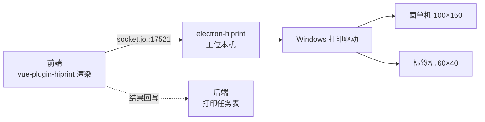

# Design

## Context

已归档的规格要求"通过局域网打印代理下发面单与标签"，配套的 T5 写的是自建 FastAPI 代理加 ZPL 指令直发。改成 `vue-plugin-hiprint` 之后，通道、模板来源、依赖形态三样全变。

核实过的组件事实：

- `vue-plugin-hiprint` 是 hiprint 2.5.4 的重新打包，支持 Vue3，提供拖拽模板设计器与打印引擎，产物是 JSON 模板。
- 静默打印依赖 `electron-hiprint` 本地客户端：客户端内置 socket.io 服务（默认 17521），前端用 `socket.io-client` 连上去，客户端调用**操作系统打印驱动**出纸——不是发 ZPL 指令。
- 跨网段可用 `node-hiprint-transit` 中继，本地局域网易位不需要。

## Decisions

### P1 通道：socket.io 客户端直连，不做中继

不引入 `node-hiprint-transit`：它在跨网段、客户端不在同一局域网时才需要，仓库里客户端与浏览器同机，多一层中继只是多一个故障点。

**每台打包工位装一个客户端**，前端只连本机 `localhost:17521`。跨机打印不做——让 A 工位往 B 工位的打印机下发，出问题是查不出来的。

### P2 模板存后端，不存本地

hiprint 默认可以把模板存在浏览器 localStorage，那样每个工位各改一份，改面单版式要跑遍所有机器。

所以模板落库：`wms_print_template`。后台提供可视化编辑页，保存 JSON。前端打印前按类型取模板。

| 字段 | 说明 |
|---|---|
| id / code / name | 标识 |
| template_type | `waybill` 面单 / `location_label` 库位 / `sku_label` 商品 / `pallet_label` 托盘 / `parcel_label` 包裹 / `pick_sheet` 拣货单 / `packing_list` 装箱单 |
| paper_width / paper_height | 单位 mm，决定渲染尺寸 |
| content | hiprint 的 JSON |
| version | 递增，便于排查"某工位用的是旧模板" |
| status | 启用 / 停用 |

一个类型只允许一个启用中的模板，避免打印时不确定该用哪份。

### P3 打印任务落库，失败要能追

前端每下发一次打印，回写一条 `wms_print_task`：

| 字段 | 说明 |
|---|---|
| id / ref_type / ref_id | 打印对象：包裹、库位、单据 |
| template_id | 用了哪份模板 |
| printer_name | 目标打印机（客户端上的名字） |
| client_id | 哪台客户端 |
| status | `success` / `failed` |
| error_msg | 失败原因：离线、缺纸、驱动报错 |
| reprint_times | 重打次数 |
| operator_id / created_at | 谁、什么时候 |

**"不产生第二张有效面单"靠这张表实现**：重打时把前一条标记为作废，新的一条生效；快递面单号不变，但系统里只有一条有效记录。

### P4 电子面单以图片贴入

快递公司返回的是 PDF 或图片。不做解析重排——PDF 转图片后作为整幅图片元素放进模板，铺满 100×150。

理由：面单版式由快递公司定义且会变，解析字段再排版等于给自己挖坑。整图打印的唯一代价是 PDF 转图那一步，用前端 `pdf.js` 或后端转都行，选后端转（P4 已有 httpx，加一个渲染依赖）。

### P5 吞吐要按工位算，不能按整仓算

已知事实：客户端走系统驱动渲染，一张面单大约 0.3–1 秒（取决于机器与驱动）。三万张按单机算要 2.5–8 小时，**必须多台并行**。

规划口径：按打包工位数配客户端数。假设 8 个打包工位、每工位 4000 张、单张 0.5 秒，约 33 分钟出完——这个数字要在 P4 实测后再定工位数量。

**不做集中打印排队。** 集中排队会把"某台打印机卡纸"放大成"整条线停摆"，而且排队系统本身要维护状态机。各工位打各自的，出问题影响面小。

### P6 两张表归主数据域

打印不属于任何业务域，是平台级能力。模板是配置、任务是操作留痕，都不改变库存与单据状态，所以放在主数据域：

| 表 | 内容 |
|---|---|
| `wms_master_data_print_template` | 模板 JSON、类型、纸张尺寸、版本、启停 |
| `wms_master_data_print_task` | 每次打印的模板版本、目标打印机、客户端、成败、重打次数、操作人 |

代价是主数据域多一张高增长表（三万单 × 至少一张面单 = 每天三万行）。靠按月归档控制——`wms_master_data_print_task` 的归档策略与订单表一致，只留近 90 天。

不在出库域建这两张表，是因为库位标签、商品标签、托盘标签与出库无关，塞进出库域会让它管自己业务之外的事。

## Risks / Trade-offs

- **第三方 Electron 客户端成为生产依赖** → 它跑在 Windows 上，崩溃、被安全软件拦截、开机没自启都会让工位停工。缓解：开机自启 + 前端检测连接状态并显示醒目提示 + 每个工位配一台备用打印通道（浏览器 A4 应急）。
- **走系统打印驱动，打印质量取决于驱动** → 小尺寸条码可能比原生 ZPL 糊。P4 必须在真机上验证二维码可扫，不合格就回退到 ZPL 方案（保留自建代理的接口形状，只换实现）。
- **模板 JSON 由人编辑，可能存出坏模板** → 保存时用 hiprint 的渲染器试渲染一次，失败则拒绝保存；每次打印记录模板版本号，出问题能定位是哪一版。
- **三万张的实测速率未知** → 0.3–1 秒是估计值。P4 验收要求在真实工位上连续打 500 张并计时，作为工位数量的依据。
- **PDF 转图片增加后端依赖** → 比自写 ZPL 便宜得多，但会引入一个渲染库（体积不小）。若装不上，退回"快递平台返回图片 URL"的方式。
