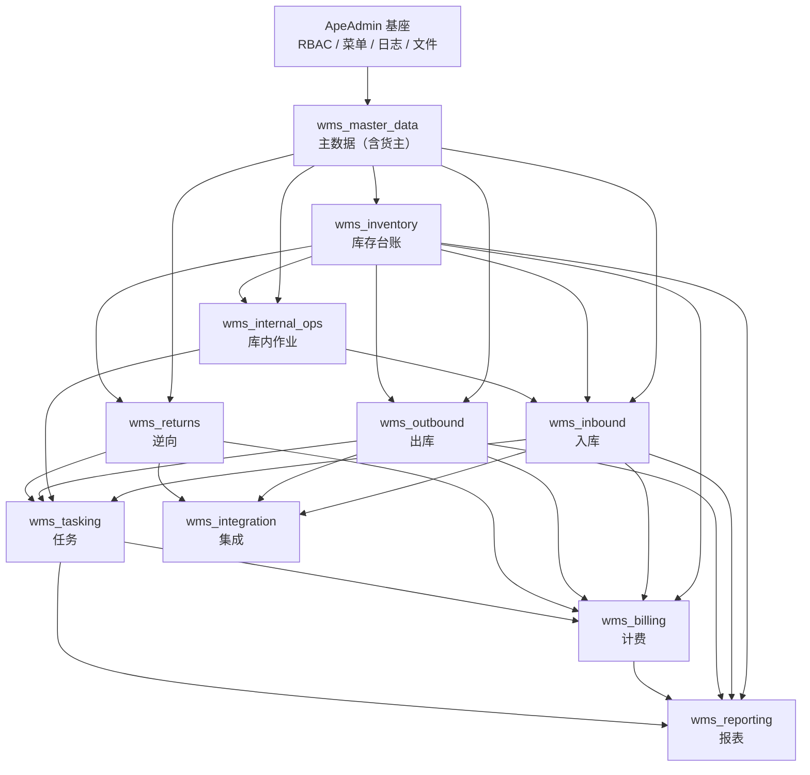
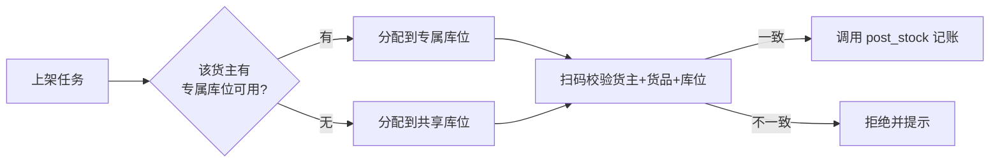
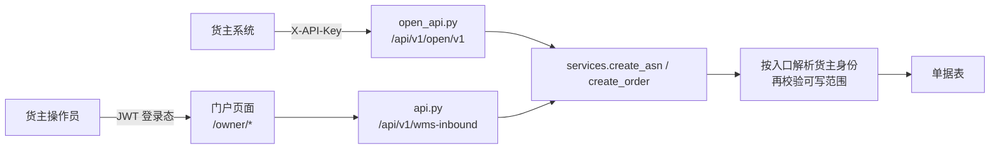
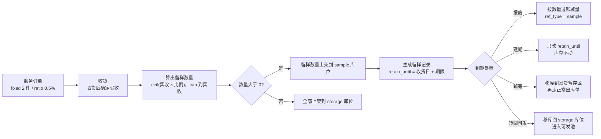
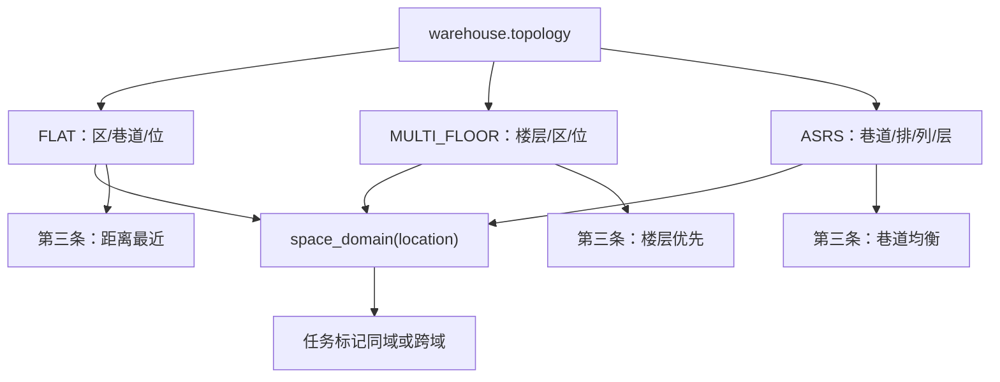
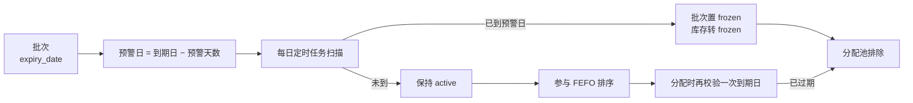
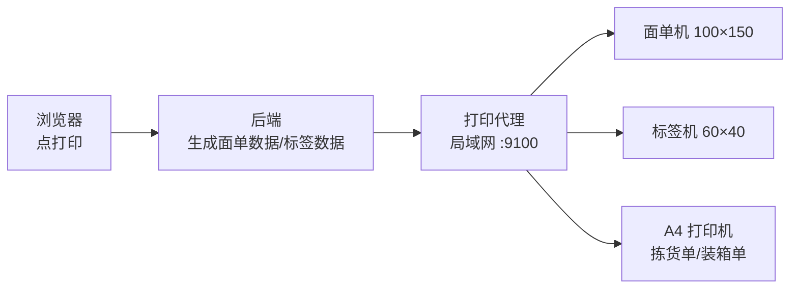
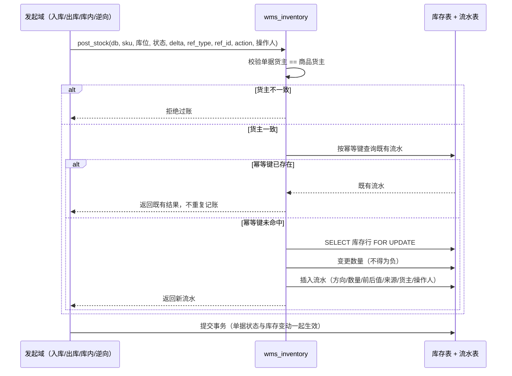

# Design

## 文档分层

这套文档分两层，写的时候就要分清，读的时候也一样：

| 层 | 回答什么 | 冲突时 |
|---|---|---|
| **蓝图** | 系统由哪些部分组成、边界在哪、为什么这么分 | 以蓝图为准 |
| **详细设计** | 具体到表、字段、接口、页面怎么定 | 蓝图没提到的，以详细设计为准 |

**分工规则**：出现新的架构判断（新增域、改依赖方向、推翻某条决策）写本文并给 D 编号；出现新的字段、接口、页面写详细设计。两层不互相抄。

| 文件 | 层 | 内容 |
|---|---|---|
| [`docs/design/data-model.md`](../../../../docs/design/data-model.md) | 详细设计 | 十个域的表结构、字段、约束与索引；枚举字典；各单据状态机；单号规则 |
| [`docs/design/interface-map.md`](../../../../docs/design/interface-map.md) | 详细设计 | 权限标识清单与角色授权、后台路由、对外接口与错误码、跨域契约、幂等键汇总 |
| [`docs/design/ui-map.md`](../../../../docs/design/ui-map.md) | 详细设计 | 后台与门户菜单树、作业端路由、前端目录映射、每期页面交付 |
| [`docs/design/tech-stack.md`](../../../../docs/design/tech-stack.md) | 详细设计 | 技术栈定稿：运行环境、后端/前端/移动端栈、开发工具链、容量推算、部署 |
| [`docs/design/inbound-walkthrough.md`](../../../../docs/design/inbound-walkthrough.md) | 详细设计 | 一次来货的双轨推演：物理世界发生什么、系统感知到什么、每阶段的表与库存变化。兼作 P2 验收脚本 |
| [`仓库模拟建模.md`](../../../../仓库模拟建模.md) | 规划参考 | 三类仓型的空间与容量推导、分区比例、库位坐标编码、上架选位策略。D21 决定它有哪几条结论进入系统 |
| [`仓内设备与调度模型.md`](../../../../仓内设备与调度模型.md) | 规划参考 | 搬运、分拣、调度资源建模与产能推导。不进系统，Non-Goals 已划出设备边界 |

## Context

仓库里目前只有 `openspec/` 与 `CODEBUDDY.md`，`backend/`、`frontend/` 都还不存在。基座选定 `ApeAdmin-master`（FastAPI + SQLAlchemy 2.0 async + Vue 3.5 + Element Plus），本设计只依赖它已具备的能力，不改造其框架代码。动机见 proposal.md。

从基座源码读出、直接影响本设计的八条事实：

1. **插件发现**：`src/plugins/builtin/<pkg>/` 下每个含 `PluginInterface` 子类的包即一个插件，`plugin.json` 提供 `name`/`display_name`/`version`/`dependencies`。生命周期为 `on_load → install → register → register_mcp_tools`。
2. **建表方式**：`install()` 里调 `Base.metadata.create_all(tables=[...])`。`create_all` 只建缺失的表，**不改已有表结构**。基座自己的补救办法是 `src/core/dbmigrate.py` 的幂等 ALTER 补丁。
3. **依赖校验现成**：`PluginManager._check_dependencies` 在启用时按 `plugin.json` 的 `dependencies` 校验，`_check_dependents` 在卸载时拦截被依赖的插件。插件强依赖不需要新造机制。
4. **菜单归属靠字符串前缀**：插件管理器认定菜单属于某插件的条件是 `permission` 以 `{plugin_name}:` 开头，或 `component` 等于/以 `{plugin_name}/` 开头，或 `path` 等于/以 `/{plugin_name}`（含下划线转连字符）开头。禁用插件即把这些菜单 `status=0`。
5. **前端不能插件化**：`frontend/src/router/index.ts` 用 `import.meta.glob('@/views/**/*.vue')` 解析菜单里的 `component`，页面文件必须物理存在于宿主工程的 `src/views/` 下。插件的 ZIP 导入只解压后端包。
6. **单进程前提**：`PLUGIN_RUNTIME_MODE` 固定 `single_process`，插件运行时状态在进程内存里。
7. **基座没有货主维度**：`Role.data_scope` 是部门维度（1 本人 / 2 本部门及以下 / 3 本部门 / 4 全部），与货主无关。`sys_user` 只有 `dept_id`，没有归属货主的字段，也不能改。
8. **鉴权依赖绑死在 Bearer 上**：`get_current_user` 用 `HTTPBearer(auto_error=False)` 取 `Authorization` 头再 `decode_token`，中间件不区分来源。货主凭证若也塞进这个头，会被当成 JWT 解析并失败。

## Goals / Non-Goals

**Goals:**

- 十个域各自成为可独立启用/停用的插件包，彼此依赖形成无环图。
- 货主成为商品、库存、单据的第一维度，且货主归属只有一个派生来源。
- 库存数量只有一个写入入口，且这个入口可被调用方在同一事务里复用。
- 货主的 API 与自助端共用同一份建单实现，规则不存在两套。
- 应收费用可逐笔回溯到来源单据与当时费率，账期锁定后不再变动。
- 每期的代码落位、表名、路由、权限标识、前端目录在动工前就确定，不留给实现时临时决定。

**Non-Goals:**

- 不做插件市场、不做插件 ZIP 分发。业务插件随仓库发版。
- 不做多仓、序列号级追踪、跨货主合单。
- 不做自动化分拣线与 AGV 调度。播种墙的电子标签只做显示与提示，不接管输送设备。
- 不做第二套业务工程。Android 应用是同一份 Web 构建的容器，不是原生重写。
- 不做货主端移动端（不做窄屏适配、不出安装包），不做 iOS 客户端，不做离线作业与本地排队。
- 不做对接财务系统、不做发票开具、不做阶梯费率与促销规则。
- 不做设备模型：堆垛机、输送线、AGV 的选型、调度与路径计算不在系统内（`仓库模拟建模.md` 第八节划的边界）。
- 不做前端国际化，不做 Redis 缓存。
- 不做多实例部署。单仓单进程是明确前提。
- 不重构 ApeAdmin 的框架层（RBAC、插件管理器、MCP 网关均保持原样）。

## Decisions

### D1 一域一插件，命名三段对齐

域标识贯穿插件包名、表前缀、路由、权限、前端目录，全部使用同一个 `wms_<域>` 记号，只有 URL 段转连字符。

| 层 | 入库域示例 |
|---|---|
| 插件包 | `src/plugins/builtin/wms_inbound/` |
| 表名 | `wms_inbound_asn`、`wms_inbound_receipt` |
| 路由 | `/api/v1/wms-inbound/asn` |
| 权限 | `wms_inbound:asn:create` |
| 菜单顶级 path | `/wms-inbound` |
| 菜单 component | `wms_inbound/asn/index` |
| 前端页面 | `frontend/src/views/wms_inbound/asn/index.vue` |

理由：基座的菜单归属、表元数据清理（`_remove_plugin_metadata` 按 `{name}_` 前缀删表定义）都依赖这个前缀约定。一处偏离就会让禁用插件时菜单藏不掉或元数据清不净。

备选：用短前缀（`wms_md_`、`wms_inv_`）换可读性。否决，因为要和基座约定对齐，短前缀反而要额外维护映射表。

### D2 域拓扑：主干单向，支撑旁挂



主干域与主数据域之间有两条边（一条经库存传递、一条直接），因为主干域要直接读货主、库位、商品档案，还要用主数据域的隔离注入（D5）。`plugin.json` 的 `dependencies` 只列直接 import 的域，不列传递依赖。

`wms_outbound` 声明 `["wms_inventory", "wms_master_data"]`，其余同理。基座在启用时校验，缺失即拒绝启用——正是需要的语义，不用另写守卫。

### D3 货主是商品、库存、单据的第一维度

货主即委托方。`wms_master_data_owner` 存货主档案；`wms_master_data_sku` 带 `owner_id`（非空），唯一键 `(owner_id, code)`。

商品档案归属货主，而不是仓库统一建档。理由：多货主的核心诉求是"我的商品和我的库存跟我自己走"——货主改编码不该影响别人的账，两个货主卖同款商品也不该互相覆盖档案。统一编码会引入跨货主合并语义，而合并（拼单、越库、同一实物多个货主分摊）是另一门业务，不该在 P1 顺手承担。

备选：仓库统一商品主档 + 货主编码映射表。否决，多一层映射表就多一层"映射错了库存就串了"的故障面。

SKU 上另存 `owner_sku_code`（货主自己的编码，可空），用于对接上游和打印标签，不参与主键。

**档案由货主建，存储要求由仓库补。** 字段按"谁的实物知识"分成两组，两组不重叠、接口按组校验：货主填编码、名称、规格、单位、货主编码、分类、重量体积、温区要求、一箱件数、条码；仓库补上架优先库区、一托件数、上架要求。分界线是「这是什么货」与「这货怎么存」。

不做事前审核，货主建完即可用——审核会阻塞下单，而档案错了通常在收货扫码或盘点时才暴露，事后治理成本可控。未建档的商品在**建单时**就拒绝，不留到收货现场；收货扫到未知条码同样拒绝，不自动建档，因为现场没人能判断规格，自动建出来的是脏数据。

单据表带 `owner_id` 非空，一单一货主（spec: 单仓多货主边界）。跨货主合单不做。

### D4 库位三个属性定死：专属、类型、状态

`wms_master_data_location` 上三个字段决定一个库位能放什么、能做什么：

| 字段 | 取值 | 作用 |
|---|---|---|
| `owner_id` | 空 = 共享，非空 = 专属 | 谁能用 |
| `location_type` | `storage` / `sample` | 用来干什么 |
| `status` | 启用 / 停用 | 能不能用 |

上架选位时专属库位优先，共享库位作回落。共享库位允许物理混放，不加"是否允许混放"开关——加了等于再造一个要有人维护的状态，而真正消掉错发的是拣货端的扫码校验。

`location_type` 是新增的，`sample` 表示留样区。留样只往这类库位里上架，分配只从 `storage` 里选（D20）。



### D5 数据隔离收敛在请求入口

货主方用户通过 `wms_master_data_user_owner(user_id, owner_id)` 绑定货主（不改 `sys_user` 表）。请求入口提供一个依赖，返回 `OwnerScope`：

```
unrestricted          # 仓库员工，可看全部货主
owner_ids: [1, 2]     # 货主方用户，只能看绑定的货主
```

所有列表与详情接口调用 `apply_owner_scope(stmt, scope)` 再执行查询。货主范围的判定只在这一个依赖里出现一次，业务代码只消费 `OwnerScope`，不再判角色、不再判 `owner_id is None`。

理由：这是越权漏洞的高发点，同一个判断散在十几个接口里必然漏掉一个。收敛到一处，漏也只会漏在入口。

不套基座的 `Role.data_scope`：它是部门维度，和货主维度正交，硬套会让两个过滤条件互相干扰（比如"本部门"的人却绑了货主）。

### D6 跨域调用：契约层 + 同一事务

强依赖域之间直接 import 对方的 `contract.py`，不允许 import 对方的 `models.py` 或直接写对方的表。

```
wms_inventory/
  contract.py   # 对外契约：只有函数签名与入参/出参 dataclass
  services.py   # 实现
  models.py     # ORM
  api.py        # 本域路由
  seed.py       # 菜单与角色绑定
  patches.py    # 幂等 ALTER 补丁
```

契约函数的第一个参数统一是调用方的 `db: AsyncSession`，被调用方**不自己开事务、不自己 commit**。一次跨域操作天然是一个事务，回滚边界清晰。

契约函数不接受 `owner_id` 参数——货主由商品档案派生（D3），调用方没有机会传错。

备选：用事件总线做最终一致。否决——入库扣库存这类操作不能容忍中间不一致，事件只用于允许延迟的联动（生成任务、刷新报表）。

### D7 库存记账契约 `post_stock`

```python
async def post_stock(
    db: AsyncSession,
    *,
    sku_id: int,
    lot_id: int,            # 未启用批次管理的商品传 0
    location_id: int,
    stock_status: str,      # available / frozen / damaged
    delta: Decimal,         # 正数入库，负数出库
    ref_type: str,          # asn / receipt / order / shipment / count / transfer / lot_expiry
    ref_id: int,
    action: str,            # 同一单据内的动作区分，如 receipt / putaway / pick
    operator_id: int,
) -> StockPosting: ...
```

执行顺序固定为：校验单据货主与商品货主一致 → 查幂等键 → 未命中则锁库存行 → 变更数量 → 写流水 → 返回新流水。

库存状态三种：`available`（可发）、`frozen`（冻结）、`damaged`（破损）。留样不在这三个里面，它靠库位类型表达（D20）。

同一库位内的状态转换走第二个契约：

```python
async def transfer_status(
    db, *, sku_id, location_id, from_status, to_status, qty,
    ref_type, ref_id, action, operator_id,
) -> StockPosting: ...
```

它做的是"一减一增"两次变动，但只写一条带 `from_status`/`to_status` 的流水。不拆成两次 `post_stock`，是因为仓库对不上账时，"状态转换"和"一次进一次出"的排查方式完全不同，流水里看不出来就只能靠猜。总量不变，唯一约束照旧。

它只管可发、冻结、破损之间的互转。留样不在这里，因为留样换的是位置而不是状态。

库存表保留 `owner_id` 冗余字段（由 `sku.owner_id` 派生），唯一约束 `(owner_id, sku_id, location_id, stock_status)`。冗余的作用是让货主过滤直接命中索引，不必每次 join 商品表。

幂等键 `(ref_type, ref_id, sku_id, location_id, action)` 建唯一索引，并发下靠数据库约束兜住，捕获冲突后读回已有流水返回。

金额与数量统一 `Numeric(18, 4)`，禁止 `Float`——浮点误差在库存上就是账不平。

### D8 任务域不反向依赖主干域

任务域持有 `wms_tasking_task`，但不知道任何具体业务动作。主干域在 `register()` 时向任务域注册处理器：

```
wms_tasking/registry.py    register_handler(task_type, handler)
wms_inbound/plugin.py      register() 里 register_handler("putaway", handle_putaway)
```

执行方向是「任务域回调已注册的函数引用」，import 方向仍是主干域 → 任务域，拓扑保持无环。任务表只存 `type / owner_id / target_type / target_id / location_id / assignee_id / status / priority`，明细留在各域自己的表里。任务列表能统一查，业务语义不串味。

### D9 单据状态机集中声明

每个单据类型在本域 `states.py` 里声明状态集合与允许的迁移边，所有状态变更走同一个 `transit(doc, event)` 函数。禁止在接口里直接 `doc.status = "xxx"`。

理由：WMS 最常见的线上事故是单据状态被某条分支悄悄改到一个不该到的状态，事后只能从日志倒推。把迁移边写成数据，越界即抛错。

### D10 表结构演进用幂等补丁，不用 Alembic

每域一个 `patches.py`，导出 `ensure_columns(conn)`，在 `install()` 里于 `create_all` 之后执行。写法与基座 `src/core/dbmigrate.py` 一致：先查 `information_schema` / `PRAGMA table_info`，缺列再 `ALTER TABLE ADD COLUMN`。

理由：插件可能被热启用，Alembic 的多分支版本链在"某个插件此刻才第一次建表"的场景下很难协调；基座已经验证了补丁模式在自己身上可用。

代价：补丁脚本只增不减，长期会堆积。缓解办法见风险一节。

### D11 开发与生产都跑 MySQL，锁只有一条路径

`post_stock` 用 `SELECT ... FOR UPDATE` 锁库存行。开发环境同样跑在 MySQL 容器上，不存在"引擎不同所以锁写法不同"的分叉。

理由：并行维护两条锁路径意味着两套行为、两套测试、两套边界情况，而开发机有 Docker，起一个 MySQL 是几秒钟的事。更关键的是幂等的正确性依赖唯一索引，唯一索引的行为受排序规则影响——SQLite 上跑通的测试证明不了 MySQL 上成立。

SQLite 仍然保留（基座安装向导默认它），但定位降为"零配置把界面跑起来看看"，不用于并发与幂等相关验收。

备选：彻底砍掉 SQLite。否决——基座安装向导依赖它做快速初始化，砍掉要改基座。

### D12 前端不插件化，PDA 用同一工程的路由组

业务页面放在宿主 `frontend/src/views/wms_<域>/` 下，与菜单 `component` 一一对应。PDA 界面不新建工程，作为同一 SPA 的独立路由组 `/m/*`，使用独立布局，页面在 `views/wms_mobile/`。

理由：基座的动态路由机制不支持插件携带页面（Context 第 5 条）；两套工程意味着登录态、权限、打包全部要维护两份。单仓的 PDA 只要求扫码与最少输入，一个紧凑路由组足够。

不做离线缓存：单仓 Wi-Fi 覆盖是可满足的前提，离线同步会引入冲突合并这一整类问题。移动端同样如此，见 D19。

### D13 权限粒度与岗位角色

权限标识 `wms_<域>:<资源>:<动作>`，动作取 `list / create / edit / delete / confirm / cancel / execute`。P0 一次性建九个角色：

| 角色 code | 范围 |
|---|---|
| `wms_admin` | 全部域全部动作，跨货主 |
| `wms_receiver` | 入库域的收货相关动作 |
| `wms_putaway` | 入库域上架动作 + 任务域 |
| `wms_picker` | 出库域拣货动作 + 任务域 |
| `wms_checker` | 出库域复核与发运 |
| `wms_counter` | 库内作业域盘点动作 |
| `wms_viewer` | 全部域的 list |
| `wms_owner_admin` | 货主主账号：本货主端全部功能 + 子账号管理 |
| `wms_owner_operator` | 货主子账号：本货主 list + 入库预报与出库订单 create |
| `wms_owner_viewer` | 货主子账号：本货主 list |
| `admin` | 基座超管，绕过权限校验 |

三个货主侧角色都通过 `wms_master_data_user_owner` 绑定到具体货主，仓库员工一律不绑定。数据可见范围三者相同，差别只在能否写（owner-access spec: 子账号的可用功能由授予范围决定）。

系统对接不走这三个角色，走 API 凭证（D17）。两套身份可以指向同一个货主，但凭证不互通。

### D14 单号生成用序列表

`wms_master_data_sequence(prefix, period, current)`，取号时 `SELECT ... FOR UPDATE`，格式 `前缀 + yyMMdd + 4 位流水`，如 `ASN2511210001`。所有单据必须有业务单号，不把数据库自增 ID 暴露给操作员和外部系统。

### D15 集成只做出站，不做消息队列

`wms_integration` 只负责把仓库内部发生的结果推出去：发货结果、收货结果、库存变动通知，按货主分别配置目标地址。入站建单不走集成域（D17）。

失败重试带指数退避，落 `wms_integration_sync_log`，失败的记录在后台可见并可手工重推。

理由：单仓日单量在万级以下，HTTP 加轮询足够，消息中间件带来的是运维成本而不是吞吐收益。

### D16 计费只读作业事实，用每日快照冻结占用

依赖方向是 `wms_billing` → 各作业域，作业域不知道计费域存在。作业域对外只提供纯查询契约：

```
wms_inbound.contract.list_completed(doc_type, since, until)
wms_outbound.contract.list_completed(doc_type, since, until)
wms_inventory.contract.snapshot_occupancy(day)
```

计费域按三个节拍工作：每 5 分钟扫最近 2 小时完成的单据生成操作费；每日 00:10 冻结前一日各货主的库位占用；每月 1 日生成上月账单。

四张表：`wms_billing_rate`（费率，带生效区间与计费项）、`wms_billing_charge`（费用流水，只追加）、`wms_billing_invoice` + `wms_billing_invoice_line`（账单）、`wms_billing_occupancy_snapshot`（每日占用）。

**仓储费按存储类型分开算。** 常规库位与留样库位占的是不同性质的空间——前者周转、后者长期占着不产生出库作业，混在一个单价里算不清。所以：

- `wms_billing_rate` 与 `wms_billing_occupancy_snapshot` 都带 `location_type`（`storage` / `sample`），快照唯一键为 `(owner_id, day, location_type)`。
- 费用行也按 `(计费项, 存储类型)` 分开生成，账单上分行列示，不合并成一条"仓储费"。
- 费率优先取该存储类型的专属配置，缺失时回落到该计费项的通用费率。

不同步记账的理由：计费失败不能阻断发货，而把写钱表塞进作业事务会把事务拉长且拖累主链路。迟到的事实靠幂等键 `(charge_item, ref_type, ref_id, period)` 去重，扫多少轮都不会重复。

快照必须存在而不能事后推算：仓储费按"占用多少库位"计价，事后拿实时库存回溯必然算错，因为库存早就变了。

### D17 货主两个入口，一套建单服务

系统对接走 API，人工操作走自助端（D18）。两个入口必须收敛到同一份实现，否则校验规则一定会漂移——API 加了必填项，界面没加，货主就会用界面的口子绕过去。



三件事分开落地：

| 关注点 | 落点 |
|---|---|
| 凭证签发与识别 | `wms_master_data`（`owner_api_key` 表 + `get_owner_principal` 依赖） |
| 建单服务 | 各域 `services.py`，两个入口都调它 |
| 入站路由 | 各域 `open_api.py`（API）与 `api.py`（自助端与后台） |
| 结果推送 | `wms_integration`（D15） |

**换头不换前缀解决不了鉴权冲突**：基座的 `get_current_user` 绑在 `Authorization: Bearer` 上并 `decode_token`（Context 事实 8），货主凭证复用这个头会被当 JWT 解析而失败。所以货主 API 用 `X-API-Key` 头、独立依赖、独立前缀 `/api/v1/open/v1/...`，与后台路由在物理上分开。

**规范由我们出，版本化**：对外路由单独一个 `APIRouter` 加独立 tag，P2 交付时导出 `openapi-owner.json` 与一份接入说明给货主。版本走路径前缀（`/open/v1`、`/open/v2`），旧版本保留过渡期并在响应头给 `Deprecation`。不按货主现有格式改语义——对方改造或加适配层。

凭证只存哈希：`owner_api_key(owner_id, name, key_prefix, key_hash, status, last_used_at, expires_at)`。明文只在创建时返回一次，`key_prefix` 存前 8 位明文用于界面识别与日志排查。

建单幂等靠货主侧单号：唯一约束 `(owner_id, owner_doc_no)`，重复提交返回首次结果，不建第二张单。

对外响应格式独立于后台：固定 `{code, message, data, request_id}`，`code` 用字符串枚举。后台的 `success_response` 结构会随内部需要调整，对外接口不能跟着变。

不做限流：单仓货主数量有限，先不上限流器，等出现实际滥用再加。

### D18 货主自助端：同一前端的独立路由组

不新建工程。自助端是同一 SPA 里的 `/owner/*` 路由组，配 `layout/OwnerLayout.vue` 独立布局与独立菜单树。

页面按域归属放，不建目录集中堆放：

```
frontend/src/views/wms_master_data/portal/stock/index.vue
frontend/src/views/wms_inbound/portal/asn/index.vue
frontend/src/views/wms_outbound/portal/order/index.vue
frontend/src/views/wms_billing/portal/invoice/index.vue
```

菜单 `component` 形如 `wms_inbound/portal/asn/index`，前缀命中 `wms_inbound/`，所以停用入库域时门户里的入库入口跟着藏（D1 的约定直接复用，不需要额外机制）。

门户顶级菜单 `path=/owner`、`permission=wms_master_data:portal:view`。它靠 permission 前缀归主数据域所有，停用主数据域时整个门户收起——货主身份和商品档案都来自主数据，这个联动是合理的。

登录后去向不改基座 `/auth/userinfo`：前端登录成功后调 `GET /api/v1/wms-master-data/me/portal` 判断是否货主账号，是则跳 `/owner/dashboard`，否则走原有 `/dashboard-monitor`。多一次请求换掉对 core 的侵入。

**账号分两级，主账号唯一由字段保证。** `wms_master_data_owner.primary_user_id` 指向主账号，唯一性来自"一列一值"。不用 `(owner_id, is_primary)` 这类唯一索引，是因为 MySQL 下允许多条 `false` 冲突。

开户（仓库侧建主账号）与建子账号（主账号自己建）是两条路径，权限不同：前者是仓管动作，后者是货主自助。

`/owner/account` 页面配 `GET/POST /api/v1/wms-master-data/portal/accounts` 专用接口，**不复用基座 `/api/v1/user`**——那是全量用户接口，会暴露其他货主的账号。新接口内部强制 `owner_id = 当前账号的货主`，入参里根本不给 owner 字段。

创建一条子账号要在一个事务里写三处：`sys_user`、`sys_user_role`、`wms_master_data_user_owner`。同库同会话，一起提交。

**不做自定义角色。** 基座 `sys_role` 是全局表，没有货主维度。让货主自建角色，就可能出现"货主 A 给自己建的角色勾上库存调整"，还要额外校验可选菜单子集。固定三个角色把可选范围压死，越权面消失。

主账号不能停用或删除自己，避免货主失去管理入口，这类操作只能由仓库侧执行。

**货主端只做桌面。** 门户页面按 1280 以上宽度设计，不做窄屏适配、不出安装包。货主想在手机上用，得先说清是新增需求，不并入本次交付。这条压掉的是所有页面重做一遍响应式的成本。

**密码两条路，切断访问靠停用。** 自助改密码要校验原密码；主账号重置子账号密码不要原密码、需管理权限。两者都用基座 `hash_password`（bcrypt）。

重置密码不追溯已签发的会话——基座的 token 黑名单按 `jti` 记录，只能拉黑单个已知 token，做不到"把这个人的所有会话干掉"。要立即切断，用停用账号：`get_current_user` 每个请求都查一次 `user.status`，置 0 立刻生效。所以界面上把「停用账号」和「重置密码」并排放，人走了点停用，别只重置密码。

不为这个场景给 `sys_user` 加 `password_changed_at` 之类的新列：那要改基座表和 `decode_token` 的判定，收益是省下用户点一次停用。

### D19 作业端用容器封装，只打一个包

Web 端先跑通，Android 是交付形态，不是另一套实现，而且只有作业端需要它。货主端只做桌面浏览器（D18），不出安装包。

```
frontend/          现有 Vue 工程，产出唯一一份 dist
mobile/            Capacitor 容器工程
  android/         单个 productFlavor：pda
```

| | 作业端 |
|---|---|
| 包名 | `com.huoling.wms.pda` |
| 启动路由 | `/m/tasks` |
| 原生能力 | 广播扫码、蓝牙打印 |

**选容器而不是 RN / Flutter**：业务代码已经在 Vue 里，重写等于养两套登录态、两套权限、两套表单，换来的只是动画流畅度，单仓作业场景不值这个价。

**选容器而不是 PWA**：要的是可安装的 APK。PWA 在 Android 能装，但分发与启动体验不如原生包，且 PDA 的广播扫码 PWA 拿不到。

Android 14 起（`minSdk 34`、`targetSdk 35`）。系统 WebView 随 Chrome 更新，Android 14 自带 Chrome 116+，前端构建目标对齐 `chrome >= 116`——用了更新的语法会在旧 WebView 上直接白屏，这类问题只在真机上才暴露。

扫码桥接靠设备的广播模式：扫码结果通过 `Intent` 广播发出，容器插件监听后转成 JS 事件。这是设备与容器之间的约定，**必须先拿到型号再定**。

版本门槛两道：设备系统低于 14 在安装阶段就拒绝；应用内资源与服务端不兼容时，启动调一次 `GET /api/v1/system/version`，不匹配就挡住并提示升级，不让人进到一个必然报错的界面。

不做离线：断网提交直接失败并提示重试。离线要引入本地队列、冲突合并、时钟偏差处理，单仓 Wi-Fi 覆盖的前提下，这套复杂度换不到对等的收益。

### D20 留样是存储位置，不是库存状态

留样有两种诱人的错误做法：给它一个 `sample` 库存状态，或者只在留样表里记个数字。前者让"不可发"变成一个会被忘掉的状态位，后者让留样货被分配算法当成可发量拿走。

正解是拆成两件事：

- **物理上**：货上架到 `location_type = sample` 的库位，库存状态仍是可发，只是不在可分配的区域里。
- **业务上**：`wms_internal_ops_sample` 记录来源、数量、期限与处置结果。

分配只从 `storage` 库位的可发数量里选，留样区天然被排除。这样"留样不可发"不靠人记住，而是位置决定的。

留样记录的字段：

```
owner_id, sku_id, qty, location_id
source_service_order_id     货主服务订单
source_receipt_id           产生它的收货单
retained_at, retain_until
status: holding / released / shipped / disposed
extended_times              延期次数
disposed_at, handled_ref    处置结果与出库单号
```

**货主服务订单归入库域**（`wms_inbound_service_order`）。货主每来一次货提一张，说明这批货要不要留样、留多少、留多久。一张 ASN 可挂多条（将来贴标、换箱也走这里），当前只支持留样一项。货主要求就留，不要求就不留，仓库不替货主决定。

留样数量支持两种取值方式，由服务订单选一种：

| 方式 | 字段 | 算法 |
|---|---|---|
| 固定件数 | `sample_mode = fixed`、`sample_qty` | 直接用填的数字 |
| 按比例 | `sample_mode = ratio`、`sample_ratio`（如 0.005） | `ceil(实收数量 × sample_ratio)` |

比例方式**向上取整**，再与实收数量取小——万一比例配错（填成 1.5）也不会留出超过到货量的数。结果落在小数计量商品上时向上取整到整数单位，宁可多留不可少留。



四条路径落到不同机制上：

- **报废**：`post_stock` 负数，`ref_type = sample`。库存消失，有流水。
- **延期**：只改 `retain_until`，不碰库存，因此不写流水。库存没变就不该有账。
- **邮寄**：先把货从留样区移库到发货暂存区，再建一张普通出库单走正常拣货发运。两张单都能查，留样记录只存 `handled_ref`。
- **转回可发**：移库回 `storage` 库位，货进入可发池正常销售。留样记录置 `released` 并关闭。

邮寄和转回都不自动建单：到期清单摆在后台，运营点一下生成。设计一套"库内作业依赖出库域"的自动链路，出错时发错货的代价远大于点一下的成本。留样出库也不走"指定库位发货"——那会给分配逻辑开一个特例口子，移库一步更干净。

留样列表做两个视图，共用一张表两种查询条件：默认只列 `holding`（待办，处理完就消失），切到「全部」不过滤（台账，能回查已转回、已邮寄、已报废的记录）。两者都要，因为前者回答"今天该处理哪些"，后者回答"这批货当时怎么处理的"。

### D21 一套坐标字段覆盖三种仓型

`仓库模拟建模.md` 里的内容，真正要进系统的只有三条：坐标怎么编、空间域怎么判、选位按什么顺序。容量公式、分区比例和敏感性分析是规划工作，不进代码。

**仓型是配置，不是多仓。** `warehouse.topology` 取 `FLAT` / `MULTI_FLOOR` / `ASRS`，同一时刻只有一种生效。换仓型改配置，业务流程与库存结构不动。这与"不做多仓"不冲突：多仓是多个仓库实例，仓型是一个实例的空间形态。

**坐标五个字段，含义随仓型变。**

| 字段 | FLAT 平面仓 | MULTI_FLOOR 楼层仓 | ASRS 立库 |
|---|---|---|---|
| `floor_no` | 恒为 1 | 建筑楼层 | 恒为 1 |
| `aisle` | 巷道 | — | 巷道 |
| `rack` | — | — | 排 |
| `level` | 货架层 | 货架层 | 货架层 |
| `bin` | 位 | 位 | 列 |

`floor_no` 与 `level` 必须分开。楼层仓里「建筑第 3 层」和「货架第 2 层」是两个维度，混用一个字段，跨层作业判定直接算错。

**空间域判定只有一个函数。** `space_domain(location)` 返回域标识：FLAT 取 `zone_id`、MULTI_FLOOR 取 `floor_no`、ASRS 取 `aisle`。两个库位域相同即同域作业。判定只出现在这一处，任务、移库、盘点都消费它的结果。

**选位三条优先级。**

1. 货主专属库位可用
2. 该商品已在某库位有库存，且该库位可继续放
3. 按仓型：FLAT 距离收发货区最近、MULTI_FLOOR 收发货层优先否则按周转等级放低层、ASRS 巷道占用率最低

前两条跨仓型不变，只有第三条随拓扑换算法。候选池永远只含 `location_type = storage` 且启用的库位——收货暂存、拣选、发货暂存、留样区一律不进。



第三条不写死成"距离最近"：立库里"距离"由堆垛机走法决定，属于设备模型（建模文档第八节）。业务模型不替设备算路径。

**容量数字不进系统。** 建模文档算出的 3,266 / 9,000 / 6,552 托位是规划参考，用来回答"这个仓放不放得下"。系统里 `location.capacity` 是单个库位能放几托，是运行约束。两者不是一回事，运行时不校验总量是否达到规划值。

### D23 温区是选位建议，不做硬拦截

仓库有冷藏区，但允许临时混放。所以温区做成"优先匹配 + 不匹配时留痕"，不做硬拦截。

`zone.temp_zone` 为来源，`location.temp_zone` 冗余（与 `floor_no` 同处理），`sku.temp_requirement` 与它同构，取值 `ambient` / `chilled`。

上架选位时先按温区筛，筛不到再放开：货品要求冷藏而冷藏区无位，仍可上架到常温区，但 `putaway_line.temp_mismatch` 置真并提示作业员。

硬拦截的问题很实际：冷藏区装满时，货已经到了月台，拦下来等于不收货。系统在这里能做的只有两件事——优先放对、放错了记住。

**`temp_mismatch` 这个字段不是仪表盘装饰**，是货损发生时的定位依据：查得出这批货是谁、什么时候、上架到哪个非匹配温区。

只定两个温区值。将来有冷冻需求就加一个枚举值，不预留字段。

### D24 批次按商品开关，效期靠预警冻结

库存粒度加上批次：`(货主, 货品, 批次, 库位, 状态)`。但批次对**未启用批次管理的商品**不该存在——包材、耗材没有批号，强行要人填是制造错误。

所以开关放在商品上：`lot_required`。启用后收货必须录批号与效期，出库按批次选货；未启用则整条链路不出现批次。

**`lot_id = 0` 表示默认批次，不建实体记录。** 备选是建一条 id=0 的"虚拟批次"，但那样每次 join 都会把它带出来，各处都要排除一次。用 0 表示"无批次"只有一处判断，且集中在展示层。

**批次由收货现场建立，货主不填。** 批号印在实物喷码上，预报时货主未必知道，收货时对一眼最快。同一批号再次到货复用记录、累加库存；批号相同而效期不同则拒绝——一个批号只能有一个效期，否则先进先出就无从算起。

**出库默认 FEFO，允许指定批次。** 按到期日从早到晚选，到期日相同按入库时间。货主点名要某批时按指定的来，库存不足就明确提示，不自动换批。

**到期是「预警到期」，不是保质期到期。** 商品上配 `expiry_warn_days`（默认 30），当天日期达到「到期日 − 预警天数」时，该批次库存自动转 `frozen`，不再参与分配。配 0 就等于到期当天才冻。



冻结产生的库存变动走 `transfer_status`，`ref_type=lot_expiry`，能在流水里单独筛出来——这是把"系统自动做的动作"和"人做的动作"分开，对账时不会混。

**任务漏跑的兜底在分配环节，不在任务本身。** 分配时再算一次到期日，已过期的一律排除。这样即使定时任务停了一周，也不会把过期货发出去；代价只是库存状态暂时没同步，临期清单可能不准。

**自动冻结而非仅告警**的理由：告警依赖有人看，而仓库的临期货是典型的"所有人都知道要处理但没人处理"。冻结把责任从"记得检查"变成"系统不让你发"。代价是任务必须可靠，且到期当天库存状态会变、产生流水——这条已记入风险。

### D25 破损处置挂在逆向域，比退货单早三个期次

破损货在 P2 就会产生（收货现场压瘪、摔坏），但逆向域的完整能力排在 P6。中间四个期次里，这些货没有出口，会一直堆在收货暂存位。

解法是把逆向域的**处置**部分先拎出来，P2 就上线；退货单本身仍留在 P6。

```
wms_returns/
  disposal.py    P2：破损处置，restock / scrap / return_owner
  return.py      P6：客户退货单
```

三种处置对应三种已有机制，不新造记账逻辑：

| method | 动作 |
|---|---|
| `restock` | `transfer_status(damaged → available)`，货主同意降级销售 |
| `scrap` | `post_stock(-qty, damaged, ref=disposal)`，报废减量 |
| `return_owner` | 建出库单出货，依赖 P3 的出库能力，所以 P3 才开放 |

**不做审批流。** 报废货主的货理论上要授权，但单仓场景下这个决定通常是仓管和货主在电话里谈完的，系统只需要记录结论——谁、什么时候、处置了多少、什么原因。加一套审批状态机反而会让人绕过系统。

### D26 一个 ASN 可挂多张收货单

「一张收货单一次收完」在分批到货时会卡住：应收 60 箱实收 58，供应商第二天补 2 箱——如果必须新建 ASN，货主要为一个补货动作把预报重填一遍。

改成 ASN 与收货单的一对多。**ASN 是这次来货的委托，收货单是每次实际到货。**

不用改表结构：`wms_inbound_receipt.asn_id` 本来就不唯一，要改的是状态机语义。

| 状态 | 含义 |
|---|---|
| `confirmed` | 已确认，还没开始收 |
| `receiving` | 已开始收，还有未收数量；期间可反复开新收货单 |
| `received` | 累计实收达到应收，**或人工结案** |
| `closed` | 归档 |

人工结案是必须的：收了 58 箱之后供应商再也不送，这张 ASN 不能永远挂在 `receiving`。结案动作把未收差额定性为"放弃"，之后不再接受新收货单。

每张收货单独立入账、独立上架，互不干扰——上一张的货已经在货架上了，这一张才刚进月台。

代价：ASN 的"收了多少"不再是一个字段能回答的，要按 `asn_id` 汇总所有收货单明细。库存查询与报表里涉及"应到 vs 实到"的地方都要走这个汇总。

备选是让原收货单反复打开关闭，但那与 D9「状态只推进不回退」直接冲突，且一张单反复过账会让幂等键的语义变得可疑。

### D27 库存只存最小单位，箱与托是录入时的换算

仓管按箱点数、货主按箱下单，但库存不能按箱记——拆零出库时"0.3 箱"没有意义，而且箱规一变账就废了。

所以定死一条：**所有表里的 `qty` 都是最小计量单位的件数**，箱与托只存在于录入和展示两端。

货品上加两个换算系数，分属不同组：

| 字段 | 填写方 | 含义 |
|---|---|---|
| `qty_per_box` | 货主 | 一箱几件，商品属性 |
| `qty_per_pallet` | 仓库 | 一托几件，作业属性 |

收货界面是一个「包装」下拉（件 / 箱 / 托）加一个数量框，提交前换算成件。货主下单同理，写"10 箱"系统按箱规折成件，进了订单明细就是件数。

**不做一品多包装。** 礼盒装 6 件、箱装 24 件这种同一 SKU 多种销售包装的情况，靠这两个字段表达不了。真遇到时要加一张包装规格表，并让条码带上所属包装——那时是新增，不是改造，现有的两个字段不会被废掉。

**为什么不干脆让人按件录。** 一天收几十托货，每托都心算乘除，出错率不会低，而错了就是库存错。换算这一步交给系统，成本是一个下拉框。

### D28 三万单的出库：波次是主链路，不是优化项

日单量三万意味着按单拣根本走不通——拣货员一天要在仓库里走几十公里，而且每单都要回到起点。**行走距离是唯一的瓶颈，拣货速度不是。**

量级推算：峰值约 6000 单/小时、1.7 单/秒，每天 7.5 万拣货行，3 万张面单。这个量级下 MySQL 加单进程 FastAPI 撑得住过账（5 行/秒），**真正的瓶颈在波次生成**。

**订单分两条分支，共用一套单据。**

| | B 端 | C 端 |
|---|---|---|
| 拣货单位 | 整箱、整托 | 单件 |
| 分播方式 | 边拣边分，一车一单 | 播种墙 |
| 补货 | 不需要 | 必需 |
| 单量占比 | 少 | 多 |

分支只影响分配策略、拣货单位与分播方式，库存记账、批次、复核全部共用。

**波次规则可组合，不写死算法。** 实际仓库同时跑三种切法：按截单时间、按承运商截止时间倒推、按区域与热度。所以规则做成一张表，条件从五个维度里挑（订单类型、承运商、区域、截单窗口、热度分级），按优先级匹配，没命中的留在池里等下一轮。

**分播两种，一个波次只用一种。** 播种墙适合 C 端拆零——按库位聚合拣一批，再按格口分到每单；边拣边分适合 B 端整箱——一车一单，拣完即分完。混用会让拣货单失去意义。

**补货是 C 端的前提。** 拣选区只能拆零，货得从存储区补过来。补货按库位上下限触发，整箱补、不拆箱补。没有补货，拣选区第二天就空。

**波次生成必须异步。** 一次波次要算 300–500 单的分配，每单约 10 ms，同步算就是 3–5 秒的阻塞。所以生成走后台任务，前端轮询进度；生成中断则回滚已分配的订单，退回池中重来。

**多 worker 不可行。** 插件运行时状态在进程内存（`PLUGIN_RUNTIME_MODE: single_process`），多 worker 会让插件启停与菜单同步各自为政。所以只能单进程靠异步并发，重计算必须让出事件循环。

这个事实也改了 T2 的判断：APScheduler 只够跑定时任务，波次生成需要一个能跑长任务、能查进度、能中止的执行器。实现上仍用同一套后台任务机制，但要把「长任务」和「定时任务」分开对待。

### D29 打印改走本地代理

T5 定的浏览器打印在三万单场景下不成立：3 万张热敏面单，A4 不干胶每单撕一张、手动贴，作业量不可行。

改成：**后端出指令，局域网代理下发，热敏打印机出纸。**



代理是一个常驻小服务，跑在仓库某台电脑上，接收 HTTP 请求后按目标打印机转发。它维护一张「工位 → 打印机」映射，让操作员不用每次选打印机。

保留浏览器打印，但只用于 A4 文档类（拣货单、装箱单、盘点表）——这些一天几十张，不值得走代理。

**标签不止面单。** 库位标签、商品标签、托盘标签、包裹标签、格口标签、装箱单都要打，所以代理要支持多种纸张与模板，不能只做一个面单通道。

**代理是新维护点。** 它跑在仓库本地，出问题没人远程修得了。这是选热敏打印的必然代价，写进运维清单。


**不加 `quarantine` 库位类型。** 破损货留在收货暂存位的 `damaged` 状态，等处置。理由是不为一个临时状态新增库位类型，暂存区本来就该有多个库位。

代价要认：暂存位会被破损货占住。缓解手段是待处置视图按滞留天数列出，超期未处理的排在前面——**看得见就会有人管，这是清单而不是拦截**。

同样因为不加待处理区，批号实物模糊的货没有专门的落脚点。处理方式是：该批次明细不录、整行暂不收货，物理上留在暂存区，等货主确认批号后补一张收货单。系统里不产生记录，账实一致——都不认这批货。

### D22 技术栈与运行形态

完整清单与十项选择的理由记在 [tech-stack.md](tech-stack.md)，这里只留结论：

| 项 | 结论 |
|---|---|
| 新增依赖 | 后端只有 `apscheduler`、`qrcode`、`openpyxl` 三个，前端只有 `dayjs` 一个；其余全部来自基座 |
| MCP 与 AI 助手 | 保留代码，`MCP_ENABLED=false`，6 个菜单 `status=0` 隐藏 |
| 定时任务 | APScheduler 进程内，四类任务靠幂等键去重 |
| 部署 | 全栈 Docker Compose，`utf8mb4_0900_ai_ci` 与时区写死在 `my.cnf` |
| 测试 | pytest 窄范围五处，统一跑 MySQL 容器，不分裂成两种引擎 |
| 打印 | 浏览器打印，标签用 A4 不干胶 + 二维码，100% 原尺寸 |
| 缓存 | 不部署 Redis，但依赖包留在基座里不卸 |
| 国际化 | 不做，中文硬编码，`i18n_key` 留空 |
| 前端代码检查 | 只靠 `vue-tsc`，不引 ESLint / Prettier |
| CI | 不建，用 `docker compose run --rm backend pytest` 一条命令替代 |

三条与设计直接咬合的约束：APScheduler 在进程内，多 worker 会重复执行，前提是四类任务都幂等（它们确实都是）；浏览器打印必须 100% 原尺寸，缩放会让二维码模块宽度不足而扫不出；不引 ESLint 意味着格式一致性靠 review，这是接受了的成本。

## 域职责与分期

| 域 | 拥有的数据 | 不做什么 |
|---|---|---|
| `wms_master_data` | 仓库（含仓型）、货主（含主账号指向）、货主 API 凭证、用户与货主绑定、子账号、库区（含温区）、库位（含坐标、类型、温区、专属货主）、商品档案（货主建基础 + 仓库补存储）、条码、单位、供应商、客户、单号序列、门户菜单根 | 不持有任何数量，不建业务单据 |
| `wms_inventory` | 库存台账（含货主与批次维度）、库存流水、库存状态、批次与效期 | 不知道单据长什么样，只认 `ref_type`/`ref_id`；不判断批次该不该发，只按调用方给的批次记账 |
| `wms_inbound` | ASN、货主服务订单、收货单、收货明细（含应收/实收/破损/差异原因）、上架单 | 不直接改库存数量，不跨货主，不做质检判定 |
| `wms_internal_ops` | 移库单、盘点单、盘点明细、补货单、留样记录与到期处置 | 不改总量，不跨货主移库，不反向读入库域的表 |
| `wms_outbound` | 订单、波次规则与波次、分配记录、拣货单、分播记录、格口、复核单（含称重）、发运单 | 不直接改库存数量，不跨货主合单，不混类型成波 |
| `wms_returns` | 破损处置（P2 起）、退货单与退货明细（P6 起） | 不复用入库单模型，不做报废审批流 |
| `wms_tasking` | 任务、任务分配、执行记录 | 不含任何业务明细字段 |
| `wms_billing` | 费率、费用流水、每日占用快照、账单与账单明细 | 不写作业域任何表，不受理人工录入金额 |
| `wms_reporting` | 无写入表，只读汇总（按货主可切） | 不写任何业务表 |
| `wms_integration` | 推送配置、推送日志 | 不承载业务规则，不承接入站建单 |

分期与验收路径：

| 期 | 域 | 关闭本期的验收路径 |
|---|---|---|
| P0 | 基座 | 登录 → 侧边栏出现货灵菜单 → 建一个岗位角色并绑定用户；货主账号登录落到门户布局而不是仓库布局 |
| P1 | `wms_master_data` + `wms_inventory` | 配置仓型 → 建两个货主并各开一个主账号 → 主账号各建一个子账号，子账号建不到别家货主下 → 子账号自助改密码、主账号重置子账号密码、停用后旧会话立即被拒 → 签发一个货主 API Key → 各建带坐标类型的库区库位 → 货主在门户自建商品（一个开批次、一个不开）、仓库补上架要求 → 手工调整库存 → 货主 A 查不到货主 B 的数量与流水，只读子账号建单被拒 |
| P2 | `wms_inbound` + `wms_returns`（处置部分） | 货主调 API 建 ASN 与服务订单、也在门户里建 → 两者走同一套校验 → 收货时按批次录数量与效期，记录应收/实收/破损 → 按服务订单划留样并上架到留样区 → 库存增加且流水可追，批次独立成行；破损货能走处置：转回可发或报废，待处置视图按滞留天数排序；扫到别家货主的商品或错批次被拦；重复提交同一单号不建第二张单；导出并交付对外接口规范 v1 |
| P3 | `wms_outbound`（基础） | 货主调 API 建出库订单、也在门户里建 → 分配按先到期先出选批次 → 拣货 → 打包称重拦截 → 发运 → 库存只扣本货主本批次的数量；B 端整箱走边拣边分；分配不会选中留样区；指定批次不足时不自动换批；破损处置的第三种方式「退回货主」开放 |
| P4 | `wms_outbound`（波次）+ `wms_internal_ops`（补货） | 波次规则按截单时间、承运商、区域、热度组合成波 → 后台生成可查进度可中止 → 播种墙分播按格口提示 → 拣选区低于下限触发补货整箱补入 → 三万单跑完一天的作业 |
| P5 | `wms_internal_ops` + `wms_tasking` + 移动作业端 | 移库 → 按批次盘点 → 差异调整；留样到期四条路径；批次预警自动冻结；作业员装 APK 领任务扫码执行 |
| P6 | `wms_returns` + `wms_reporting` | 退货入库 → 库存与按货主汇总的报表同时正确 |
| P7 | `wms_integration` | 作业完成 → 按货主配置的目标推送出去 → 失败可在后台看到并重推 |
| P8 | `wms_billing` | 冻结一日占用（常规与留样分区）→ 生成操作费与两类仓储费 → 出一张月账单，常规与留样分行 → 追溯任一计费项到来源单据与费率 |

## 库存记账链路



发起域必须在同一事务里把单据状态改到位，否则会出现库存已变而单据未推进的悬挂状态。

## Risks / Trade-offs

- **共享库位物理混放导致错发** → 收货上架、拣货、复核一律强制扫货主+货品+库位三者，不提供跳过开关。错发的成本远高于扫一次码的几秒。
- **留样被遗忘，占用库位到永远** → 留样记录必有 `retain_until`，到期前在后台按天列出待处置清单；没有期限的留样不允许创建。这条不做，半年后库位上全是没人认领的样品。
- **分配算法漏掉留样区过滤** → 分配只从 `location_type = storage` 取数，写成一条 where 条件而不是散在各处判断。P3 验收里专门有一条"分配不会选中留样区"。
- **货主隔离漏注入成越权** → 所有列表与详情统一走 `apply_owner_scope`；P1 的验收就要求"用货主 B 的账号访问货主 A 的详情返回 404"，不通过则本期不算完。
- **同一实物被多个货主重复建档** → 允许。靠条码与标签区分，不做跨货主商品主档合并。若将来要做，是主数据域的独立变更。
- **货主自建档案填错规格，导致上架或盘点出错** → 不做事前审核，但建单时校验商品存在、收货时校验条码可识别，错误在进入作业前就拦一次。仓库可用 `status=disabled` 停用脏档案，但不能替货主改基础信息。
- **温区不硬拦截，冷藏货被放进常温区** → 选位优先匹配温区，不匹配时置 `temp_mismatch` 并提示。这是有意接受的损失：硬拦会让冷藏区满了就无法收货，而货已经到月台了。标记的作用是货损时能定位。
- **到期冻结任务漏跑，过期货仍可发** → 兜底不在任务里，在分配环节：分配时再算一次到期日，已过期的一律排除。任务停一周的最坏后果是库存状态滞后、临期清单不准，不会是发错货。
- **自动冻结在到期当天产生库存流水，干扰对账** → 冻结流水统一用 `ref_type=lot_expiry`，与人工操作分离。对账时按 `ref_type` 分组，系统动作单独成一行。
- **批次让库存行数成倍增长** → 一个商品十个批次就是十条库存记录、十条流水。库位查询与库存汇总必须带批次条件，否则会漏行。前端列表默认按「商品」聚合展示，需要明细时再展开批次。
- **破损货占住收货暂存位** → 不设待处理区，破损货留在暂存位的 `damaged` 状态。缓解是待处置视图按滞留天数排序，超期排前面。另外收货暂存区必须建多个库位，只有一个时会被堵死——这条写进 P2 的建位要求。
- **批号模糊的货在系统里完全不存在** → 该行暂不收货，物理上留在暂存区。系统不记录、不占位、也不提醒，账实一致但全靠人记。这是不加待处理区的直接代价。
- **波次生成中断，订单卡在半分配状态** → 生成过程全部在一个事务内，中断则整体回滚，订单退回池中。不做"部分成功"，因为半分配的订单既拣不了也发不出。
- **称重容差定太紧，误拦正常包裹** → 容差按商品重量波动设，初始给 5%，按前两周实际数据调。缺重量数据的商品直接放行，不因为缺数据阻断发货。
- **打印代理挂掉，整条打包线停摆** → 代理跑在仓库本地，无法远程修复。缓解：代理开机自启、心跳检查、失败时回落到浏览器打印 A4 应急。这是选热敏打印的必然代价。
- **三万单集中在几小时，峰值打满数据库** → 峰值约 5 行/秒的过账，MySQL 单机有余量；真正的风险在报表查询与波次生成同时跑。报表默认查近 7 天，跨月查询走归档表。
- **`create_all` 不改表结构** → 每域 `patches.py` 幂等补齐，且启动时校验期望列存在，缺列直接报错而不是让运行期 500。补丁只增不减的堆积问题，在 P8 结束时统一做一次基线合并。
- **SQLite 无行锁，并发过账可能双扣** → 开发与验收一律跑 MySQL，SQLite 只用于零配置看界面（D11）。运维若用 SQLite 上生产，这条风险立即成立，须在部署检查单里禁止。
- **十插件同进程，一个插件的异常可能拖垮整条链路** → 跨域调用不放宽异常，让错误冒到接口层统一返回；只在任务生成、计费扫描、报表刷新这类旁路上用事件总线或定时任务隔离。
- **计费口径跑错要重算两个月** → 幂等键让扫描可重跑，费用只追加让错账可冲抵，账单确认后锁定让已出账的钱不动。三条一起用，错了只影响未确认账期。
- **占用快照漏冻结导致当日仓储费无法计算** → 快照任务每日 00:10 跑，缺失时不生成账单并告警，绝不用实时库存反推。
- **货主 API 凭证泄露** → 只存哈希、明文只回显一次、支持按凭证单独停用与过期；`last_used_at` 在后台可见，异常凭证能被发现。
- **对外接口与后台接口混用同一套鉴权** → 物理隔离：`X-API-Key` 头 + `/api/v1/open/v1` 前缀 + 独立依赖，后台 JWT 无法调用对外接口，反之亦然。
- **两个入口的校验规则漂移** → 建单逻辑只存在于 `services.py`，`api.py` 与 `open_api.py` 都是薄壳，不写任何校验。评审时只看 `services.py`。
- **门户误露出仓库内部功能** → 门户权限按三个货主侧角色显式枚举，不给通配；每个门户页面独立于内部页面，不共用同一组件的宽表字段。
- **子账号管理接口被拿去做越权** → 不复用基座 `/api/v1/user`，新建 `portal/accounts` 且入参不含 `owner_id`，货主从登录态取。审查时只看这条：接口签名里没有 owner 参数。
- **货主自建角色导致菜单越权** → 不支持自定义角色，可选范围压到三个固定角色。若将来放开，必须先给 `sys_role` 加货主维度并校验菜单子集。
- **前端用了 Android 14 WebView 不支持的语法导致白屏** → 构建目标对齐 `chrome >= 116`，CI 里跑一次 browserslist 校验。这类问题只在真机暴露，不做静态约束就只能等用户反馈。
- **作业端 APK 与后端版本漂移** → 启动时校验接口版本，不匹配就挡在门口。否则出现"某个按钮点了没反应"这类无法复现的问题。
- **货主端被顺手做成响应式** → 桌面宽度设计写进 D18 与 mobile-app spec 的验收场景：窄屏可用性不作为验收项。不做的话，页面会一页一页被"顺手适配一下"拖成两套布局。
- **PDA 扫码拿不到数据** → 广播扫码依赖设备型号与厂商配置，P4 前必须确认型号并在真机上跑通一次。不确认就只能按键盘模拟输入兜底，体验差一截。
- **基座升级与本地改造冲突** → 改造集中在 `.env`、`APP_NAME`、`seed.py` 与新增插件目录，不动 `core/`、`plugins/base.py`、`plugins/manager.py`。升级时按这三个文件的 diff 手工合并。
- **前端页面不随插件停用而消失** → 停用只影响菜单与接口。这是行为特性不是缺陷，写进运维说明，避免误以为页面还能用。
- **单号序列表成为热点** → 所有单据取号都过一把锁。单仓量级下可接受；若实测排队，按前缀拆行即可，不影响格式。

## Migration Plan

本期只产蓝图，无数据迁移。P0 的落地方式：把 `ApeAdmin-master` 的 `backend/`、`frontend/` 复制为仓库的两个根目录，改 `APP_NAME`、`DB_NAME`、`JWT_SECRET`、`CORS_ORIGINS`，清掉 `apeadmin.db` 与 `setup.lock` 走一遍安装向导，然后按本设计的命名约定建十个空插件包骨架（只有 `plugin.json` 与最小 `PluginInterface` 实现，不建表不注册菜单）。

回滚策略：P0 阶段是纯增量，直接在仓库里丢弃改动即可；进入 P1 之后每期一个 change，回滚以 change 为单位。

## Open Questions

- 日单量、货主数、SKU 数、库位数、峰值收货批次实际是多少。这决定 P3 是否需要把分配过程异步化、以及 P5 的 PDA 是否需要批量领取。P1 结束时按真实数据回填。
- 存储费能否按批次归集取决于计价方式：按库位日计价时分不清库位上哪批货占了多少；按件数乘天数计价才能落到批次。这条与费项口径一起在 P6 前定。
- 面向货主收哪些费项：仓储费按库位数还是按体积或重量、操作费按件还是按单、是否收增值服务费。决定 P8 的费率模型，P6 之前需要答案。
- 账期规则：自然月结算还是按合同起止日，是否需要预付款或押金抵扣。影响 `wms_billing_invoice` 的账期字段与状态机，P8 之前需要答案。
- 货主自助端是否需要打印面单或入库标签。若需要，P3 之前要把打印代理纳入范围，而不是等 P5。
- 作业端 APK 的分发方式：内部下载页、企业分发平台，还是上应用商店。前者要自己维护版本清单，后者要处理审核与上架周期；P5 之前需要答案。
- 是否要做强制更新（低于某版本直接不可用）。这决定 `/system/version` 的返回内容与拦截强度，P5 之前需要答案。
- 上游系统除货主自有系统外，是否还有电商平台或 ERP 需要主动拉单，各自认证方式。决定 P7 的推送目标配置形态。
- PDA 设备型号与扫码方式（一维/二维码、广播还是键盘模拟、是否带蓝牙打印）。决定 P5 的输入控件与扫码桥接实现，P4 之前不需要答案。
