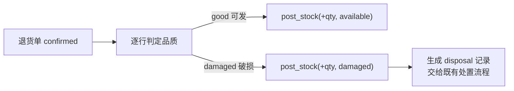

# Design

## Context

P5 之后系统有 7 个插件、41 张表。库存数量的写入口只有 `post_stock` / `transfer_status`。
退货入库必须复用它们，不能自己改 `wms_inventory_stock.qty`。

货主门户是独立构建产物，路由写死在 `router/owner.ts`，菜单从 `/owner` 目录的
子菜单动态取。新增门户页要同时改路由表与菜单 seed，漏一处就是白屏。

## Decisions

### R1 退货入库按品质分流，不默认可发

客户退回来的货不是自动可发的。判成破损的进 `damaged` 并生成一条 `disposal`，
走 P2 已经跑通的转回可发 / 报废 / 退回货主三条路径。这样退货与收货破损共用
同一套处置逻辑，不新增第二套。

### R2 退货入库到收货暂存位，不直接上货架

退货和采购收货一样，先落 `location_type='receiving'` 的暂存位，再由上架作业
决定去哪个库位。直接上货架会绕过温区匹配与留痕。

### R3 幂等键含 `lot_id` 与品质状态

同一退货行的好货与破损货是两条流水，用 `action='return:good'` /
`action='return:damaged'` 区分。`ref_id` 用退货行 id，重复确认不会重复入库。

### R4 门户建单的 `owner_id` 只从会话取

不在请求体里收 `owner_id`。货主账号绑定的 `owner_id` 由
`wms_master_data_user_owner` 查出，服务端注入。否则改一下请求体就能替别的
货主建单——与开放接口 `X-API-Key` 注入 `owner_id` 是同一条原则。

### R5 `sync_enabled` 决定门户能否建单

接了 ERP 的货主，订单与预报由上游下发，门户建单入口关闭。切换开关不中断在途单据：
只控制「新建」按钮与建单接口，已有单据照常查询与推进。

### R6 门户页复用后台服务，不另写一套逻辑

门户的「入库预报」调 `service.create_asn()`，「出库订单」调
`service.create_order()`，与后台、开放接口共用同一处校验。前端只是不同的表单
布局与字段裁剪。

## Risks / Trade-offs

- **退货行允许不指定批次** → 启用批次管理的商品若不填批号，用 `lot_id=0` 的
  虚拟批次入库会破坏 FEFO。本期对启用批次的商品强制要求批号，未填直接拒。
- **门户两套产物各 1.3MB** → 整包引入 Element Plus，首次打开慢。等门户页面补齐
  后按实际使用按需引入，本期不动构建。
- **报表顺延** → P8 计费需要按来源单据统计费用，但那是计费域自己的读模型，
  不依赖报表插件，因此不阻塞。
