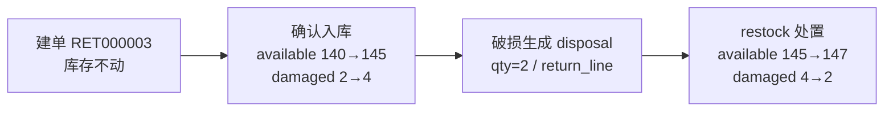

# Tasks

> 报表三页、门户查询类页面、打印整块按用户 2026-11-22 决定顺延至最终验收前。

## 1. 退货单

- [x] 1.1 `wms_returns` 追加 `return`、`return_line` 两表；验证标准：重启后旧 `disposal` 数据不丢
- [x] 1.2 建退货单：按货主+商品+批次录退回数量与品质（good / damaged）；启用批次的商品强制批号
- [x] 1.3 收货入库：好货进 `available`、破损进 `damaged` 并生成 `disposal`，同事务写流水
- [x] 1.4 重复确认幂等；确认后不可改数量
- [x] 1.5 退货单列表与详情接口，按货主隔离

## 2. 货主自助建单

- [x] 2.1 门户「入库预报」页：调 `create_asn`，`owner_id` 由会话注入，不读请求体
- [x] 2.2 门户「出库订单」页：调 `create_order`，规则同上
- [x] 2.3 三处同步：`router/owner.ts` 注册路由、门户菜单 seed 建菜单并绑角色、`OwnerLayout` 菜单来源
- [x] 2.4 `sync_enabled=true` 的货主关闭建单入口，已有单据不受影响
- [x] 2.5 门户概览页与子账号页从占位换成真页面（最小可用）

## 3. 前端与验收

- [x] 3.1 后台退货单页面：列表 + 新建抽屉 + 确认入库
- [x] 3.2 `npm run build` 两套产物通过
- [x] 3.3 全链路：退货入库 → 库存增加 → 破损生成待处置 → 处置后账实一致
- [x] 3.4 货主账号门户建单：owner_id 不被请求体覆盖；员工账号访问门户页被拒

## 实施记录

2026-11-22 在 `backend` 起 uvicorn（MySQL `127.0.0.1:3307` / `huoling_wms`），用临时门禁脚本跑完全部验证点，脚本已删除。

| 验证点 | 实测 |
| --- | --- |
| 1.1 旧数据 | 服务重启后 `wms_returns_disposal` 仍有 `receipt_line` 2 条、`return_line` 2 条 |
| 1.2 批次校验 | 商品 2 不填批号 → 422「商品 2 启用批次管理，退货必须指定批次」 |
| 1.3 建单 / 入库 | 建单 200 且库存保持 `available 140 / damaged 2`；确认后 `145 / 4` |
| 1.4 幂等 | 二次 `receive` 返回 200，库存仍是 `145 / 4`；已过账行的 `posted` 为 true |
| 1.5 隔离口径 | 列表 200（2 条）、详情 200（2 行）；`owner_id` 是可选筛选参数，货主账号访问后台列表 403 `Missing permission: wms_returns:return:list`，门户不暴露退货接口 |
| 2.1 / 2.2 注入 | 请求体塞 `owner_id=2`，落库 `owner_id=1`；`ASN000008` / `SO000068` 的 `source=portal`、`status=confirmed` |
| 2.4 ERP 开关 | `sync_enabled=1` → `can_create=false`、建单 422、已有 `PORTAL-ASN-2` 仍可查；改回 0 后 `can_create=true` |
| 3.4 员工拒绝 | 员工账号门户建单 401「该账号未绑定货主」 |
| 3.2 构建 | `npm run build` 退出码 0，`dist/admin` 与 `dist/owner` 均产出；已同步到 `backend/frontend_dist`、`backend/frontend_dist_owner`。仅有 chunk 超过 500 kB 的警告 |

退货建单曾返回 500 / `MissingGreenlet`：`_return_dict` 读取 flush 后 expired 的 `created_at` 触发异步会话隐式 SELECT。改为 `include_dates=False`，并在 `commit()` 前把返回数据取成普通 dict，门户建单接口同样处理。
