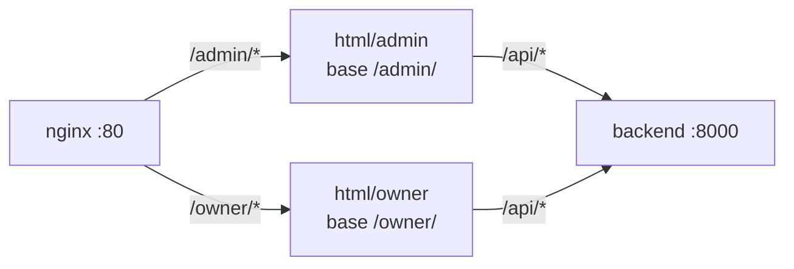

# Design

## Context

P0 的做法：一个 SPA、一个 `/login`、一个 `/auth/login`，登录后调 `/me/portal` 判断身份再重定向。代码上只是几十行守卫，代价却是三条真实的边界漏洞。

这一期把"分开"落到三层：入口、登录、会话。缺任何一层，另外两层都只是装饰。

## Decisions

### S1 用 `vite --mode` 而不是环境变量

两套产物需要两个 `base`，而 `base` 是构建期常量——只能构建两次。

切换方式选 `--mode owner`，不选 `APP_TARGET=owner`：npm 脚本在 Windows 上走 cmd，`FOO=bar vite` 这种前置赋值语法不生效，要引 `cross-env` 才跨平台，那就多一个依赖。`mode` 是 Vite 原生参数，零成本。

```bash
npm run build          # 出 dist/admin 与 dist/owner
npm run dev            # 后台，5173，base /admin/
npm run dev:owner      # 门户，5174，base /owner/
```

### S2 门户入口放在 `owner/index.html`

Vite 按入口文件的相对路径决定产物位置：入口在 `owner/index.html`，产物就是 `dist/owner/owner/index.html`。而静态服务器与 SPA 回退只认 `index.html`。

所以构建末尾补一次拷贝（`scripts/fix-owner-dist.mjs`，十行，无依赖）。不这么做的话，要么改 `outDir` 导致两套产物互相覆盖，要么改 Vite root 导致别名与 `node_modules` 解析全乱。

### S3 登录判定放在服务端，做在两个接口里

| 入口 | 接口 | 规则 |
|---|---|---|
| 后台 | `POST /auth/login`（基座） | `before_login` 钩子：账号绑了货主就抛异常 |
| 门户 | `POST /wms-master-data/owner-login`（插件） | 只接受绑定货主、且货主与绑定都启用的账号 |

**不改基座 `auth.py`**。基座这个接口被后台、安装向导和以后的 MCP 共用，改它的入参会波及别人；而 `before_login`（钩子）本来就是给插件拦登录用的，用它最合适。

门户登录不复用 `/auth/login` 的另一个原因：那个接口的语义是"验证凭据"，「这张凭据能不能进这个界面」是两件事，混在一起就退回到 P0 那种"先发 token 再判断"。

### S4 会话共享，身份不共享

两端用同一套 JWT（同一 `sys_user` 表），但：
- 门户守卫先调 `/me/portal`，不是货主就清 token 回门户登录页
- 后台守卫不再判断货主——货主根本拿不到后台的 token，因为登录那一步就失败了

守卫里留着的 `/me/portal` 调用是兜底：防的是"历史遗留 token"与"账号被改成货主绑定"这两种情况。

### S5 两套产物、两个静态目录



后台与门户各回退到自己的 `index.html`，不互相兜底——一份 index 兜两套界面，就是 P0 那个问题的物理根源。

本地开发不跑 nginx，所以 `main.py` 额外把 `frontend_dist_owner` 挂到 `/owner`，与已有的 `/admin` 并列。

## Risks / Trade-offs

- **门户产物 1.3MB**：整包引入了 Element Plus。门户是货主面向的，首次加载要等。后续可按需引入或把门户做成更轻的一套组件；本期不做，因为 P1 才刚把功能跑通。
- **两个产物要构建两次**：`npm run build` 从 7 秒变 15 秒。可接受。
- **`before_login` 会拦截所有绑定货主的账号**：如果将来真有"货主方员工也需要进后台"的场景，得改成按入口参数区分。当前业务下货主方不该进后台，所以先按最严的做。
- **门户与后台共用 `vue-i18n` 与 Element Plus**：包体积重复，但换来一份组件资产。等门户真要独立发版，S1 的两套产物已经让它只差一次目录搬移。
