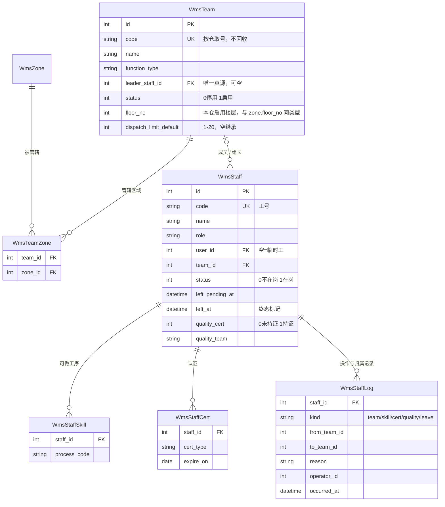

# Design

## Context

现有 `wms_master_data` 插件已有 `WmsTeam`／`WmsStaff` 两张表、service、api、前端两个页面和菜单种子，来源于已归档变更 `2026-11-23-team-and-staff-management`。本次是在这套实现上扩字段、改规则，不是另起一套。

现状约束：

- 严格单仓：`WmsWarehouse` 只有一行（`code="MAIN"`），`zone.warehouse_id` 只是单仓内的冗余归属，没有切仓路由。新字段不引入多仓逻辑。
- 楼层不是独立实体：只有 `WmsZone.floor_no` 字段，没有 floor 表和 CRUD；库区有 `status` 启用位。
- 上下游缺口：没有工序字典、没有执行单元（现有 `WmsUnit` 是计量单位）、没有派单／改派／退回待派、没有用户中心离职事件回调、没有按仓配置（`sys_setting` 是系统级 key-value）。`wms_tasking_task.status=pending` 是现有公开任务池。

动机与范围见 `proposal.md`；行为要求见 `specs/wms/team-staff/spec.md`。

## Goals / Non-Goals

**Goals:**

- 把 PRD 中属于班组与人员本体的字段落库，并使派生读数按统一口径从数据库实算。
- 用同一份归属数据支撑两个视图，避免班组侧与人员侧各存一份。
- 把停用、离职、调组、删除的规则替换落到 service 层，前端只读展示结果。
- 为范围外的上下游写出可对接的数据契约，而非静默降级。

**Non-Goals:**

- 不建楼层主数据、工序字典、执行单元、仓级配置表，也不改任务域状态机。
- 不实现派工、改派、回池的任务侧动作；离职处置只写人员侧状态并给出改派跳转入口。
- 不接用户中心事件；建档与离职同步由后续变更接入，本页只承接结果。
- 不做导出内容、格式与脱敏规则，只保留入口与权限位。
- 姓名全局唯一不是本页校验口径：`WmsStaff.name` 沿用现有建档规则，用户中心的姓名约束不在本页重复实现。

## Decisions

### 1. 字段扩在现有两张表，能力认证与日志拆子表

`WmsTeam`、`WmsStaff` 继续作为班组与人员的唯一主表。一对多的数据拆成四张子表：

备选是把区域、工序、认证存成 JSON 列。放弃该方案：按区域筛班组、按工序筛人员、按到期日筛认证都会退化为全表扫描，且无法用唯一约束防重复。四张子表都建索引：`WmsTeamZone(team_id, zone_id)` 唯一、`WmsStaffSkill(staff_id, process_code)` 唯一、`WmsStaffCert(staff_id, cert_type)` 唯一、`WmsStaffLog(staff_id, occurred_at)` 普通索引。

### 2. 班组长只存一处，人员侧派生

`WmsTeam.leader_staff_id` 是唯一真源。人员行的"班组长"标签由 `staff.id == team.leader_staff_id` 派生，不在 `WmsStaff` 加 `is_leader` 列。

备选是两处都存布尔标记再靠同步保持一致。放弃：一旦有一次保存失败就会双写不一致，而 PRD 把一致性列为验收项。新建班组时 leader 必填，选中即在同一个事务里把该人的 `team_id` 指向新组，不产生无组长的中间态。

### 3. 楼层引用 `zone.floor_no`，不新建楼层实体

`WmsTeam.floor_no` 存字符串，取值来自 `WmsZone.floor_no` 的去重集合；管辖区域通过 `WmsTeamZone` 关联现有 `WmsZone.id`，候选限定 `zone.status=1` 且 `floor_no` 相等。换楼层时清掉不属新楼层的已选区域并回传清除数量。

备选是新建 `floor` 主数据表。放弃：本次范围外，且现有库区已带 `floor_no`，再建一张表会引入第二份楼层真源。

### 4. 状态语义升级，不新增状态值

`WmsStaff.status` 从 0=离职／1=在职改为 0=不在岗／1=在岗，列值不变，语义收窄。离职用 `left_at` 标记终态，待处置用 `left_pending_at` 标记；两者都不改变 `status` 的取值集合。

现有"复职恢复可选"被"离职不可回退"替换：service 在检测到 `left_at` 非空时拒绝把 `status` 改回 1。

### 5. 停用去掉清空前置，任务处置交给下游

`toggle_team` 移除"有在职成员则拒绝停用"的校验。停用只改 `WmsTeam.status`，成员归属和作业位置保留。派工候选读取方必须按 `team.status` 过滤；已派未开工任务退回待派、在办任务跟人做完由任务中心按现有 `wms_tasking_task.status` 处理，本次不改任务域。

备选是在本插件内直接改任务表。放弃：会让主数据插件反向依赖任务域，且现有任务状态机只有 `pending/claimed/done/cancelled`，没有"已派未开工"的独立状态可精确匹配。

### 6. 编号复用现有序列器

班组编号用现有 `WmsSequence(prefix="NC-T", period=仓库code)` 取号。删除班组时不回退 `current`，跳号合法。

备选是新建按仓自增列。放弃：项目已有序列器且已用于其他单据，重复造一套会产生两套并发取号逻辑。

### 7. 在办上限三层，只落仓级与组级

仓级默认存 `sys_setting` 的系统级键 `wms.dispatch_limit_default`（单仓语义），缺省 3。`WmsTeam.dispatch_limit_default` 可空，空即继承仓级。人级覆盖的字段与写入口属于任务中心，本次只定义读取优先级 `人级 → 组级 → 仓级 → 3`，不建人级列。

### 8. 派生读数统一在后端计算

可承接工序、可派人数、成员数、在岗数、配置状态、认证到期三态、组内身份、区域覆盖读数都在 service 层计算后随列表 DTO 返回，前端只做展示与筛选。

备选是前端从明细自行聚合。放弃：PRD 的口径有多处限定（只算在岗、停用组不参与、已离职不计入、字典外码原样显示），前端再实现一遍必然漂移。

### 9. 查询条件走 API 参数，条件回显走前端

`list_teams` 增加 `keyword/leader_name/floor_no/process_code/zone_id/updated_from/updated_to`，`list_staffs` 增加 `keyword/team_id/role/leader_flag/process_code/cert_type/config_state/employment_state/bound_state/cert_expiry/last_op_from/last_op_to`。多词关键词按空格切分后全部命中；时间含端点，起点晚于终点时返回 400。

条件回显 chip、移除单项、重置、展开收起、班组下钻都在前端完成，下钻通过预置 `team_id` 参数重跑查询。

### 10. 范围外依赖的数据契约

| 依赖 | 本次读取方式 | 缺口时的行为 | 后续接入点 |
| --- | --- | --- | --- |
| 库区与楼层 | `GET /zones?status=1` 的 `id/code/name/floor_no` | 无启用库区时新建置灰或区域候选为空并提示 | 仓库档案补楼层实体后替换 `floor_no` 来源 |
| 工序字典 | `WmsStaffSkill.process_code` 只存码，展示中文名由前端映射 | 字典外码原样显示，不校验 | 工序字典落地后接候选源 |
| 执行单元 | 人员行的 `bound_unit` 与 `in_progress_count` 由外部 provider 注入 | 分别回落「未登录」与 0，界面提示等待同步 | 执行单元能力落地后实现 provider |
| 任务中心 | 停用时输出受影响组成员与任务范围 | 本页只提示后果，不改任务状态 | 任务中心实现退回待派与批量改派后对接 |
| 用户中心 | 建档与离职事件走 service 入口 | 未同步的人不出现或仍按手工状态 | 离职事件回调 `WmsStaff.left_pending_at` |
| 仓级上限 | `sys_setting.wms.dispatch_limit_default` | 缺省 3 | 仓级配置落地后按仓取值 |

provider 用可选依赖注入，不让主数据插件 import 任务域或执行单元模块。

## Risks / Trade-offs

- [停用后任务未自动退回待派] → service 在停用响应中回传受影响的组与人，UI 明示后果；在 design 的契约中标记任务中心为后续接入方，避免把"停用已完成"误读为"任务已处置"。
- [工序码无字典校验] → 按 PRD 允许字典外码原样显示，只校验非空与每项唯一，不拦保存。
- [绑定单元与在办数缺失] → 回落「未登录」与 0，并在离职处置区提示数据可能未同步；不把 0 当成已清空的证据。
- [旧规则作废影响既有调用方] → `toggle_team` 与 `update_staff` 的旧校验移除后在 proposal 标 BREAKING，同步更新 `docs/design/interface-map.md` 的规则说明。
- [姓名全库不重名的 PRD 描述与本页建档口径不一致] → 本页不实现该校验，作为用户中心同步口径留给上游，避免误拒合法建档。
- [人员 `status` 语义改变] → 列值不变但含义收窄，所有读取方按"在岗／不在岗"理解；既有 `get_staff_by_user` 保持只返回在岗，不返回已离职。

## Migration Plan

本次没有测试目录，验证以构建脚本输出和按验收用例手工走查为准。

1. 加列与新表：两张主表加可空列，新建四张子表；所有新列允许为空，现有数据无需回填。
2. 数据回填：`WmsStaffLog` 不为历史人员补造记录；现有人员的"最近操作时间"取新表最大时间，无记录时为空。已 `status=0` 的人员不自动写 `left_at`，不误标"已离职"。
3. 规则切换：部署即生效。`toggle_team` 不再检查成员，`update_staff` 检测到 `left_at` 非空时拒绝复职——依赖旧规则的操作需要按新口径调整。
4. 文档同步：`docs/design/data-model.md`、`interface-map.md`、`ui-map.md` 同步字段、接口、权限和菜单。
5. 验证顺序：后端启动连 MySQL 跑接口 → 前端构建 → 按 PRD TC-01～TC-15 逐条走查 → 检查归档规格与实现一致。
6. 回滚：移除新列与新表、恢复 `toggle_team` 的成员前置校验与复职允许逻辑即可；本次没有跨库数据迁移，回滚不丢历史业务单据。

## Open Questions

- 导出字段、文件格式与脱敏规则未定（PRD Q-F-06）。本变更只保留导出入口和权限位，定稿后单独出变更。
- 班组长标签是否需要来源 tooltip（PRD Q-P-02）。不影响数据结构和派工口径，可在页面实现时按视觉结果决定。
