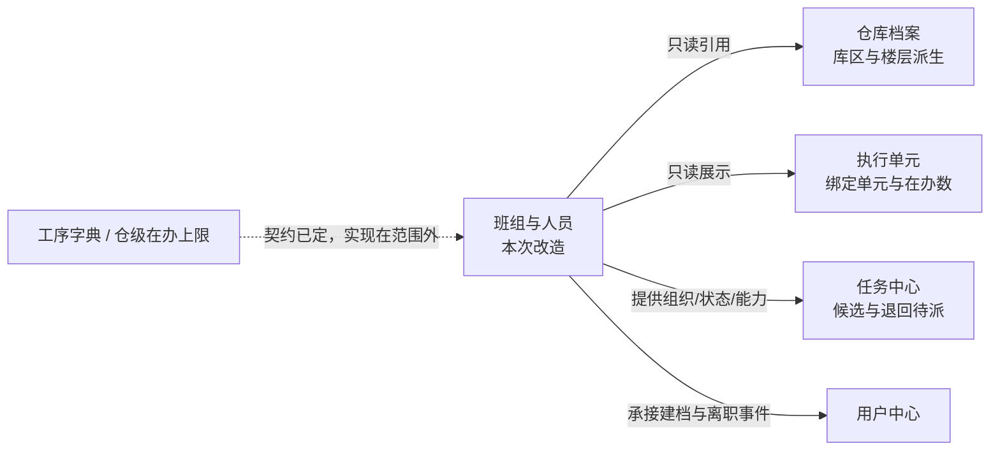

# Proposal

## Why

现有 `wms/team-staff` 只存班组编码、职能类型、组长和人员在职状态。任务中心要按楼层、区域、在岗能力和在办上限取派工候选时，这些判据没有数据落点；仓主管要确认谁归哪个组、谁会哪道工序，只能逐人查。参考 `Proto-newWMS` 的 DOC-MOD-018《班组与人员需求文档》v1，本次把组织与人力底账补齐，并按其口径替换两处与现状冲突的规则。

## What Changes

- **BREAKING** 班组停用不再要求先清空在职成员。停用只把组移出派工候选，成员归属与作业位置保留，启用后恢复；已派未开工任务退回待派、在办任务跟人做完由任务中心执行，本次只提供状态与数据。
- **BREAKING** 离职改为终态。人员状态收敛为在岗／不在岗，用 `left_pending_at` 记待处置、用 `left_at` 记离职生效；生效后不可改回在岗，重新入职按新档案建。旧的"复职恢复可选"规则作废。
- 班组扩字段：楼层（取现有关区的 `floor_no`）、管辖区域（可多选，允许一区多组）、在办上限默认（1–20 整数，空继承仓级 3）、更新时间；编号按仓取号，删除后不回收。
- 人员扩字段：角色、可做工序码集合、认证（类型加到期时间）、质检持证与质检组、待离职时间、离职时间；配置状态（已配置／待配置）按班组与能力派生，不新增状态值。
- 新增归属记录：归组、调组、组长归组、删组转未分组各写一条，含原组、新组、时间、操作人、原因；最新一条的新组必须等于当前归属。
- 新增班组删除：组员清空后二次确认删除，最后一名组长随组解除转未分组待配置，编号不复用。
- 新增组长口径：新建班组必须指定组长且选中即归组；编辑时组长只从本组成员中选；组长不可在人员抽屉直接调组，须先换组长。
- 新增调组：单人调组与批量调组。批量逐条处理，班组长、已离职、已在目标组的人跳过并逐条说明，跳过者保持勾选可重试。
- 新增派生读数：可承接工序（在岗成员能力并集）、可派人数、成员数、在岗数、区域覆盖读数（启用区域数／无组数／多组数），只读不阻断保存。
- 新增两个视图的查询定位：班组 6 类条件、人员 11 类条件，按且叠加、条件回显可逐项移除、重置、班组下钻成员。
- 前端改造 `wms_master_data/team` 与 `wms_master_data/staff` 两个页面及抽屉、批量栏、查询区；后端扩展 `wms_master_data` 插件的模型、服务、路由、菜单种子。

范围外，本次不实现但在 design 写明数据契约：楼层与库区主数据新建、工序字典、执行单元绑定与在办数统计、派工与改派、用户中心离职事件同步、仓级在办上限配置、导出字段与格式。

## Capabilities

### New Capabilities

无。本次改动落在已有的班组与人员能力边界内。

### Modified Capabilities

- `wms/team-staff`：替换停用前置条件与离职可回退两条规则；新增班组作业位置、在办上限默认、组长强制指定与更换、删除与编号不回收、归属记录、人员能力与认证、配置状态、待离职与离职终态、派生读数与查询定位的行为要求。

## Impact

- 代码：`backend/src/plugins/builtin/wms_master_data/`（models、service、api、seed）、`frontend/src/views/wms_master_data/{team,staff}/`、`frontend/src/api/wms_master_data.ts`。
- 数据：`wms_master_data_team`、`wms_master_data_staff` 加列；新增归属记录表。现有单据与任务上已记录的操作人标识不改。
- 文档：`docs/design/data-model.md`、`interface-map.md`、`ui-map.md` 随之更新；`openspec/specs/wms/team-staff/spec.md` 在归档时同步。
- 兼容：现有"停用前清空成员"与"离职可复职"两条规则作废，依赖这两条规则的调用方需要按新口径调整。
