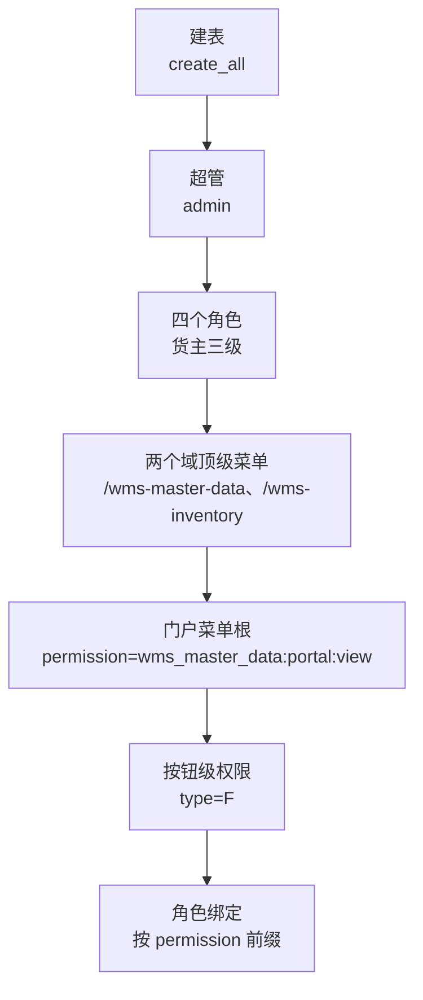
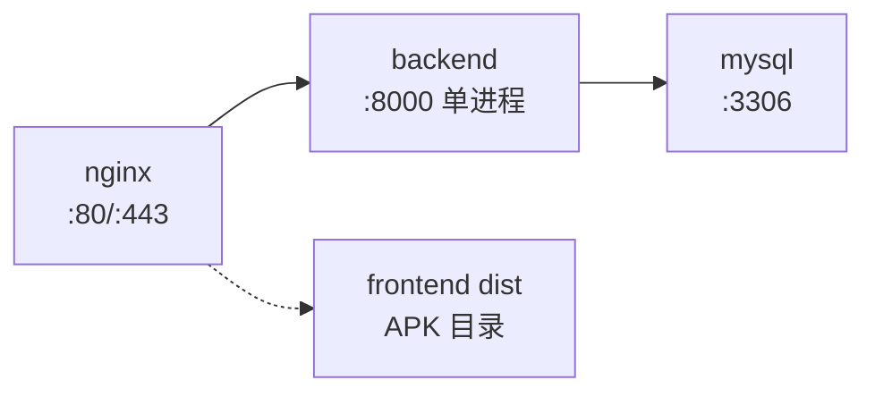

# Design

## Context

蓝图已归档，八份规格在 `openspec/specs/wms/`，详细设计在 `docs/design/`。仓库里除文档外什么都没有——没有 `backend/`、没有 `frontend/`、没有 `docker-compose.yml`。

基座是 `D:\projrct\zoo\参考代码库\ApeAdmin-master`，一套插件化的 FastAPI + Vue 工程。P0 只做搬运、改造与骨架，不写业务逻辑。

## Goals / Non-Goals

**Goals:** 一条命令起环境；主数据与库存两个插件能独立启停；菜单、角色、权限基线就位；登录后能按身份落到不同布局。

**Non-Goals:** 不实现任何业务单据；不建业务表（除账号绑定所需的两张）；不做移动端；不引入新依赖。

## Decisions

### B1 改动面锁死在三个位置

复制整个 `backend/`、`frontend/` 之后，允许改的地方只有：

| 位置 | 改什么 |
|---|---|
| `.env` / `docker-compose.yml` | 应用名、库名、密钥、跨域、字符集、时区 |
| `src/core/seed.py` | 角色基线、菜单基线、示例清理 |
| 新增 `src/plugins/builtin/wms_*/` | 两个插件包 |

`src/core/deps.py`、`src/plugins/base.py`、`src/plugins/manager.py`、`src/models/` 一律不动。理由是基座升级时要合 diff，改动面越大越难合；而这三处之外的东西，后续每期都要改，早晚会与上游分叉。

**唯一的例外是前端布局**：`src/layout/` 下新增两个布局组件、`router` 里加一段落点逻辑，这属于新建文件，不是改基座。

### B2 两个插件，一个有肉一个空壳

P1 真正用到的只有主数据与库存，所以 P0 只建这两个。其余八个域等各自期次开工时再建——一次造八个空包，验证不了什么，还多八份要维护的 `plugin.json`。

| 包 | 内容 | 依赖 |
|---|---|---|
| `wms_master_data` | `models.py`（两张表）、`api.py`（`GET /me/portal`）、`seed.py`（域菜单 + 门户根 + 四个角色）、`plugin.py`（建表 + seed + 挂路由） | `[]` |
| `wms_inventory` | 只有 `__init__.py`、`plugin.json`、`plugin.py`；`install`/`register` 空实现 | `["wms_master_data"]` |

`plugin.json` 字段照基座：`name` / `display_name` / `version` / `description` / `author` / `dependencies`。

**依赖链只有两层**，比原计划的十插件方案弱，验证点收敛为一条：停用主数据后再启用库存必须被拒。这条能过，说明依赖校验机制是通的；八层链也只是重复同一件事。

两个包的 `install()` 都必须幂等——重复启用不重复建表、不重复 seed 菜单与角色。

### B3 P0 要建两张业务表

蓝图把账号体系放在 P1，但 P0 的验收里有"货主账号落到门户"，这条依赖 `wms_master_data_user_owner` 有没有记录。所以 P0 提前建两张最小的表：

| 表 | 字段 |
|---|---|
| `wms_master_data_owner` | id, code, name, sync_enabled, status |
| `wms_master_data_user_owner` | id, user_id, owner_id, is_primary, status；`user_id` 唯一 |

`sync_enabled` 是接仓网时定的字段（是否接入上游 ERP），P0 建表就带上，省得 P1 再走 ALTER 补丁。

不建外键（跨域不建外键是既定约定，这里是同域但表还没齐）。`/api/v1/wms-master-data/me/portal` 查询有无绑定记录，返回布尔。

这是对蓝图期次的一处微调，代价是 P1 要多做一次"补字段"的补丁。收益是 P0 的交付完整、前端落点逻辑一次做完。

### B4 seed 顺序与幂等

初始化按固定顺序跑，每步都以 `code` 或权限标识判重：



角色只建四个：基座自带的 `admin`，加 `wms_owner_admin`、`wms_owner_operator`、`wms_owner_viewer`。其余岗位角色（收货、上架、拣货、复核、盘点、只读员工）跟着菜单一起加——P2 有收货菜单时再建收货员，现在建了也没菜单可绑。

菜单与角色都放 `wms_master_data/seed.py`，因为门户根的权限归主数据域，其余角色的授权也全指向前两个域的菜单。`core/seed.py` 不碰业务数据。

**示例插件菜单不删，只停用。** `dev_example`、`apehub_web`（插件市场）、`apeui`（组件演示）的菜单留记录、`status=0`。理由与 MCP 一致：删了以后重装插件会重新冒出来，停用是稳定的。

**MCP 与 AI 助手同样处理**：`MCP_ENABLED=false`，六个菜单 `status=0`。

### B5 三个布局根与落点判定

```
layout/index.vue          后台（基座自带）
layout/OwnerLayout.vue    门户，新建
layout/MobileLayout.vue   作业端，新建，P5 才用
```

登录成功后，前端调一次 `GET /api/v1/wms-master-data/me/portal`：

- 返回 `true` → 跳 `/owner/dashboard`
- 返回 `false` → 走原有 `/dashboard-monitor`

**不改基座 `/auth/userinfo`。** 多一次请求换掉对 core 的侵入，这个交易划算——`userinfo` 一旦被改，升级基座时必然冲突。

三个布局各有自己的侧边栏渲染逻辑，但都消费同一份菜单树，靠顶级目录的 path 前缀分流。

### B6 启动校验宁可吵死

启动时校验四件事，任何一项不符就抛异常退出：

| 校验 | 不符时 |
|---|---|
| 数据库排序规则 = `utf8mb4_0900_ai_ci` | 拒绝启动，打印实际值 |
| 会话时区 = `+08:00` | 拒绝启动 |
| 进程数 = 1 | 拒绝启动 |
| 关键配置非空 | 拒绝启动 |

**不做"警告后继续"。** 排序规则不一致导致的唯一索引失效不会报错，只会在某天出现"这张单建不出来"，排查成本远高于启动时拦住。

### B7 Compose 三容器，只有 MySQL 有状态



MySQL 挂数据卷，`my.cnf` 写死字符集与时区。backend 与前端的静态产物通过 volume 或镜像内建，不放数据库。nginx 同时服务前端静态文件与反向代理 `/api`。

本地开发不跑这套：`docker-compose.dev.yml` 只起 MySQL，后端前端在宿主跑热重载。全栈 compose 留给发布前验证与部署。

Windows 上不要指望容器内的热重载——源码目录挂进容器后 inotify 事件不跨挂载传递，`--reload` 和 Vite HMR 经常不触发。所以容器负责"一次跑通"，宿主负责"改一行看一行"。

## Risks / Trade-offs

- **P0 建了两张本该属于 P1 的表** → P1 要补字段时走 `patches.py` 幂等 ALTER，成本一次。换 P0 交付完整，值得。
- **依赖链只有两层，验证力弱于十插件方案** → 只保留一条硬验证：停主数据后启库存必须被拒。八层链也只是重复同一件事，代价接受。
- **插件骨架的依赖链会挡住启用顺序** → 必须先启主数据再启库存。这既是约束也是验收点，写进 tasks。
- **启动校验过严，开发机容易被拦** → 只在非 SQLite 模式下校验排序规则与时区；SQLite 模式下跳过这两项，但保留单进程校验。
- **菜单基线手工维护容易漏** → seed 用 code 判重，漏了就用"重复执行"补。所以初始化必须幂等，这条不可省。
