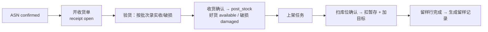

# Design

## Context

P1 交付了主数据与库存记账：`post_stock` 的四道闸（锁行、幂等、非负、同事务）已实测通过，并发扣减不会双扣。

P2 第一次在生产路径上调用它。设计要点不是"怎么记库存"，而是"什么时候记、按什么粒度记、错了怎么退"。

## Decisions

### I1 收货确认时才过账，不是上架时

好货入收货暂存位（`receiving` 类型库位的 `available` 状态），破损入同一库位的 `damaged`。

**为什么不等上架才入账**：货在月台放着，账面必须已经认它。等上架才记，月台丢一件系统完全不知道。代价是账实之间有一个已知窗口（货在月台但账在暂存位），这个窗口是必须付的。

### I2 一个 ASN 挂多张收货单

分批到货是常态。`receipt.asn_id` 不唯一，每张收货单独立入账、独立上架。

收不满时用「结案」把 ASN 从 `receiving` 推到 `received`，未收差额定性为放弃。不结案的话单据永远挂着。

### I3 批次在收货时录，按批次拆行

货主预报时不知道批号，批号印在实物外箱上。所以 `receipt_lot` 是收货环节的表：一个 `receipt_line` 对多个批次，各批次数量之和必须等于该行实收。

跨域契约新增 `inventory.ensure_lot(owner_id, sku_id, lot_code, production_date, expiry_date)`：批号存在则复用并校验效期一致，不一致直接拒绝——一个批号两个效期，先进先出就无从算起。

**幂等键含 `lot_id`**。同一次收货把同一商品拆成两个批次，键里没有批次的话，第二批会被判为重复而丢掉。

### I4 选位：三条优先级 + 温区软约束

专属库位 → 同商品就近合并 → 按仓型。酸奶要求冷藏时先筛 `temp_zone=chilled`，筛不到再放开，但 `putaway_line.temp_mismatch` 置真。

硬拦会让"冷藏区满了"变成"无法收货"，而货已经在月台了。系统能做的只有优先放对、放错了记住。

### I5 留样在上架完成时生成

收货时算出留样数量（按实收 × 比例，向上取整后封顶），拆成一条独立的上架行指向 `sample` 库位。那一行扫完，才写 `sample` 记录。

这样留样记录一出现，它记的库位就是真的。

### I6 破损处置只开两条路

P2 只做 `restock`（转回可发）与 `scrap`（报废减量）。`return_owner` 需要出库能力，等 P3。

处置记录放新建的 `wms_returns` 插件里——它比同域的退货单早三个期次，因为破损货在 P2 就会产生，不给出口就会一直堆在暂存位。

### I7 对外接口用独立请求头，不复用 JWT

`X-API-Key` + `/api/v1/open/v1`。基座的 `get_current_user` 绑死 `Authorization: Bearer`，货主系统不该为了调几个接口去换 token。

密钥存 sha256 哈希，明文只在签发时返回一次；按 `key_prefix` 能认出来是哪一把。

## Risks / Trade-offs

- **P2 是第一个大量写库存的期次** → P1 的记账契约已在并发下调通，但真实路径有"同一 ASN 多次收货"、"同批次多行"这类组合，验收要覆盖。
- **留样数量按实收算**，比例敏感时可能与货主预期差一件 → 在门户与服务订单详情里显示计算过程（实收 × 比例 = 留样数）。
- **温区不匹配放行** → 靠 `temp_mismatch` 标记回查，不拦。这条在 D23 里已经认过。
- **破损处置不做审批** → 记录谁、何时、处置多少、什么原因，不做状态机。单仓场景下审批会让人绕过系统。
