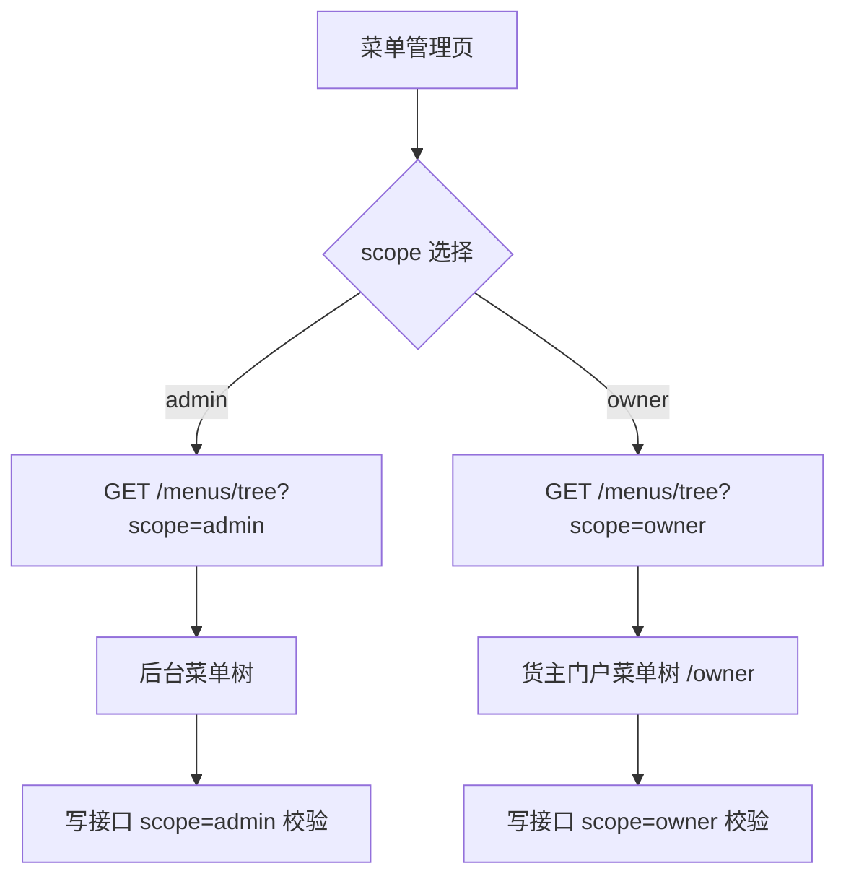

# Design

## Context

菜单归属的判定规则在 `backend/src/plugins/manager.py:226-245`：插件停用时，按 `permission.startswith(f"{name}:")`、`component == name`、`component.startswith(f"{name}/")`、path 命中 `/{name}` 四类前缀匹配菜单行，命中即置 `status=0`。菜单树构建 `backend/src/core/deps.py:147-168` 只按 `parent_id` 递归、过滤 `status==1`，不区分门户与后台。

门户菜单的顶级目录 `/owner` 当前归主数据域（`permission=wms_master_data:portal:view`），其下所有子菜单的 component 与 permission 也都挂 `wms_master_data`，所以停库存/入库/出库域不会影响门户入口。前端侧栏与动态路由靠 `path==='/owner'` 单点过滤（`ApeSidebar.vue:145-152`、`router/index.ts:13-16`），这一点不依赖归属标签。

后台菜单管理页 `frontend/src/views/system/menu/index.vue:9-15` 把 `getMenuTree()` 的全量树直接渲染，没有分区；后端 `/menus/tree`（`api/menu.py:46-54`）没有筛选参数。

## Goals / Non-Goals

**Goals:**

- 让门户各入口的域归属标签与实际业务域一致，域停用能正确收起对应入口。
- 后台菜单管理页分成"后台菜单"和"货主门户菜单"两棵树，管理员分开维护。
- 保持前台两端隔离不变：后台侧栏不出现门户菜单，货主侧栏不出现后台菜单。

**Non-Goals:**

- 不迁移门户页面文件目录——页面继续放在 `frontend/src/views/wms_master_data/portal/`，component 路径不改物理位置（见 Decisions 第 2 条）。
- 不改角色绑定机制、`role_menu` 表结构、插件停用匹配规则本身。
- 不新增独立的门户菜单表；两端仍共用 `sys_menu`。

## Decisions

### 1. 域归属用 `permission` 前缀表达，不动 `path`

`manager.py` 的四条匹配规则中，`permission` 前缀和 `component` 前缀都能表达域归属。选择只改 `permission` 前缀：

- 入库预报 → `wms_inbound:portal:asn:create`
- 出库订单 → `wms_outbound:portal:order:create`
- 库存查询 → `wms_inventory:portal:stock:view`
- 账单查询 → `wms_billing:portal:bill:view`（无插件时不注册该菜单，等计费域落地再补）
- 商品档案、概览、子账号 → 保持 `wms_master_data:*`

`path` 全部不动，`/owner` 子树结构原样保留。前端 `path==='/owner'` 过滤继续有效，不会把门户菜单漏到后台侧栏或动态路由。

**被否决的方案**：同时改 component 前缀到 `wms_inventory/portal/stock/index`。那要求迁移页面目录，且 `manager.py` 的 component 前缀规则会让停 `wms_inventory` 时后台库存页面组件与门户组件一起被匹配——虽然菜单行是独立的，但给后续维护多一条耦合路径。用户明确说"不把货主自助端跟 admin 端混到一起"，保持在 `wms_master_data/portal/` 物理目录反而是更清晰的隔离。

### 2. 页面文件不迁移，component 保持原值

component 列继续指向 `wms_master_data/portal/*`。这看起来与"归属库存域"矛盾，但 component 是**前端组件路径**，不是业务归属；归属由 `permission` 表达。设计文档 `ui-map.md` 规划了 component 也按域分目录，但那是物理组织偏好，不是行为要求。本次按"最小改动 + 用户明确不想混目录"取舍。

### 3. 菜单树接口加 `scope` 参数，默认全量兼容

`GET /menus/tree?scope=admin|owner`：

- `scope=admin`：返回 `path != '/owner'` 的顶级分支及其子树
- `scope=owner`：返回以 `/owner` 为根的整支
- 不传 `scope`：返回全量树，保持现有调用不变

实现上在 `crud_menu.get_tree` 之后、`_build_menu_tree` 之前按根节点过滤，避免改树构建逻辑。

### 4. 写接口按 scope 校验归属，前端传隐藏字段

菜单新增/编辑请求体加可选 `scope` 字段，后端校验：

- `scope=owner` 时，新建菜单 `parent_id` 必须是 `/owner` 子树内的节点或 0（此时强制挂到 `/owner` 下）
- `scope=admin` 时，`parent_id` 不得指向 `/owner` 子树
- 编辑时若跨端移动父节点，拒绝

前端管理页在当前视图的 dialog 表单里带入 `scope`，用户看不到这个字段。这样即使管理员手动构造请求，也不能把两端菜单混在一起。

### 5. 既有数据靠增量 seed 迁移，不写一次性 SQL

`_ensure_menu` 目前按 name+parent 定位；扩展为定位到已有行后，若 permission/component 与期望值不同则 UPDATE。重复执行 seed 是幂等的。账单菜单在 `wms_billing` 插件不存在时不创建（避免建一个永远灰掉的入口）；设计文档里的"我的账单"等计费域落地后由该插件自己 seed。

### 6. 菜单管理页用顶部 Radio 切换两棵树

不拆成两个路由、不做两个页面文件。在 `menu/index.vue` 顶部加 `el-radio-group`（后台菜单 / 货主门户菜单），切换时以不同 `scope` 重新拉树；表格、新增、编辑、删除逻辑复用同一套，只在提交时带上当前 scope。这样改动集中在一个文件，不产生重复 UI 代码。

## Risks / Trade-offs

- [单点 path 过滤仍存在] 前端两端隔离只靠 `path==='/owner'` → 接受；本次不改 path，风险不变。若将来要改 path，需同步改两处过滤。
- [permission 前缀变更影响角色权限] 货主角色的 `role_menu` 绑定的是菜单 id，不是 permission 字符串，所以绑定不受影响；但 `get_user_permissions` 从菜单 permission 收集权限集合，货主会拿到新的 `wms_inventory:portal:stock:view` 等权限——这是期望行为，且这些权限只用于门户页面展示控制，不开放仓库写接口。
- [停主数据域仍收起整个门户] 顶级 `/owner` 和商品档案归主数据 → 符合 spec，接受。
- [账单菜单暂缺] 设计文档规划了账单入口，但无计费插件 → 本次不创建，避免灰色入口；在 tasks 里记录为后续计费 change 的接入口。

## Migration Plan

1. 后端：扩展 `_ensure_menu` 支持字段回填；改 seed 里门户菜单的 permission 前缀；`/menus/tree` 与写接口加 scope 校验。
2. 重启后端触发 uvicorn `--reload`，重新执行 seed 使既有菜单行前缀更新；或手工执行 `python -m src.cli seed`。
3. 前端：菜单管理页加 scope 切换；验证两棵树各自独立，新增/编辑不能跨端。
4. 验证：停 `wms_inventory` 域后重新登录 own001，库存查询入口消失、其他入口仍在；后台侧栏不出现门户菜单。
5. 回滚：恢复 seed 里的 permission 前缀并重跑 seed；前端回退 scope 切换代码。

## Open Questions

无。
