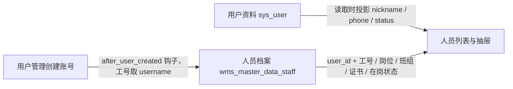

# Design

## Context

`wms_master_data_staff` 当前有独立的 `name`、`phone` 列，人员页直接编辑；`user_id` 唯一且可空，只用于按账号反查在职人员。任务领取与提交按 `sys_user.id` 判定，`wms_tasking` 不从档案取人。基座用户管理只有 `nickname`、`phone`、`status` 三个可复用的人员字段，没有工号、岗位、班组与证书。

改动覆盖基座用户创建链路、`wms_master_data` 的人员字段来源和人员页入口，不改任务领取的身份判定，不给用户管理页面加工号字段。货主主账号由 `create_owner` 直接创建，不走用户管理创建接口。

## Goals / Non-Goals

**Goals:**

- 用户管理作为人员姓名、手机、账号状态的唯一来源。
- 用户管理创建账号即生成档案；人员页只维护 WMS 专有字段，不再新建人员。
- 历史无账号档案可留存但不作为在岗作业人员；临时工与正式员工共用账号身份，后续计薪挂同一 `user_id`。

**Non-Goals:**

- 不给用户管理加工号、岗位、班组或证书字段；工号直接取 `username`。
- 不拆货主账号表；货主账号独立管理另立变更。
- 不改账号状态与在岗状态的映射，不改派工候选口径。
- 不改既有单据与任务上已记录的操作人。
- 不做计时／计件、费率与劳务结算；任务完成数量、工时与结算单留给 `labor-settlement` 变更。

## Decisions

### 1. 人员字段读取时投影，不写回

人员列表、抽屉和按账号查询在返回前按 `user_id` 批量取 `sys_user` 的 `nickname`、`phone`、`status`，覆盖档案行里的对应展示值。人员档案表不新增列，已有 `name`、`phone` 列保留以兼容非空约束和历史数据，但不再是展示来源；建档时仍写入账号当前值，用户后续改名不回写档案。

未选账号的历史档案没有投影源，展示档案行自身的值，按封存规则固定为不在岗。

备选：在用户管理更新接口里写时同步到档案表。放弃，因为要在基座接口引入插件依赖或新增广播钩子，改动面比读取投影大，且用户资料由其它入口变更时仍会漏同步。

### 2. 用户创建时自动生成档案

在插件基类与管理器增加 `after_user_created` 钩子，沿用 `before_login` 的调用模式。基座 `src/api/user.py` 在 `crud_user.create` 提交后、分配角色前调用钩子；`wms_master_data` 插件检查用户名：预置 `admin` 直接跳过，其余用 `username` 作工号调用 `create_staff`，姓名与手机从账号带入。钩子失败时基座删除刚创建的账号并把错误返回调用方，避免留下无档案账号。

`POST /staffs` 保留为内部写入口，入参仍是 `code`、`user_id`、`role`，供钩子与补建脚本复用；人员页不再直接调用。

### 3. 账号状态只读且与在岗状态解耦

`sys_user.status` 投影到人员页的账号状态列，不写 `WmsStaff.status`。在岗、待离职、离职仍由人员档案自己的状态机管理；派工候选口径保持"在岗且有可做工序"，不把账号状态加进判据。理由：账号禁用是临时操作，离职是不可回退终态，两者混在同一列会破坏现有离职规则。

### 4. 历史无账号档案用一次性数据封存

升级时执行幂等 SQL，把 `user_id IS NULL` 且 `status = 1` 的档案置为不在岗并记一条排除原因的档案日志；不删行、不改 `code`、不回填账号。已有班组归属保留但不再计入在岗数与派工候选。随后按 `username` 为已有非预置管理员、未软删、未绑货主且尚无档案的账号补建档案，跳过工号冲突的行。旧档案不复用。

### 5. 账号删除不触发档案删除

用户管理是软删除，账号行仍在，投影照常读取；界面不再把它当作可登录账号。人员档案和既有单据不做级联处理。

## Risks / Trade-offs

- 档案表保留不再作为来源的 `name`、`phone` 列，读旧代码时容易误用 → 读取路径统一走投影，建档之外不再写这两列；文档标注其兼容用途。
- 分页列表投影需要额外查一次用户表 → 用 `IN` 批量取，每页上限沿用现有 100 条。
- 历史封存会把无账号人员移出在岗统计 → 升级前给出受影响名单，由仓库确认后再执行。
- 用户改名后既有单据上显示的是当时记录的操作人 → 按现有规格保留原值，不做追溯改写。
- 钩子失败会打断建账号请求 → 只在角色分配前调用，失败即删除刚建的账号并返回原错误，不留下半创建状态。
- 去掉新建入口后老账号无法补档 → 升级脚本按 `username` 补建，跳过 admin、货主账号与工号冲突行。

## Migration Plan

1. 升级前导出 `user_id IS NULL AND status = 1` 的档案清单，以及待补建的账号清单供确认。
2. 部署后端与前端改动：用户管理建账号走自动生成钩子，人员页移除新建入口。
3. 执行封存 SQL 与补建 SQL，重复执行不产生第二条日志或重复档案。
4. 抽查新建普通账号、admin、货主主账号的档案生成结果；抽查改名、禁用、删除后的展示与派工读数。
5. 回退：恢复部署前一版前后端，并从备份恢复被封存档案的 `status`；补建出的档案保留，不回滚用户数据。

## Open Questions

无。
