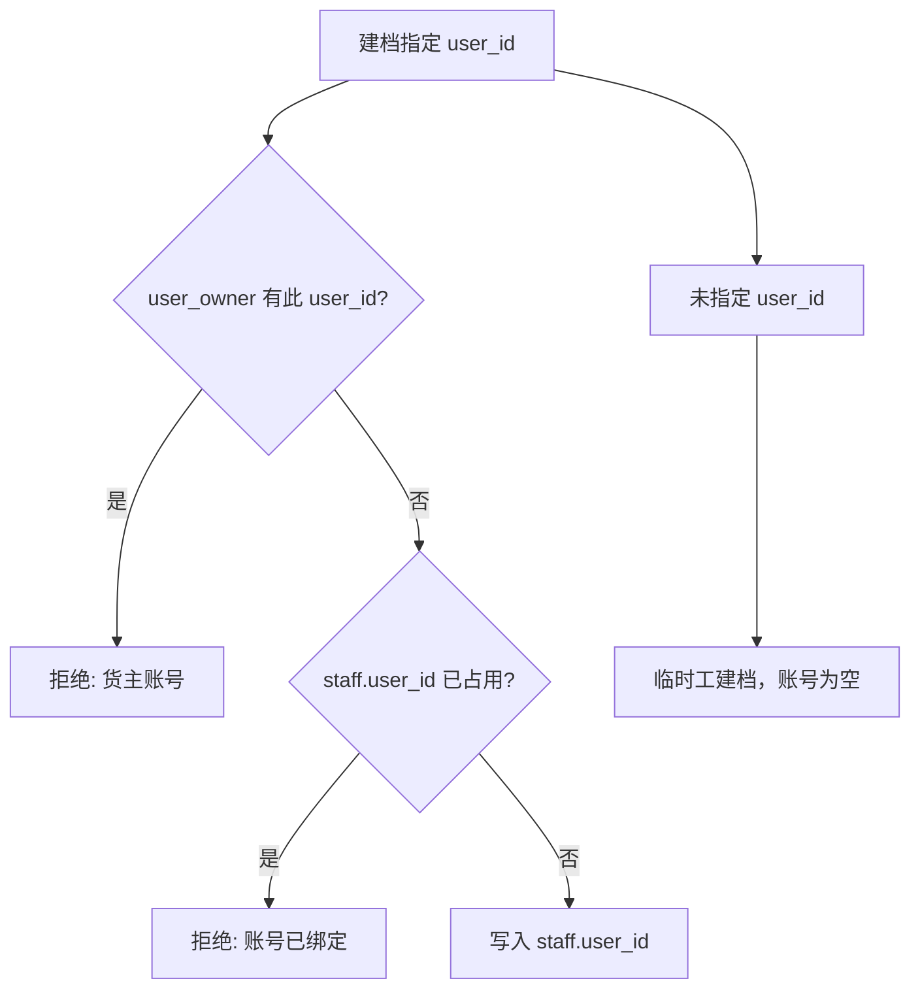
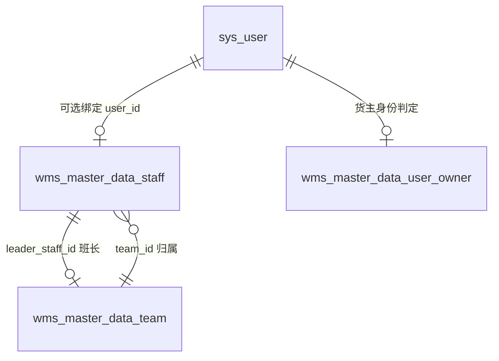

# Design

## Context

人员与班组是被单据和任务引用的静态事实，按 `wms/domain-map` 的归属原则落在主数据域。现有 `backend/src/plugins/builtin/wms_master_data/` 已经承载仓库、货主、库区、货品、合作方等同类实体，前端页面由 `seed.py` 注册的菜单 `component` 与 `frontend/src/views/` 下的 `index.vue` 对齐后动态生成路由。关系和落点见 proposal.md，行为契约见 `specs/wms/team-staff/spec.md`。

## Goals / Non-Goals

**Goals:**

- 在现有主数据插件内补齐人员与班组两张表及其 CRUD，不引入新插件或新域。
- 把账号绑定、班组归属、班长资格三类约束收敛到 service 层，接口层只做入参边界归一化。
- 提供供后续派工与统计使用的账号到人员映射查询，且不改变既有 `operator_id` / `assignee_id` 的语义。

**Non-Goals:**

- 不修改 `sys_user` 表，不给账号增加人员属性字段。
- 不建排班、考勤、工时相关表与页面。
- 不提供账号改绑接口，不提供班组或人员的物理删除接口。
- 不改任务派工、工单工序链、入库出库等既有业务域的状态机与字段。

## Decisions

### 1. 扩展 `wms_master_data`，不新建插件

人员与班组符合主数据域"被引用的静态事实"定义。新建独立插件会让插件启停、菜单认领前缀、跨域依赖都多一条分支，而它们本身不产生库存或作业状态。

备选：新建 `wms_staff` 插件。代价是要新增一套 `_TABLES`、菜单前缀、权限前缀，还要处理与主数据域的依赖声明，本期没有对应的独立启停诉求，不采用。

### 2. 账号绑定字段放人员侧，引用 `sys_user.id`

`wms_master_data_staff.user_id` 存 `sys_user.id`，可空；空值即临时工。判定是否货主账号查 `wms_master_data_user_owner.user_id`，该表在现有 `plugin.py:115` 已用于登录落点判断，复用同一事实来源。

备选：在 `sys_user` 加 `staff_id`。会改动基座模型，且把业务域字段反向塞进用户表，与现有 `WmsUserOwner` 的做法不一致，不采用。

### 3. 两张表不建物理外键，状态用 `status`

`staff.team_id` 与 `team.leader_staff_id` 互相引用，建物理外键会让建表与卸载顺序成环。两表同属一个插件，归属与班长资格统一由 service 校验，不靠数据库兜底。人员离职用 `status=0` 表示，不再叠一层 `is_deleted`，避免两种"失效"语义并存。

| 表 | 字段 | 约束 |
|---|---|---|
| `wms_master_data_team` | id, code, name, function_type, leader_staff_id, status, remark | `code` 唯一；`leader_staff_id` 可空，指向 staff.id |
| `wms_master_data_staff` | id, code, name, phone, user_id, team_id, status, remark | `code`（工号）全仓唯一；`user_id` 可空且唯一；索引 `(team_id, status)` |

`function_type` 取 `receiving / putaway / picking / sorting / checking / shipping / internal_ops / other`，`status` 取 `0` 停用或离职、`1` 启用或在职。两表都继承 `IDMixin, TimestampMixin, Base`，不继承 `SoftDeleteMixin`。

### 4. 职能类型用固定枚举，不建职能字典表

用户要的是按职能编组，不是可配置的多维分类。枚举落在模型校验和前端下拉，几行代码就能覆盖八种职能；建字典表会多出一张维护页和一套关联校验，本期没有改职能定义的场景。

备选：允许自由填写职能名称。会让派工按职能过滤时无法归一，不采用。

### 5. 调组与班长变更走独立端点

`staff.team_id` 不通过通用编辑接口修改，只经 `POST /staffs/{id}/team`；`team.leader_staff_id` 只经 `PUT /teams/{id}/leader`。这样"成员唯一归属""班长须为本组成员且在职""停用班组须无在职成员"三条判断只在 service 的两个入口出现，接口层不重复校验。

备选：把 `team_id` 和 `leader_staff_id` 塞进通用 `PUT`，在多个入口分别校验。会出现同一字段的判断分散，不采用。

### 6. 账号只在建档时绑定

建档后可改状态、调组，但不提供改绑接口。需要换绑时把原档案置为离职、新建档案。这样账号与人员的历史对应关系不会被覆盖，也避免绑定校验在新建和编辑两条路径各写一遍。

备选：提供 `PUT /staffs/{id}/user`。多一条校验路径且无本期诉求，不采用。

## 接口与权限

`team`、`staff` 都不提供删除接口，离职与停用通过状态实现。

| 方法 | 路径 | 权限 |
|---|---|---|
| GET | `/wms-master-data/teams` | `wms_master_data:team:list` |
| POST | `/wms-master-data/teams` | `wms_master_data:team:create` |
| PUT | `/wms-master-data/teams/{id}` | `wms_master_data:team:edit` |
| PUT | `/wms-master-data/teams/{id}/leader` | `wms_master_data:team:edit` |
| POST | `/wms-master-data/teams/{id}/toggle` | `wms_master_data:team:edit` |
| GET | `/wms-master-data/staffs` | `wms_master_data:staff:list` |
| POST | `/wms-master-data/staffs` | `wms_master_data:staff:create` |
| PUT | `/wms-master-data/staffs/{id}` | `wms_master_data:staff:edit` |
| POST | `/wms-master-data/staffs/{id}/team` | `wms_master_data:staff:edit` |
| GET | `/wms-master-data/staffs/by-user/{user_id}` | `wms_master_data:staff:list` |

前端落点：`frontend/src/views/wms_master_data/team/index.vue`、`frontend/src/views/wms_master_data/staff/index.vue`；API 追加到 `frontend/src/api/wms_master_data.ts`；菜单与按钮权限在 `backend/src/plugins/builtin/wms_master_data/seed.py` 注册，`component` 分别为 `wms_master_data/team/index` 与 `wms_master_data/staff/index`。

## Risks / Trade-offs

- **班长与归属靠应用层校验而非外键**：调组、离职、停用三条路径都必须触发班长清空或成员计数。缓解方式是把这些动作收敛到 service 的两个写入口，并在规格里逐条列了场景，实施时按场景逐条对照。
- **临时工作业记录仍无法指向人员**：既有 `operator_id` 指向账号，本次不改。缓解方式是保留账号到人员的映射查询，后续派工或作业域改造时按映射补齐，不在本期偷改字段语义。
- **工号人工录入**：不接 `sequence` 自动取号，重复由唯一索引拦截并提示。这符合工号在仓库内本来就是外部分配的现实，不额外建取号逻辑。

## Migration Plan

新表走现有插件安装机制：把两个 `__table__` 加入 `wms_master_data/plugin.py` 的 `_TABLES`，升级后重新执行插件安装即建表，重复执行安全。不需要 Alembic 版本脚本，不需要 `patches.py`——本期不往既有表加列。

菜单与按钮权限由 `seed.py` 幂等补录，已有环境不会重置既有角色绑定。回滚时停止使用新页面，执行插件卸载会按前缀清掉两张表和菜单，但既有业务数据不引用这两张表，回退不丢数据。

实施时需同步更新 `docs/design/data-model.md` 的主数据域表清单和 `docs/design/interface-map.md` 的权限与路由表，否则详设与代码不一致。
