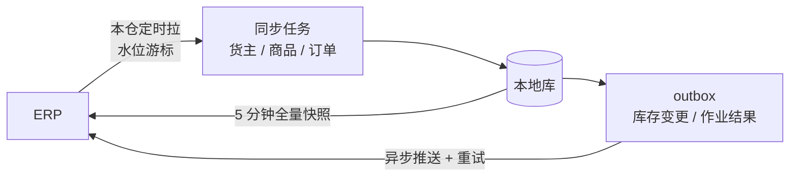

# Design

## Context

huolingWMS 独立部署在仓库内网，自己的库、自己的账号，但在业务上是仓网的一座仓。上游是 ERP（货主、商品、订单）与仓网（建仓信息、库存汇总）。

已归档的规格把货主当作直接客户：货主自己建商品、自己下单。接仓网后主线变成"上游为主、本仓执行"。

## Decisions

### S1 两套编码并存，各管一段

| 编码 | 字段 | 生成方 | 唯一约束 | 用途 |
|---|---|---|---|---|
| 仓库编码 | `sku.code` | 本仓 | 全仓唯一 | 库位标签、拣货单、作业沟通 |
| 货主编码 | `sku.owner_sku_code` | 上游或货主 | `(owner_id, owner_sku_code)` | 报文、同步匹配、货主报表 |

仓库编码规则：`SKU` + 6 位数字，新建时自动取号（走已有的序列表，前缀 `SKU`）。允许仓库改，改时校验全仓唯一。

**这两个编码不能合并成一个。** 货主编码在不同货主之间必然重复（都用 `A001`），仓库编码必须全局唯一才能贴在货架上。而库内作业不该依赖货主自己的编码习惯——货主改编码不该导致标签重贴。

同步匹配键固定为 `(owner_id, owner_sku_code)`。仓库编码对方不知道，也不该知道。

### S2 下行用拉、上行用推

**下行只能拉，不能等推。** 本仓部署在仓库内网，没有稳定的公网入口，ERP 主动 POST 过来不可靠。所以本仓定时（5 分钟）按水位游标拉增量，另支持手工立即拉。

**上行只能推。** 出站请求总能通（NAT 后也能出），所以库存与作业结果由本仓主动推给 ERP。

代价：订单延迟最多 5 分钟。对 3 万单/天的仓，如果 ERP 侧要求秒级下发，就得给本仓开一个受控的公网入口——那是另一个部署决策，不在本次范围。

### S3 上行先落本地再推

库存变更与作业结果不直接调上游接口，而是先写 `wms_integration_outbox`（同事务），再由后台任务推送。

理由：推送失败不能回滚本地已提交的库存。outbox 表保证"本地成功 = 一定会推出去"，只是可能晚。

| 字段 | 说明 |
|---|---|
| id | 主键，同时作为幂等标识推给上游 |
| event_type | `stock_changed` / `receipt_done` / `shipment_done` |
| payload | 事件内容 |
| status | `pending` / `sent` / `failed` |
| retry_count / next_retry_at | 指数退避 |
| created_at / sent_at | — |

**幂等靠 id。** 上游按 id 去重，重复推送不重复扣减。

### S4 全量快照兜底

每 5 分钟推一次全量可发库存（按货主 × 货品 × 批次汇总）。它不替代事件，是校准手段：断线期间丢的事件，靠快照对齐。

快照走独立的定时任务（APScheduler），与事件推送互不影响。

### S5 货主开关控制建单

`wms_master_data_owner` 加 `sync_enabled`。

- `true`：门户与对外接口的建单入口关闭，只能查询
- `false`：照常建单

切换时，已建的未发货单据仍可处理完——中途关掉入口不能让在途的单卡住。

### S6 三类数据一张表记日志

沿用已有的 `wms_integration_sync_log`，加两个字段区分方向（`inbound` / `outbound`）与对象类型。不新建日志表。

## Risks / Trade-offs

- **5 分钟拉取延迟，订单可能晚到** → 大促期间手工触发或临时改频率。真要秒级就得开公网入口，属于部署层面的决定。
- **两套编码增加录入与培训成本** → 界面上仓库编码为主、货主编码为辅（小字显示）。作业员只认仓库编码，货主编码只在对接与查单时出现。
- **outbox 表会积压** → 上游长时间断线时，pending 记录持续增长。加一条：超过 10 万条时告警，超过 50 万条时丢弃最老的事件并标记"需全量重推"——反正有快照兜底。
- **全量快照对上游客服不友好** → 三万单的仓，可发库存行数可能十万级。快照按货主分页推，单次不超过 5000 行。
- **上游字段只读会让本地运维抓狂** → 提供"解除同步"开关（改 `sync_enabled=false`），让本仓临时接管，但会在日志里标记，事后可查。
