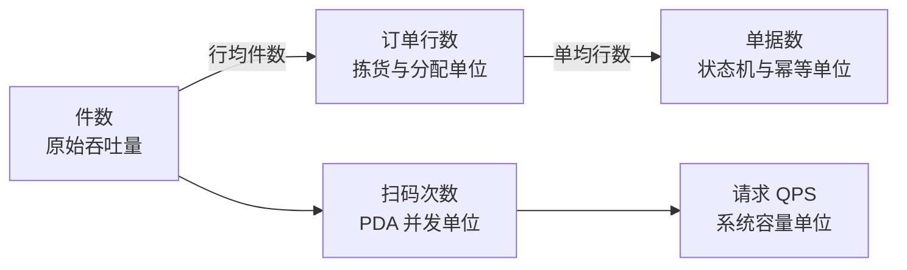

# Design

## Context

现有容量基线写在 `docs/design/tech-stack.md`：日 3 万单、峰值 6250 单/小时、扫码峰值 10 次/秒、总请求约 50 QPS，单机 4C8G、单进程、不分库分表、不上缓存。对标仓库给出的是 8 层、10 货梯、300 PDA、日 100 万件、一楼收货区 3000㎡、其余每层 8000㎡。本变更要判断现有系统在该规模下的行为边界，规格见 `spec.md`。

## Goals / Non-Goals

**Goals:**

- 给出件/行/单的换算口径与峰值测算方法，使容量数字可复现、可核对。
- 给出瓶颈定位路径与压测验收口径。
- 根据压测结果决定是否推翻 tech-stack 的部署决策。

**Non-Goals:**

- 不写设备选型、货梯参数或服务时间；按项目规则这些进设备模型文档，并标注为基准场景。
- 不预设"必须上 Redis / 分库分表 / 多 worker"，结论由压测数据决定。
- 不改变业务行为与 8 份常驻规格。

## Decisions

### 以件为原始量，行与单为派生量

现有基线把"3 万单"当容量锚点，对标仓库给的是"100 万件"，两者不能直接相除。以件为原始量、用可配置系数派生行与单，才能把两组数字放进同一张表〔1〕。

### 峰值按时间窗口分层，不用单一倍数

容量测算分日总量、峰值小时量、峰值每秒量三层，各层用各自的峰值系数。现有基线用 2.5 倍峰值系数、12 小时作业时长得出 50 QPS〔1〕；300 人 × 每人每分钟 20 次扫码的口径给出约 100 QPS 扫码峰值〔1〕。这不是最终结论，是压测的输入参数。

### 一楼 3000㎡ 作为周转约束输入，不作为建筑常量

按行业算法，收货区面积 = 日到货峰值托数 × 平均滞留天数 × 单托占地面积〔2〕。一楼 3000㎡ 占总面积约 5%，低于收货区 10–15% 的经验比例〔3〕，意味着滞留时间必须短。这个约束转化为"收货到上架的时长上限"，进入压测场景，而不是写死某个面积常量。

### 正确性约束优先于吞吐量

无论最终吞吐数字是多少，库存幂等、任务单一归属、流水可追溯三条不因规模放宽。压测把正确性断言和内吞吐指标一起跑：超限时明确拒绝，不允许静默丢账。这与 `stock-ledger` 和 `task-dispatch-split` 的既有约束一致。

### 架构结论后置，由压测决定

现有 tech-stack 明确"不做的事"包括多 worker、Redis 缓存、分库分表〔1〕。本变更不改这些决策，只规定：压测证明不足时，在 tech-stack 修订记录里写明原因与数据；证明足够时维持原决策。设备与货梯调度属于执行层，不进 WMS 规格〔4〕。

## Risks / Trade-offs

- **换算系数不确定**：行均件数、单均行数依赖真实订单结构，当前只有估算区间。→ 系数做成配置，压测前用真实样本校准，结论标注估算条件。
- **压测环境与生产差异**：4C8G 单机压出的数字不代表集群表现。→ 压测报告记录硬件与部署形态，结论只在同形态下成立。
- **规模与正确性冲突**：提高并发可能暴露行锁竞争与超时。→ 正确性断言优先，失败即判不达标，不以"偶发"放行。
- **设备层数据混入**：货梯数量、提升机速率容易被视为容量输入。→ 仅把"收货到上架时长"作为接口约束，设备参数留在设备模型文档。

来源：〔1〕`docs/design/tech-stack.md:121-143`；〔2〕`https://www.ittx.com.cn/article/warehouse-zone-planning.html`；〔3〕`https://www.originflow.cn/warehouse-layout-zoning`；〔4〕`https://www.ittx.com.cn/article/wms-system-asrs-agv-robot-collaboration.html`。
