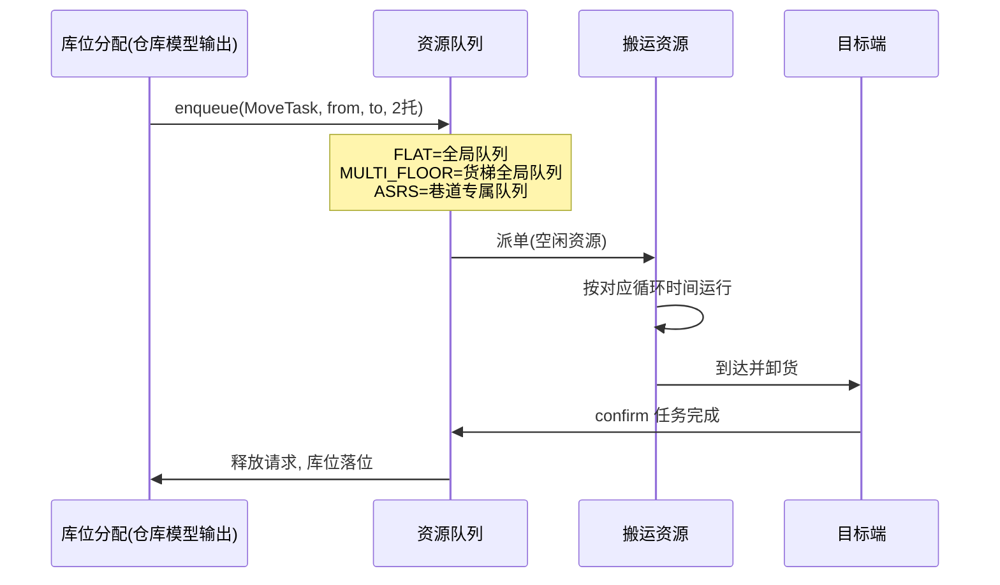
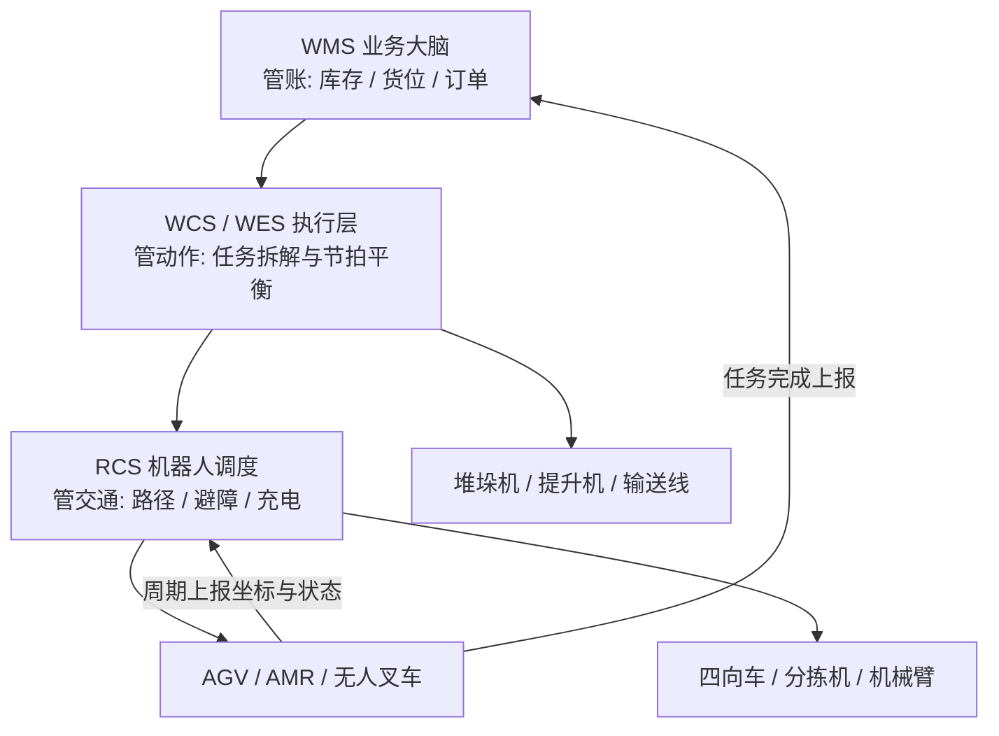

# 仓内设备与调度模型

## 一、结论先行

设备模型独立于仓库模型。仓库模型只提供库位坐标、空间域划分与跨空间域判定，本模型负责搬运、分拣、码垛与调度，两者不互相包含。

统一抽象是「资源 + 队列 + 服务时间」：所有设备都建模为可替换的服务资源，差异只在路由规则。

| 资源类别 | 队列范围 | 路由规则 | 服务时间来源 |
|---|---|---|---|
| 叉车、货梯 | 全局共享 | 任意点到任意点 | 距离/速度 + 装卸 |
| 巷道堆垛机 | 巷道专属 | 只能在本巷道内 | 单/双指令循环 |
| AGV/AMR、无人叉车 | 全局（RCS） | 路径规划 + 交通管制 | 距离/速度 + 避让等待 |
| 四向穿梭车 | 层内/巷道内 | 四向行驶，提升机换层 | 行驶 + 换向 + 顶升 + 换层 |
| 提升机 | 全局共享 | 跨层，可载货或载车 | 升降行程/速度 + 接驳 |
| 输送线、分拣机 | 固定节拍 | 按格口分流 | 额定件/小时 |
| 拆码垛机械臂 | 站点队列 | 按工作站派单 | 次/小时 |

三条判断：

- **设备标称产能不等于系统吞吐**。四向车满载 1.0–1.2 m/s、换向约 3 s、顶升约 6 s〔12〕，交叉带≥2 万件/h〔11〕，都是理想单点数据；叠加避让、充电、换层后吞吐会下降。
- **瓶颈可能不在设备台数，而在调度层**。调度算法优劣可造成约 30% 效率差异〔5〕；AGV 堵在交叉口时，硬件无故障、订单业务正常，但吞吐上不去〔18〕。
- **设备按"替换哪个环节"插拔**，不按厂商分类。换设备只改资源清单与参数，不改主循环。

## 二、模型输入

### 2.1 设备参数

| 参数 | 符号 | 基准示例 | 校准方式 |
|---|---|---|---|
| 叉车台数 | F | — | 作业量反推 |
| 货梯台数 / 载重 / 速度 | E / G / v | 4 部 / 2 托 / 1.0 m/s | 设备铭牌，见 3.2 |
| 堆垛机台数 / 水平速度 / 垂直速度 | A / `v_x` / `v_z` | 6 台 / 4 m/s / 1 m/s | 设备铭牌，见 3.3 |
| 双指令循环占比 | θ | 0（示例） | 出入库任务配对率 |
| AGV/AMR 台数与载重 | `N_agv` / `G_agv` | 10 台 / 50 kg | 设备清单，见 4 |
| 四向车台数 | `N_shuttle` | 20 台 | 见 4 选型边界 |
| 提升机台数 | `N_lift` | 2 台 | 换层流量反推 |
| 分拣线额定产能 | `μ_sort` | 20,000 件/h | 设备铭牌〔11〕 |
| 交通避让系数 | κ | 1.3（示例） | 实测；调度算法差异可达 30%〔5〕 |
| 充电策略 | — | 低电回充 | RCS 配置〔19〕 |

κ 定义为「实际服务时间 / 标称服务时间」，把交叉口避让折进服务时间。1.3 只是示例，必须用现场数据替换。

### 2.2 来自仓库模型的输入

本模型不自行推导库位，只消费仓库模型的四项输出：

| 输入 | 用途 |
|---|---|
| 库位坐标 `location_code` | 任务目标地址解析 |
| 总库位数 | 计算饱和度基准 |
| 空间域划分（分区/楼层/巷道） | 路由域与队列范围 |
| 跨空间域判定 | 是否产生跨区/跨层/跨巷道任务 |

## 三、资源循环时间与派单

### 3.1 货梯循环时间（楼层仓）

对一次从 `F_in` 到 `F_k` 的载货上行，跨层次数 `Δ = abs(F_in − F_k)`：

```
T_cycle(Δ) = t_装货 + t_门+平层 + Δ×H_floor/v + t_门+平层 + t_卸货 + Δ×H_floor/v
           = 30 + 15 + Δ×4.5 + 15 + 30 + Δ×4.5
           = 90 + 9Δ 秒        # H_floor=4.5m、v=1.0m/s 为基准值
```

- Δ=1（相邻层）：99 s，每梯每小时 36 次循环 × 2 托 = 72 托/h（基准 G=2 托）。
- Δ=4（基准 5 层仓底层到顶层）：126 s，每梯约 57 托/h。
- E 部货梯理论运力 = `E × 平均单梯运力`；基准 E=4 时约 **230–290 托/h**（含空梯返回，保守值）。

反推货梯数量：`E = ceil(峰值跨层托数/小时 / 单梯有效运力)`，有效运力取理论值的 70%（排队、故障、平层误差折扣）。

### 3.2 堆垛机循环时间（立库）

目标货位坐标 `(x, z)`，水平行程 `x = 列号 × w_slot`，垂直行程 `z = 层号 × h_slot`；两者并行，取较大值。

```
T_single(x,z) = t_取放 + 2 × max(x/v_x, z/v_z) + t_平层
T_dual(x1,z1,x2,z2) = t_取 + max(x1/v_x,z1/v_z) + t_放
                    + max(x2/v_x,z2/v_z) + t_平层
平均service_time = (1−θ) × T_single + θ × T_dual
```

基准代入：平均 x=30 m、z=10 m → `max(30/4, 10/1)` = 10 s；取放与平层合计 20 s → `T_single` ≈ 40 s，单机约 90 托/h；A=6 台约 540 托/h。

双指令循环 θ 提高单机吞吐，但会增加任务等待配对的时间。两个效应必须分别统计，不能只算增益。

### 3.3 资源分派时序



库位分配与资源派单是两个独立决策。库位先定，才知道要不要跨空间域；队列独立排队，履约时长里必须算等待。

## 四、智能设备清单与选型边界

设备清单可插拔，按"替换哪个环节"接入，不按设备厂商分类。

| 设备 | 替换环节 | 适用仓型 | 关键参数（基准/来源） | 建模落点 |
|---|---|---|---|---|
| AGV/AMR | 人工搬运 | 平面仓、楼层仓 | 分拣型载重 5–50 kg〔11〕；AMR 用 SLAM/二维码导航，AGV 走预设路径〔2〕；多品牌混场需统一调度〔20〕 | 全局队列 + 交通避让等待 |
| 无人叉车 | 人工叉车 | 平面仓、楼层仓 | 极窄巷道自主叉车〔2〕 | 同叉车，增加避让等待 |
| 托盘四向车 | 叉车、部分堆垛机 | 立库、密集库、楼库改造 | 载重 1–2 t，满载 1.0–1.2 m/s，换向≈3 s、顶升≈6 s、±5 mm〔12〕；另有 ±0.2 mm〔13〕、±3 mm〔15〕型号 | 层内队列 + 提升机换层 |
| 料箱四向车 | 拆零拣选搬运 | 立库 | 50–1,500 kg，满载最高 4 m/s，续航≥8 h〔14〕；可跨巷道跨层〔1〕 | 跨巷道资源 |
| 提升机 | 货梯（货位级） | 立库、楼库改造 | 可同时提升托盘与穿梭车，两者共用〔16〕 | 新增共享瓶颈 |
| 交叉带/摆轮分拣 | 人工分拣 | 三类 | 交叉带≥2 万件/h（双轨 4 万）、准确率 99.99%〔11〕，最高 2.4 万件/h〔10〕；摆轮 8,000–12,000 件/h〔11〕 | 固定产能服务台 |
| 视觉/RFID 识别 | 扫码 | 三类 | 3D 视觉识别异形件准确率 99.98%〔9〕；RFID 盘点效率约 10 倍、准确率 95%→99.9%〔8〕 | 并入服务时间，不单独排队 |
| 拆码垛机械臂 | 人工码垛 | 三类 | 按工作站节拍〔3〕 | 站点队列 |

选型边界来自查证资料，不是模型可以自行放宽的参数：

- **堆垛机仍占优的场景**：单托超过 1 吨、库高超过 20 m、−25 ℃ 冷库、精密料箱（MiniLoad）；已有 45 m 以上稳定运行案例〔5〕。其定位精度约 ±2 mm、存储密度约 7.5 t/㎡，适合日均 500 托以上〔4〕〔6〕。
- **四向车占优的场景**：多 SKU、拆零拣选、需要跨巷道跨层与柔性增减车数〔1〕〔14〕；托盘式密集存储会牺牲部分作业效率并增加货架成本〔16〕。
- **分拣设备**：交叉带适合 0.1–30 kg 中小件大流量，摆轮适合软包、圆柱等不规则件〔11〕。
- **拣选方式**：播种式拣选在多订单品类交叉时效率可提升 80%，但这是特定订单结构下的结果，不能当默认值〔8〕。

## 五、调度链路：WMS / WCS / RCS

"任务从哪来、谁派单、谁避让"必须分层，否则会出现硬件无故障、订单业务正常，但交叉口堵车、吞吐上不去的情况〔18〕。



- WMS 输出高阶任务（如"从货架区出库物料 A 送复核台 3"），WCS/WES 拆成设备动作时序流：四向车取货 → 提升机下行 → 输送线 → AGV 叉车接驳 → 工作站卸料〔19〕〔21〕。
- RCS 负责车队路径规划、交通管制、集群避障、死锁自愈与充电管理；周期性上报坐标状态，任务完成后上报触发 WMS 更新库存〔19〕。机器人与自动门、电梯的交互也由 RCS 处理〔20〕。
- 层间接口常用 REST API、MQTT、OPC UA、Modbus TCP〔22〕。

与蓝图的边界：WCS/WES/RCS 属于设备执行层，不在蓝图的十个业务域内。设备模型只向 WMS 上报"任务完成"，库存记账仍由 WMS 走 `post_stock` 契约，设备模型不直接写库存。

## 六、作业流程中的设备替换

仓库模型给出的是业务动作序列，设备模型决定每一步由谁执行：

| 业务节点 | 可由哪些设备替换 | 依据 |
|---|---|---|
| 核对/扫码 | 视觉/RFID 识别 | 〔8〕〔9〕 |
| 搬运到库位 | 叉车、AGV/AMR、无人叉车 | 〔2〕 |
| 跨层移动 | 货梯、提升机 | 〔16〕 |
| 密集库存取 | 堆垛机、四向穿梭车（按第 4 节边界切换） | 〔1〕〔5〕 |
| 拣选 | 人工、摘果/播种 + 电子标签/语音、拣选机器人 | 〔8〕 |
| 分拣 | 人工、交叉带/摆轮 + 视觉识别 | 〔9〕〔11〕 |

同一业务节点换设备后，必须重算该段的服务时间与产能，不能沿用原设备的 μ。

## 七、离散事件仿真规格

### 7.1 五要素

| 要素 | 内容 |
|---|---|
| 系统状态 | 资源状态（位置/方向/载货/任务/队列长度/电量）；交叉口占用与交通管制状态；队列集合 |
| 实体 | 搬运任务 MoveTask、机器人任务、托盘/货箱 |
| 事件 | `RESOURCE_REQ`、`RCS_DISPATCH`、`TRAFFIC_WAIT`、`CHARGE_REQ`、`LIFT_REQ`、`RESOURCE_ARRIVE` |
| 时钟 | 下一事件推进（next-event time advance），跳过无事件区间 |
| 随机数 | 服务时长 LogNormal(μ,σ)；交通避让系数 κ、双指令占比 θ、充电电量阈值为配置 |

事件名不含具体设备字样——`RESOURCE_REQ` 按资源清单分派，避免仿真引擎按设备写多套主循环。设备层事件不进入库存记账。

### 7.2 事件主循环（伪代码）

```
while sim_time < SIM_DURATION:
    e = min(未来事件堆)
    sim_time = e.time
    switch e.type:
        RESOURCE_REQ:    按资源清单选资源(叉车/货梯/堆垛机/AGV/四向车)
                         若跨层且启用提升机则先 enqueue(Q_lift)
                         若存在空闲资源则派单; 否则等待
        RCS_DISPATCH:    分派车号与路径; 更新交叉口占用状态〔19〕
        TRAFFIC_WAIT:    交叉口避让; 服务时间乘 κ
        CHARGE_REQ:      电量低于阈值退出可调度池; 回充后回归〔19〕
        LIFT_REQ:        提升机换层; 可载货或载车〔16〕
        RESOURCE_ARRIVE: 目标端取货; 上报任务完成
    记录 KPI 采样点
```

warmup 30 天后开始统计，避免初始空仓偏差。单次仿真跑 30 天，重复 20 次取均值与 P95。

## 八、KPI 与瓶颈判据

| KPI | 公式 | 用途 |
|---|---|---|
| 资源利用率 | 忙时 / 总时 | >85% 说明设备成瓶颈 |
| 资源队列 P95 等待 | 队列等待时间 95 分位 | 履约时长的关键组成 |
| 调度等待占比 | 调度等待 / 履约时长 | 核心诊断项；占比高说明瓶颈在调度而非台数 |
| 各站到达率/服务率比 | λ/μ | >1 的站点是瓶颈 |
| 交通避让次数 | 单位时间交叉口避让事件数 | 定位 RCS 交通瓶颈 |
| 充电不可用时长 | 充电中台时 / 总台时 | 验证车队规模是否够 |
| 提升机队列 P95 | 提升机等待 95 分位 | 四向车跨层场景的新共享瓶颈 |
| 分拣线饱和度 | 分拣件数 / `μ_sort` | >85% 说明分拣成瓶颈 |
| 标称/实际吞吐比 | 实际吞吐 / 铭牌产能合计 | 偏离越大说明调度与交通损耗越高 |

判据：按 λ/μ 排序，比值最大的站点是瓶颈。设备没故障、订单业务正常但吞吐上不去，通常出在调度层而不是设备台数〔18〕。

## 九、故障场景与验证

1. **故障场景**：E 部货梯故障 1 部运力掉 `1/E`（基准 25%）；A 条巷道堆垛机故障则该巷道完全停摆——立库没有跨巷道备份，影响比货梯更硬。模型必须支持退出任意资源。
2. **参数校准**：用设备埋点替换服务时长，用 RCS 日志校准 κ 与交通避让次数。没有实测之前，所有 KPI 只是相对比较。
3. **敏感性分析**：AGV/AMR 台数 5/10/20、κ 1.0/1.3/1.6、提升机 1/2/3 台、双指令占比 0/30/60%；各输出调度等待占比、标称/实际吞吐比与瓶颈排序的变化。

## 十、容易被忽略的点

1. **提升机可能取代货梯成为新瓶颈**。托盘式提升机可同时提升托盘与穿梭车、两者共用〔16〕，四向车跨层全靠它；车数增加会把等待直接转移到提升机队列。
2. **三层边界不能混**。WMS 管账、WCS 管动作、RCS 管交通〔18〕〔19〕；混在一起就会出现交叉口堵车而硬件与订单两侧都显示正常的局面。
3. **设备清单可插拔但不等于可以随意混搭**。堆垛机与四向车的选型边界来自实际场景〔5〕，不是配置好参数就能互换。

## 来源

〔1〕中科微至科技股份有限公司 2025 年年度报告摘要，上海证券报，2026-04-23：AMR、堆垛机、穿梭车分类，托盘式与料箱式四向车能力。

〔2〕思瀚产业研究院《2025 年智能场内物流机器人业务模式、价值链及发展趋势》，2025-07-09：穿梭车两向/四向分类，AMR 与 AGV 导航方式差异。

〔3〕C-WMS《机器人在仓库中有哪些应用?》：搬运类与分拣类机器人分类。

〔4〕金伙伴存储设备《四向穿梭车货架:自动化立体仓库有哪些类型?》：三类立库的构成、参数与适用场景。

〔5〕距米网《智能仓储与物流自动化 2025 技术选型白皮书——从堆垛机到四向穿梭车的进化逻辑》：WCS/RCS 调度算法可致 30% 效率差异，堆垛机仍占优的四类场景。

〔6〕今日头条《目前市面上常见的立体仓库主要有什么类型》：堆垛机高度、速度、定位精度与存储密度。

〔7〕欧创智慧《智能仓库里都应用哪些硬件?》：AS/RS 系统组成、巷道宽度与空间利用率。

〔8〕绘阖产业集团《智能仓储物流解决方案》：RFID 盘点、摘果式/播种式拣选、扫码与重量双重防错。

〔9〕先进物流装备《物流全自动分拣设备:技术革新与行业变革的驱动力!》，2025-04-23：3D 视觉与异形件识别准确率。

〔10〕先进物流装备《电商物流分拣设备》，2025-04-16：交叉带分拣效率。

〔11〕香港宏达集团《物流设备与技术应用》：交叉带/摆轮分拣参数，AGV/AMR 负载与集群效率。

〔12〕华川科技《四向穿梭车》：系统组成、载重、速度、换向与顶升时间、定位精度。

〔13〕百度百科《四向穿梭车》：托盘式与箱式四向车技术参数，温区与跨层能力。

〔14〕佳林制造《四向穿梭车立体仓库》：载重档位、速度、续航与 WCS 统一调度。

〔15〕哈工库讯《密集式立体仓储设备》：四向车载重、速度、定位精度、顶升与换向时间。

〔16〕上海挪科《托盘式四向穿梭车料箱式四向穿梭车区别》：移载方式、提升机共用、速度边界。

〔17〕见田科技《四向车货架》：货架高度、经济层数、货位荷载与 FIFO/FILO。

〔18〕友仓科技《一文讲透 WMS、WCS、RCS 的区别,你的仓库到底需要哪套系统?》：三层职责划分与交叉口堵车成因。

〔19〕通天晓《RCS 机器人调度系统核心架构是怎样的》：三层数据流、任务确认回执、状态上报与完成上报。

〔20〕Wesar《WMS、WCS 和 RCS 如何在自动化仓库中协同工作》：多类型机器人集中协调，机器人与自动门/电梯交互。

〔21〕通天晓《智能仓储 AGV 与输送线穿梭车怎么协同 集群调度算法与容灾指南》：WES 动作时序流拆解与节拍平衡。

〔22〕lpqz《智能工厂物流规划实战:动线、流量、设备与系统协同》：三层架构与 REST API、MQTT、OPC UA、Modbus TCP 接口。
