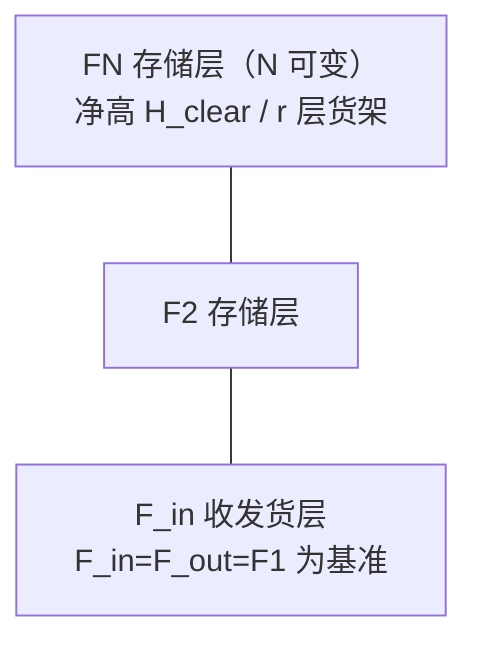
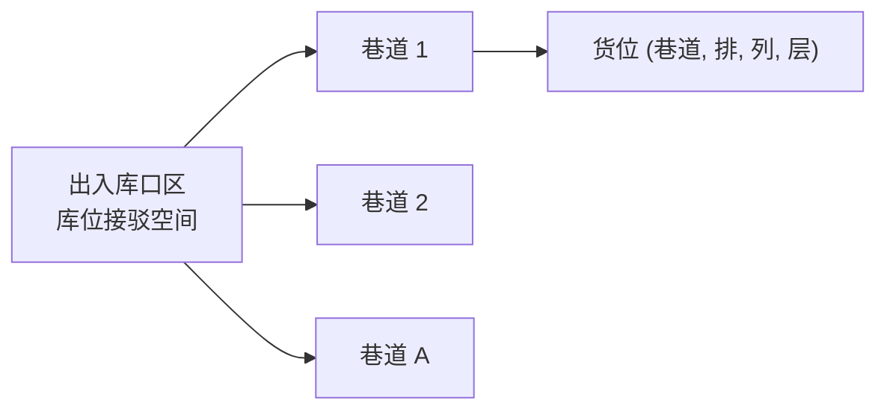
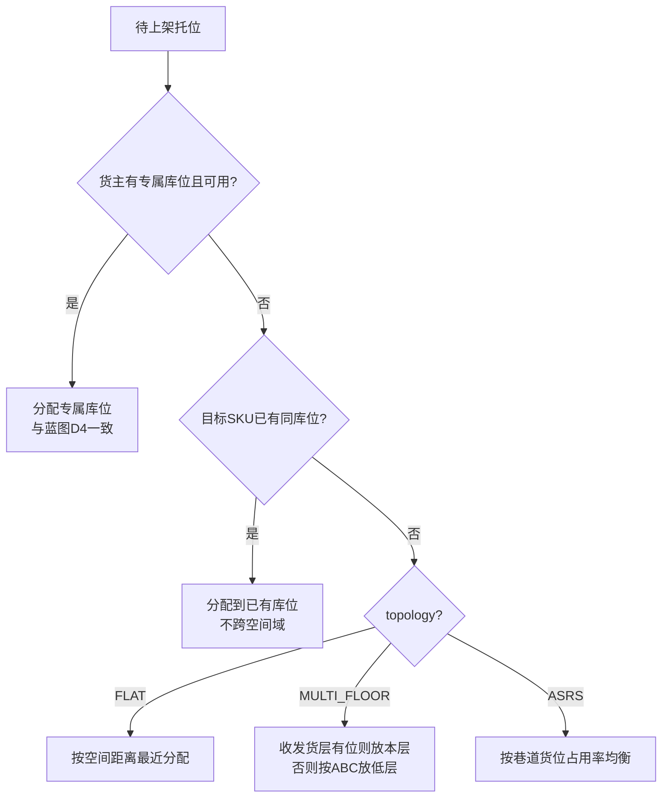

# 仓库模型（平面仓 / 楼层仓 / 钢结构立库）

## 一、结论先行

仓库模型只描述**空间、容量、布局与库位编码**，不包含设备。搬运、分拣、码垛与调度属于独立的设备模型，两者通过库位坐标和空间域划分衔接。

三类仓型的差异不在名字，而在两件事：空间怎么铺开、密度从哪里来。

| 仓型 | 空间形态 | 密度来源 | 关键约束 |
|---|---|---|---|
| 平面仓 | 单层大平面，功能分区 | 地面堆码层数 + 货架层数 | 通道占比、行走距离 |
| 楼层仓 | 多层叠加 | 单层面积 × 层数 × 货架层数 | 层高、消防余量 |
| 钢结构立库 | 高度换面积 | 货架高度 × 巷道数 × 货位密度 | 巷道间距、货位规格 |

三条判断：

- **同一套接口，不同的容量公式**。三类仓都只产出「总库位数」和「库位坐标」，公式随拓扑切换。
- **换仓只改配置**。具体数值都是同一组公式在某个基准场景下的代入；换仓填新的 topology 与参数，不改公式。
- **"跨楼层"泛化成"跨空间域"**。楼层仓是跨层，平面仓是跨区，立库是跨巷道——空间域的划分决定库位怎么分配，与谁来执行搬运无关。

## 二、模型输入

### 2.1 仓型拓扑（第一维输入）

`topology ∈ {FLAT, MULTI_FLOOR, ASRS}`，决定加载哪套空间公式。

| 拓扑 | 中文 | 空间坐标 | 高度参数 | 典型规模 |
|---|---|---|---|---|
| FLAT | 平面仓 | `(区, 巷道, 位)` | 建筑净高 | 单层 5,000–30,000 ㎡ |
| MULTI_FLOOR | 楼层仓 | `(层, 区, 位)` | `H_floor × N` | 2–10 层，单层 5,000–20,000 ㎡ |
| ASRS | 钢结构立库 | `(巷道, 排, 列, 层)` | `H_rack` 10–30 m | 6–20 巷道，高 15–30 m |

### 2.2 建筑与布局参数

| 参数 | 符号 | 基准示例 | 层级 | 校准方式 |
|---|---|---|---|---|
| 仓型 | topology | MULTI_FLOOR | 实例必填 | 现场勘察 |
| 单层面积 | `A_floor` | 10,000 ㎡ | 实例必填 | 建筑图纸 |
| 建筑长宽 | W × D | 100 m × 100 m | 可配置 | 建筑图纸；长宽比影响行走距离 |
| 楼层层高 | `H_floor` | 4.5 m | 实例必填（仅楼层仓） | 建筑图纸 |
| 楼板/梁占用 | δ | 0.5 m → 净高 4.0 m | 可配置 | 建筑图纸 |
| 货架层数 | r | 3 | 可配置 | 净高与消防规范反推 |
| 分区比例 | α_i | 见 3.1 | 可配置 | 作业量结构 |
| 收发货层 | `F_in` / `F_out` | F1 / F1 | 可配置 | 卸货平台所在层 |

### 2.3 仓型专属参数

| 仓型 | 参数 | 符号 | 基准示例 | 校准方式 |
|---|---|---|---|---|
| 平面仓 | 地面堆码层数 | `h_stack` | 2 | 货物耐压与举升限制 |
| 平面仓 | 货架区占比 | α_rack | 40% | 作业量结构 |
| 平面仓 | 堆码位等效占地 | `a_stack` | 2.4 ㎡/位 | 托盘规格 + 通道，为纯托盘占地 2 倍 |
| 楼层仓 | 层数 | N | 5 | SKU 数与周转天数反推 |
| 楼层仓 | ABC 分层阈值 | — | A→F2, C→FN | 周转率分布 |
| 立库 | 货架高度 | `H_rack` | 20 m | 钢结构设计图 |
| 立库 | 巷道数 | A | 6 | 布局图 |
| 立库 | 巷道长度 | L | 60 m | 布局图 |
| 立库 | 货位宽 / 层高 | `w_slot` / `h_slot` | 1.4 m / 1.5 m | 托盘规格与定位精度〔17〕 |

未查证到具体仓的建筑图与布局图，示例值只能用实测替换，不能用常识替代。

### 2.4 配置变更与公式变更的边界

| 变更 | 改配置即可 | 需要扩公式 |
|---|---|---|
| 平面仓 ↔ 楼层仓 ↔ 立库 | topology 及专属参数 | 否，加载对应空间子模型 |
| 层数、面积、层高、巷道数、货位规格 | 是 | 否 |
| 非矩形平面布局 | 否 | 存储区可用面积按实际形状重算 |
| 多卸货平台、收货在地下层 | 是（`F_in`/`F_out`） | 否 |
| 立库改为双深度货位 | 是（每巷道货位数） | 否，容量公式按双深度重算 |

## 三、空间与容量模型

### 3.1 平面仓（FLAT）

单层功能分区按功能切分，同层内不重叠、合计等于 `A_floor`。基准示例：

| 分区 | 比例 α_i | 基准面积(㎡) | 作用 |
|---|---:|---:|---|
| 收货暂存区 | 8% | 800 | 卸货、核对、扫码、待上架 |
| 存储区（地面堆码 + 货架） | 52% | 5,200 | 托盘存储 |
| 拣选/复核/打包区 | 12% | 1,200 | 拆零、集货、复核、打包 |
| 发货暂存区 | 8% | 800 | 待装车 |
| 主通道 | 15% | 1,500 | 贯通、消防、分流 |
| 辅助/消防 | 5% | 500 | 配电、休息、消防设施 |
| **合计** | **100%** | **`A_floor`** | 穷尽单层 |

```
堆码区面积 = A_floor × α_storage × (1 − α_rack)
货架区面积 = A_floor × α_storage × α_rack
地面堆码位 = floor(堆码区面积 / a_stack) × h_stack   # a_stack 含通道
模块节距   = 2 × 货架深度 + 巷道宽度
货架托位   = floor(货架区面积 / (模块节距 × D)) × floor(D / 货位节距) × (并列托位 × r)
总托位     = 地面堆码位 + 货架托位
```

基准代入：`A_floor`=10,000、α_storage=52% → 存储区 5,200 ㎡；α_rack=40% → 堆码区 3,120 ㎡、货架区 2,080 ㎡。`a_stack`=2.4 ㎡/位 → 地面 1,300 位 × `h_stack`=2 = 2,600 位。货架区：模块节距 5.5 m、D=100 → 模块数 `floor(2080/550)`=3；节数 `floor(100/2.7)`=37；每节 2×3=6 → 3×37×6=666 位。合计约 **3,266 托位**。

### 3.2 楼层仓（MULTI_FLOOR）

净高 `H_clear = H_floor − δ`，货架层数 r 由净高与消防余量反推。基准场景 4.5 − 0.5 = 4.0 m，放 3 层 1.2 m 货架（3.6 m）+ 0.4 m 喷淋照明间隙。r 增加前必须先过消防规范。



```
存储区面积   = A_floor × α_storage
模块节距     = 2 × 货架深度 + 巷道宽度
每模块节数   = floor(D / 货位节距)
每节托位     = 并列托位 × r
货架模块数   = floor(存储区面积 / (模块节距 × D))
单层托位     = 货架模块数 × 每模块节数 × 每节托位
全仓托位     = Σ(每层托位)   # 收发货层按其 α_storage 单独算
```

基准代入：`A_floor`=10,000、α_storage=52% → 5,200；D=100；货架深度 1.1、巷道 3.3 → 模块节距 5.5；货位节距 2.7；并列 2、r=3 → 单层约 2,000 位，5 层约 9,000 位（收发货层缩减）。

收发货层 `F_in`/`F_out` 默认 F1，因为货车通常只能到地面层。有多个卸货平台或收货在地下层时改配置。

### 3.3 钢结构立库（ASRS）

立库用高度换面积，库位是巷道两侧的密集货位，不是地面货架模块。巷道宽 1.5–2 m、空间利用率为传统平库的 3–5 倍〔7〕。



```
每巷道列数 = floor(L / w_slot)
每巷道层数 = floor(H_rack / h_slot)
每巷道货位 = 2（巷道两侧） × 列数 × 层数
总货位     = A × 每巷道货位
```

基准代入：L=60、w_slot=1.4 → 42 列；H_rack=20、h_slot=1.5 → 13 层；每巷道 2×42×13=1,092 位；A=6 → 6,552 货位。占地只有 6 条巷道加接驳区，约 2,000–3,000 ㎡。

立库的「层」是货位坐标的一部分，不是建筑楼层；货架高度可达 25 m，经济层数 6–12 层〔17〕。

### 3.4 统一容量接口

三套公式只产出两个东西：

- `总库位数`：KPI 分母，也是蓝图 `wms_master_data_location` 的库位总量规划值。
- `库位坐标`：平面仓 `(区,巷道,位)`、楼层仓 `(层,区,位)`、立库 `(巷道,排,列,层)`，统一编码成 `location_code`。

库存粒度不随仓型变，仍是 `(owner, sku, location, status)`；物理坐标只是 `location` 的编码方式，不进库存表结构。

## 四、作业流程（业务视角）

流程只描述业务动作，不描述由什么设备执行。


流程中的空间信息是「从哪个空间域到哪个空间域」，由库位坐标直接得出。同一个业务流程可以对应完全不同的执行方式，那是设备模型的事。

## 五、库位分配策略（空间规则）

按优先级排序，前一条命中就不走后一条：



- 平面仓：距离最近优先，A 类商品靠近收发货区。
- 楼层仓：A 类放低层，减少跨层次数；收发货层存储区与收货暂存区抢面积是硬约束。
- 立库：巷道间货位占用率保持均衡，避免某个巷道先填满。

专属库位优先是蓝图 D4 的硬规则，三类仓都不能破坏。留样库位（`location_type=sample`）不进分配池。

## 六、场景清单（MECE）

切分维度：作业阶段 × 是否跨空间域。同一层级只用这一个维度。

|  | 同域 | 跨空间域 |
|---|---|---|
| 入库 | `F_in` 收货→同域上架 | 收货→其他区/层/巷道上架 |
| 存储 | 域内移库、盘点、状态转换 | 跨区/跨层/跨巷道移库 |
| 出库 | 域内拣选→`F_out` 发货 | 其他域拣选→`F_out` 发货 |
| 逆向 | `F_in` 退货收货→同域上架 | 退货从其他域退回 `F_in` |

四个阶段 × 两种跨域状态 = 8 类场景，对三类仓型都成立，只是"域"的含义按 topology 替换：平面仓是功能分区，楼层仓是建筑楼层，立库是存储巷道。

留样、破损、冻结作为库存状态叠加在 8 类场景之上，不单独成类。

## 七、验证

1. **结构验证**：8 类场景 × 3 种 topology 逐条跑空间坐标流转，确认每类都能定位到唯一库位。
2. **参数校准**：用建筑图纸和库存快照替换面积、层高、巷道数等示例值。没有实测之前，容量数字只是规划参考。
3. **敏感性分析**：
   - 平面仓：堆码层数 1/2/3、货架占比 30/40/50%。
   - 楼层仓：层数 3/5/7、层高 4.0/4.5/5.0 m。
   - 立库：巷道数 4/6/8、货位层高 1.3/1.5/1.7 m。
   各输出总库位数与单位面积库位数的变化。

## 八、与设备模型的接口

仓库模型只向设备模型提供四样东西，不描述设备本身：

| 输出 | 内容 | 设备模型用途 |
|---|---|---|
| 总库位数 | 各空间公式的计算结果 | 计算饱和度基准 |
| 库位坐标 | `location_code` 编码规则 | 目标地址解析 |
| 空间域划分 | 分区 / 楼层 / 巷道边界 | 空间路由范围 |
| 跨空间域判定 | 两个库位是否同域 | 是否产生跨区/跨层/跨巷道任务 |

设备模型由此决定采用什么资源、如何路由、服务时间多长。仓库模型不写设备类型、数量、速度与调度规则。

## 九、容易被忽略的点

1. **收发货层与存储抢空间**。楼层仓收发货层存储区缩减，若 A 类商品也想放低层，会与收货暂存区冲突。这是分区面积的硬约束。
2. **净高 r 由消防封顶**。基准 3 层货架已贴近喷淋高度；任何"再加一层"都要先过消防规范，不是模型能自行放宽的参数。立库高度由钢结构设计决定，不受这条约束。
3. **非矩形布局**。2.4 表列出的情况需要重算存储区可用面积，不能沿用 `W × D`。
4. **参数化优先于拍死**。topology、层数、面积、层高、巷道数全部是配置输入；本文所有数字都是同一组公式在基准场景的代入。模型价值在于回答"这个仓的空间改 X 会怎样"。

## 来源

仓库模型的面积、层高由具体仓给定，其余为建模假设，需现场实测替换。立库货位与货架参数参考了查证资料：

〔7〕欧创智慧《智能仓库里都应用哪些硬件?》：AS/RS 系统组成、巷道宽度与空间利用率。

〔17〕见田科技《四向车货架》：货架高度、经济层数、货位荷载。
